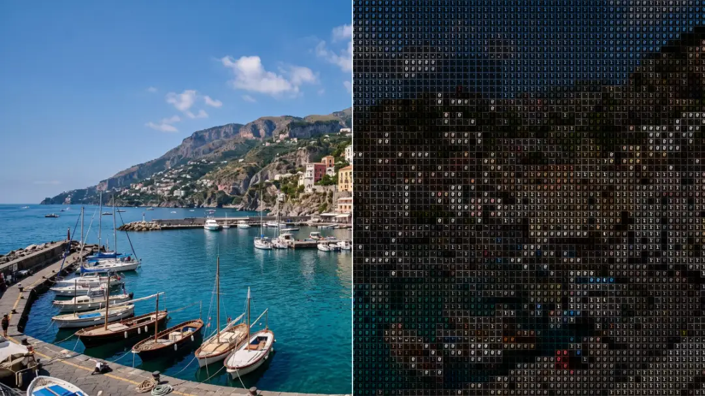

# Creative UI Collage

<!-- effect-docs: basic page sha=e046915ff835, written by scripts/effect-docs.mjs. Delete this line to write the page by hand (template B in Documentation-Site.md). -->

Turns the image into boxed UI-like cells with characters, borders and cursor dots that shuffle over time; Cell Size sets the box size.

Group: [Text & Glyph](../Effects-Glyph.md) · [How to add an effect](../Effects.md#add-an-effect)

<figure class="docs-shot">

<figcaption>Left: the original. Right: Creative UI Collage at its default settings, one frame of its movement. An enlarged detail, so the characters can be read.</figcaption>
</figure>

*A short page made from the editor’s effect catalog: what the effect does and its controls. Tips and its node setup will follow.*

## Controls

<!-- generated:controls start -->
| Control | Range | Default |
|---|---|---|
| **Grid** | | |
| Cell Size | 4 to 72 | 18 |
| **Style** | | |
| Amount | 0 to 1 | 1 |
| Invert Ramp | on or off | off |
| **Glyphs** | | |
| Ramp | standard, detailed, blocks, binary, numeric, symbols | binary |
| Custom Ramp | text | empty |
| Font | Monospace, Serif, Sans Serif | Monospace |
| Weight | 200 to 900 | 600 |
| **Color** | | |
| Color Source | Source, Duotone | Source |
| Dark | a colour | `#081018` |
| Light | a colour | `#e8fff5` |
| **Motion** | | |
| Speed | 0 to 5 | 1 |
<!-- generated:controls end -->

**Styles:** the **Style** menu in the effect card switches to another look of the same engine and keeps the values and keyframes: [Tag Pills](./capsule-cloud.md), [Data Hatching](./data-hatch.md), [Dither Text](./dither-text.md), [Glyph Matrix](./glyph-matrix.md), [Matrix Rain](./matrix.md), [Dither Glow](./pixel-dither.md), [Retro Matrix](./retro-matrix.md), [Symbol Matrix](./symbol-matrix.md).

## Technical details

Creative UI Collage is one look of the glyph engine; its looks share one node setup. It keeps moving while the playhead stands still. How effects are stored, rendered and exported: [Effect system](../Effect-System.md). Its building blocks: [Node Catalog](../Node-Catalog.md).
