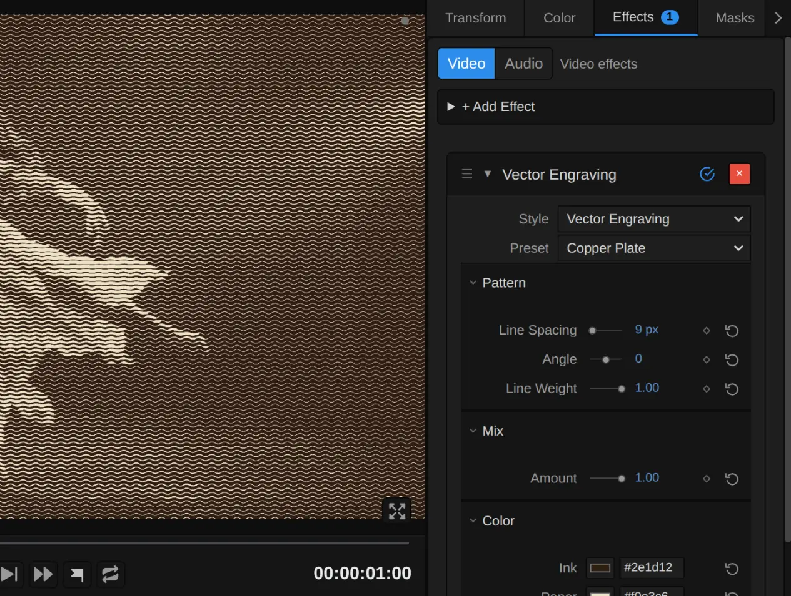
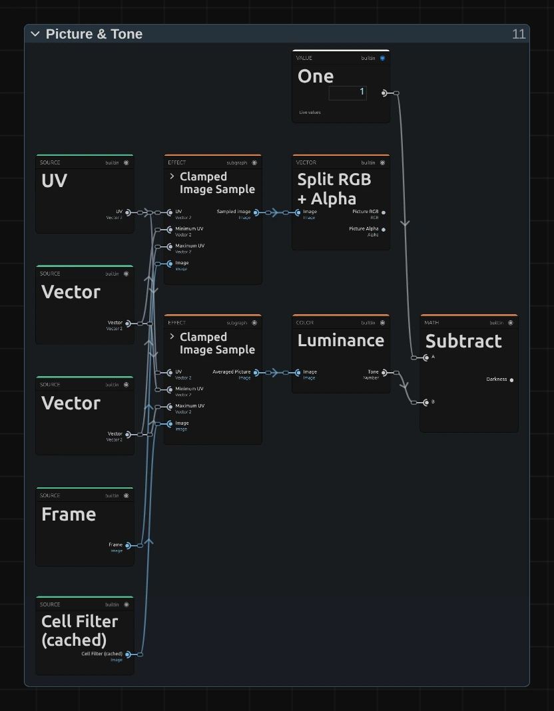
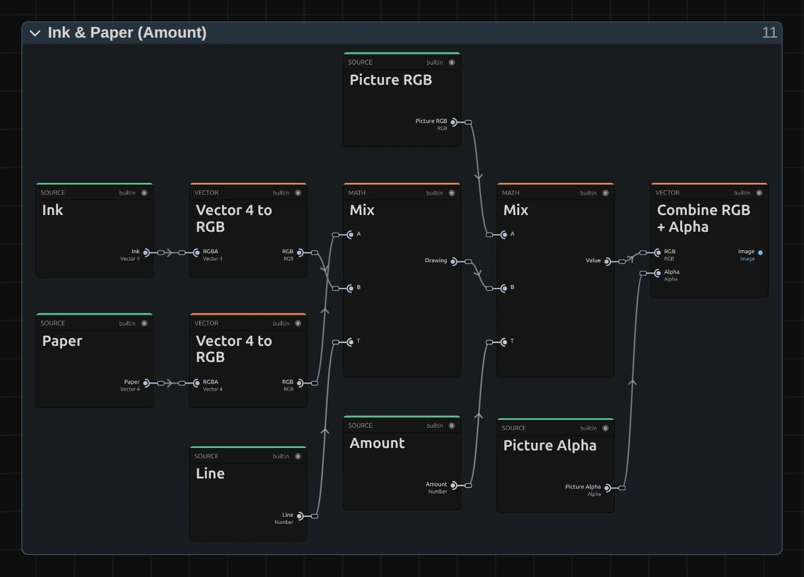

# Vector Engraving

Draws the picture with rows of wavy engraved lines: heavy and deeply waved where it is dark, fine and almost straight where it is light. For banknote portraits, old prints and bold op-art waves on stage.

Group: [Lines & Engraving](../Effects-Lines.md) · [How to add an effect](../Effects.md#add-an-effect)

<figure class="docs-shot docs-compare docs-shot--float-left">

<figcaption>Left: original. Right: Vector Engraving at its default settings.</figcaption>
</figure>

**Use it for:** a face or a figure that turns into a banknote portrait · an old print for a memory or a document · bold op-art waves on a gauze or a backdrop.

- **Line Spacing** – how fine the engraving is.
- **Line Weight** – how heavy the lines get in the shadows.
- **Angle** – the direction of the lines.
- **Ink** and **Paper** – the two colours of the print.

**Tip:** keyframe **Angle** slowly from 0 to 90 over a scene: the lines turn while the picture stays where it is.

## Presets

<figure class="docs-shot docs-shot--detail">

<figcaption>The five presets on the whole figure.</figcaption>
</figure>

Pick one in the **Preset** row of the effect card. It sets all controls at once, in one undo step, and the row then shows its name until you change something. A control with keyframes keeps them, and the card says so.

**Banknote** – fine, dark-green lines on pale paper, like the portrait on a bank note. The lines are so close that the picture reads almost as a photo from a few metres away.

**Copper Plate** – brown ink on warm cream, with lines that swell to solid ink in the shadows: an old copper-plate print. Strong for a memory or a historical scene.

**Op Art** – wide black waves on white, slanted by −20°. The figure becomes a graphic poster that still reads from the back of a large hall.

**Cyanotype** – pale upright lines on deep blue. Because the ink is lighter than the paper, the picture turns into a negative: the dark stage fills with light lines and the bright figure stays blue.

**Engraved Photo** – fine lines over the picture's own colours, half and half: the picture stays and an engraving lies over it. The quietest preset.

## Controls

<figure class="docs-shot">

<svg class="docs-shot-overlay" viewBox="0 0 1017 768" aria-hidden="true" focusable="false">
<defs><marker id="vector-tiling-inspector-arrow" viewBox="0 0 10 10" refX="8" refY="5" markerWidth="5" markerHeight="5" orient="auto-start-reverse"><path d="M 0 0 L 10 5 L 0 10 Z" fill="#ffd54a" /></marker></defs>
<path class="docs-shot-arrow" d="M565 319 L649 319" marker-end="url(#vector-tiling-inspector-arrow)" />
<circle class="docs-shot-number" cx="565" cy="319" r="18" /><text x="565" y="319" class="docs-shot-number-text">1</text>
<path class="docs-shot-arrow" d="M551 425 L635 425" marker-end="url(#vector-tiling-inspector-arrow)" />
<circle class="docs-shot-number" cx="551" cy="425" r="18" /><text x="551" y="425" class="docs-shot-number-text">2</text>
<path class="docs-shot-arrow" d="M607 462 L691 462" marker-end="url(#vector-tiling-inspector-arrow)" />
<circle class="docs-shot-number" cx="607" cy="462" r="18" /><text x="607" y="462" class="docs-shot-number-text">3</text>
<path class="docs-shot-arrow" d="M560 500 L644 500" marker-end="url(#vector-tiling-inspector-arrow)" />
<circle class="docs-shot-number" cx="560" cy="500" r="18" /><text x="560" y="500" class="docs-shot-number-text">4</text>
<path class="docs-shot-arrow" d="M628 731 L712 731" marker-end="url(#vector-tiling-inspector-arrow)" />
<circle class="docs-shot-number" cx="628" cy="731" r="18" /><text x="628" y="731" class="docs-shot-number-text">5</text>
</svg>

<figcaption>Vector Engraving with the Copper Plate preset. 1 — Preset: pick a starting point. 2 — Line Spacing. 3 — Angle: the direction of the lines. 4 — Line Weight: how heavy the lines get in the shadows. 5 — Ink.</figcaption>
</figure>

**Preset** – sets every control at once to one of the five starting points above.

**Style** – switches to another look of the same engine, for example [Crosshatch](./crosshatch.md), [Halftone](./halftone.md) or [Contour Map](./contour-map.md). **Line Spacing**, **Angle**, **Amount**, **Ink** and **Paper** keep the values and keyframes you set in looks that have the same control, also under another name (Halftone's Dot Size). **Line Weight** carries over to and from Crosshatch, where it does the same. A control that means something else in the new look starts at that look's default, and the row under the menu says so: Contour Map's Band Density counts bands. **Undo** brings the old value back.

### Pattern

**Line Spacing** – how far apart the lines sit, and so how fine the engraving is. 5–8 px gives a fine banknote engraving that reads as a photo from a few metres away, 14 a clear print, 25 and more bold op-art waves; detail smaller than the spacing disappears. It counts pixels of a 1080p picture, so a 4K export shows the same engraving as the preview, only sharper. Below 3 px (from keyframes or a tool) it renders 3 px, and the card says so. 3 to 80 px, default 14 px.

**Angle** – the direction of the lines, turned about the centre of the frame. 0 runs them across, 90 stands them upright, 45 lays them diagonally; the spacing stays the same at every angle and on every frame shape. A value past ±180 simply turns on round. −180 to 180, default 0.

**Line Weight** – how heavy the lines get in the shadows. At 0 every line keeps one thin, even width, and a dark area shows only deeper waves; 0.7 thickens the lines clearly in the dark parts; at 1 each line starts as a hairline in the light and swells in black until only thin gaps of paper remain, like a copper-plate print. Values outside 0 to 1 (from keyframes or a tool) render as 0 or 1, and the card says so. 0 to 1, default 0.7.

### Mix

**Amount** – how much of the engraving covers the picture. At 1 there are only ink and paper; 0.5 lays the lines over the picture's own colours; 0 switches the engraving off. Keyframe it to let the engraving appear on a cue. 0 to 1, default 0.75.

### Color

**Ink** – the colour of the lines. Black or a dark brown reads like printing ink, a dark green like a bank note. With an ink lighter than the paper the engraving turns into a negative: the dark parts fill with light lines. It takes a colour, default `#111827`.

**Paper** – the colour between the lines, which fills the light parts of the picture. A warm cream looks like old paper, a pale green-grey like a bank note, a deep blue like a cyanotype. It takes a colour, default `#f8fafc`.

## Node setup

<figure class="docs-shot docs-shot--graph">

<svg class="docs-shot-overlay" viewBox="0 0 1017 719" aria-hidden="true" focusable="false">
<defs><marker id="vector-tiling-arrow" viewBox="0 0 10 10" refX="8" refY="5" markerWidth="5" markerHeight="5" orient="auto-start-reverse"><path d="M 0 0 L 10 5 L 0 10 Z" fill="#ffd54a" /></marker></defs>
<path class="docs-shot-arrow" d="M231 695 L231 611" marker-end="url(#vector-tiling-arrow)" />
<circle class="docs-shot-number" cx="231" cy="695" r="18" /><text x="231" y="695" class="docs-shot-number-text">1</text>
<path class="docs-shot-arrow" d="M370 450 L370 366" marker-end="url(#vector-tiling-arrow)" />
<circle class="docs-shot-number" cx="370" cy="450" r="18" /><text x="370" y="450" class="docs-shot-number-text">2</text>
<path class="docs-shot-arrow" d="M508 23 L508 107" marker-end="url(#vector-tiling-arrow)" />
<circle class="docs-shot-number" cx="508" cy="23" r="18" /><text x="508" y="23" class="docs-shot-number-text">3</text>
<path class="docs-shot-arrow" d="M647 360 L647 444" marker-end="url(#vector-tiling-arrow)" />
<circle class="docs-shot-number" cx="647" cy="360" r="18" /><text x="647" y="360" class="docs-shot-number-text">4</text>
<path class="docs-shot-arrow" d="M786 589 L786 505" marker-end="url(#vector-tiling-arrow)" />
<circle class="docs-shot-number" cx="786" cy="589" r="18" /><text x="786" y="589" class="docs-shot-number-text">5</text>
<path class="docs-shot-arrow" d="M924 134 L924 218" marker-end="url(#vector-tiling-arrow)" />
<circle class="docs-shot-number" cx="924" cy="134" r="18" /><text x="924" y="134" class="docs-shot-number-text">6</text>
</svg>

<figcaption>Vector Engraving opened in the Nodes tab (input frame and output left out). 1 — Line Grid: rows of lines, turned. 2 — Cell Filter: the picture averaged over half a line spacing. 3 — Picture & Tone: the picture and how dark it is. 4 — Wave: the wavy line and the distance to it. 5 — Line Width: how wide each line is drawn. 6 — Ink & Paper: the colours and the mix.</figcaption>
</figure>

Vector Engraving works in six stages, one folder each in the Nodes tab: **Line Grid** turns the frame and divides it into rows of lines, **Cell Filter** keeps a copy of the picture averaged over half a line spacing, **Picture & Tone** reads the picture and how dark it is, **Wave** bends each line by that darkness and measures the distance to it, **Line Width** works out how wide the line is drawn there, and **Ink & Paper** colours the result and mixes it with the picture. Click a folder's header to open it; the sections below show what is inside. Vector Engraving is one look of the pattern engine that the [Lines & Engraving](../Effects-Lines.md#the-shared-idea) looks share; its **Style** menu switches between them.

### Line Grid

<figure class="docs-shot docs-shot--graph">

<svg class="docs-shot-overlay" viewBox="0 0 1017 712" aria-hidden="true" focusable="false">
<defs><marker id="vector-tiling-line-grid-arrow" viewBox="0 0 10 10" refX="8" refY="5" markerWidth="5" markerHeight="5" orient="auto-start-reverse"><path d="M 0 0 L 10 5 L 0 10 Z" fill="#ffd54a" /></marker></defs>
<path class="docs-shot-arrow" d="M589 22 L589 102" marker-end="url(#vector-tiling-line-grid-arrow)" />
<circle class="docs-shot-number" cx="589" cy="22" r="18" /><text x="589" y="22" class="docs-shot-number-text">1</text>
<path class="docs-shot-arrow" d="M589 508 L589 424" marker-end="url(#vector-tiling-line-grid-arrow)" />
<circle class="docs-shot-number" cx="589" cy="508" r="18" /><text x="589" y="508" class="docs-shot-number-text">2</text>
<path class="docs-shot-arrow" d="M752 22 L752 102" marker-end="url(#vector-tiling-line-grid-arrow)" />
<circle class="docs-shot-number" cx="752" cy="22" r="18" /><text x="752" y="22" class="docs-shot-number-text">3</text>
<path class="docs-shot-arrow" d="M914 320 L914 236" marker-end="url(#vector-tiling-line-grid-arrow)" />
<circle class="docs-shot-number" cx="914" cy="320" r="18" /><text x="914" y="320" class="docs-shot-number-text">4</text>
</svg>

<figcaption>Inside Line Grid (Line Spacing, Angle). 1 — Rotate UV: turns the pixel by the Angle. 2 — Maximum: the line spacing in pixels. 3 — Divide: the position in line spacings. 4 — Split Vector: along and across the lines.</figcaption>
</figure>

**Rotate UV** – the pixel's place (UV times Resolution) minus the frame centre (Resolution times 0.5, Subtract), turned by the Angle (Degrees to Radians). It turns real pixels, so the lines keep their spacing at every angle on a wide frame.

**Maximum** – the line spacing in pixels of this frame: Line Spacing times the frame's size compared with 1080p (the Multiply card), and never less than one pixel.

**Divide** – the turned pixel divided by that spacing: its position counted in line spacings.

**Split Vector** – hands on the two parts: Along runs with the lines, Across counts the lines, one whole number per line.

### Cell Filter

<figure class="docs-shot docs-shot--graph">

![Inside the Cell Filter folder: Maximum gives the Box Width, half a line spacing in whole pixels, and Minimum the Reads per Row, at most 32; Clamped Image Sample reads the frame at one Read Position of a row, Split RGB + Alpha, sRGB to Linear and Multiply give its light weighted by alpha; Sequence Reduce adds up the reads of a row, RGBA to Image and Cache Image keep the row average; a second Clamped Image Sample and Sequence Reduce average those down a column; Divide by the Average Alpha and Linear to sRGB give the average colour, and Cache Image keeps the Cell Filter](../assets/effects/graphs/vector-tiling-cell-filter.webp)

<svg class="docs-shot-overlay" viewBox="0 0 1017 1468" aria-hidden="true" focusable="false">
<defs><marker id="vector-tiling-cell-filter-arrow" viewBox="0 0 10 10" refX="8" refY="5" markerWidth="5" markerHeight="5" orient="auto-start-reverse"><path d="M 0 0 L 10 5 L 0 10 Z" fill="#ffd54a" /></marker></defs>
<path class="docs-shot-arrow" d="M895 326 L895 410" marker-end="url(#vector-tiling-cell-filter-arrow)" />
<circle class="docs-shot-number" cx="895" cy="326" r="18" /><text x="895" y="326" class="docs-shot-number-text">1</text>
<path class="docs-shot-arrow" d="M121 831 L121 915" marker-end="url(#vector-tiling-cell-filter-arrow)" />
<circle class="docs-shot-number" cx="121" cy="831" r="18" /><text x="121" y="831" class="docs-shot-number-text">2</text>
<path class="docs-shot-arrow" d="M430 1106 L430 1022" marker-end="url(#vector-tiling-cell-filter-arrow)" />
<circle class="docs-shot-number" cx="430" cy="1106" r="18" /><text x="430" y="1106" class="docs-shot-number-text">3</text>
<path class="docs-shot-arrow" d="M740 1083 L740 1167" marker-end="url(#vector-tiling-cell-filter-arrow)" />
<circle class="docs-shot-number" cx="740" cy="1083" r="18" /><text x="740" y="1083" class="docs-shot-number-text">4</text>
</svg>

<figcaption>Inside Cell Filter, with one read of a row. 1 — Minimum: how many reads a row takes. 2 — Sequence Reduce: the average of a row. 3 — Cache Image: keeps the row averages. 4 — Cache Image: keeps the Cell Filter for Picture & Tone.</figcaption>
</figure>

A line reads the darkness at each of its pixels. Read from the picture itself, fine detail such as hair or a lace edge would make the line width flicker from pixel to pixel, and on moving footage the lines would shimmer. So Picture & Tone reads this copy of the picture instead, in which every pixel holds the average of a box half a line spacing wide around it: the lines swell and thin smoothly and stay calm when the picture moves. It is the same filter as in [Halftone](./halftone.md#cell-filter).

**Minimum** – Maximum first gives the Box Width: Line Spacing in pixels times 0.5, rounded to whole pixels and never less than one. Minimum takes that, but at most 32: how many reads a row takes. Wider boxes spread their 32 reads evenly.

**Sequence Reduce** – reads the frame at every point of the row around the pixel (Clamped Image Sample, in linear light weighted with its alpha, so a transparent pixel adds nothing) and adds them up, each weighing 1 ÷ Reads: the row's average.

**Cache Image** – keeps those row averages as a picture of their own, worked out once per frame. A second Sequence Reduce averages them down a column, so together they give the average of the whole box.

**Cache Image** – the last one keeps the result, turned back into colour (Divide by the Average Alpha, Linear to sRGB): the Cell Filter that Picture & Tone reads.

### Picture & Tone

<figure class="docs-shot docs-shot--float-right">

<svg class="docs-shot-overlay" viewBox="0 0 590 758" aria-hidden="true" focusable="false">
<defs><marker id="vector-tiling-picture-tone-arrow" viewBox="0 0 10 10" refX="8" refY="5" markerWidth="5" markerHeight="5" orient="auto-start-reverse"><path d="M 0 0 L 10 5 L 0 10 Z" fill="#ffd54a" /></marker></defs>
<path class="docs-shot-arrow" d="M227 564 L227 480" marker-end="url(#vector-tiling-picture-tone-arrow)" />
<circle class="docs-shot-number" cx="227" cy="564" r="18" /><text x="227" y="564" class="docs-shot-number-text">1</text>
<path class="docs-shot-arrow" d="M363 509 L363 425" marker-end="url(#vector-tiling-picture-tone-arrow)" />
<circle class="docs-shot-number" cx="363" cy="509" r="18" /><text x="363" y="509" class="docs-shot-number-text">2</text>
<path class="docs-shot-arrow" d="M500 551 L500 467" marker-end="url(#vector-tiling-picture-tone-arrow)" />
<circle class="docs-shot-number" cx="500" cy="551" r="18" /><text x="500" y="551" class="docs-shot-number-text">3</text>
</svg>

<figcaption>Inside Picture & Tone. 1 — Clamped Image Sample: reads the averaged picture. 2 — Luminance: its brightness. 3 — Subtract: how dark it is.</figcaption>
</figure>

**Clamped Image Sample** – reads the Cell Filter at the pixel, kept just inside the frame. The other Clamped Image Sample reads the input picture itself; Split RGB + Alpha splits it into its colour, which **Amount** mixes back in at the end, and its transparency, which the result keeps.

**Luminance** – the brightness of the averaged picture, from 0 for black to 1 for white.

**Subtract** – One minus that brightness: the Darkness, 0 on white and 1 on black. It decides how deep the wave runs and how wide the line is drawn.

### Wave

<figure class="docs-shot docs-shot--graph">

<svg class="docs-shot-overlay" viewBox="0 0 1017 507" aria-hidden="true" focusable="false">
<defs><marker id="vector-tiling-wave-arrow" viewBox="0 0 10 10" refX="8" refY="5" markerWidth="5" markerHeight="5" orient="auto-start-reverse"><path d="M 0 0 L 10 5 L 0 10 Z" fill="#ffd54a" /></marker></defs>
<path class="docs-shot-arrow" d="M326 62 L326 146" marker-end="url(#vector-tiling-wave-arrow)" />
<circle class="docs-shot-number" cx="326" cy="62" r="18" /><text x="326" y="62" class="docs-shot-number-text">1</text>
<path class="docs-shot-arrow" d="M326 463 L326 379" marker-end="url(#vector-tiling-wave-arrow)" />
<circle class="docs-shot-number" cx="326" cy="463" r="18" /><text x="326" y="463" class="docs-shot-number-text">2</text>
<path class="docs-shot-arrow" d="M569 62 L569 146" marker-end="url(#vector-tiling-wave-arrow)" />
<circle class="docs-shot-number" cx="569" cy="62" r="18" /><text x="569" y="62" class="docs-shot-number-text">3</text>
<path class="docs-shot-arrow" d="M935 322 L935 238" marker-end="url(#vector-tiling-wave-arrow)" />
<circle class="docs-shot-number" cx="935" cy="322" r="18" /><text x="935" y="322" class="docs-shot-number-text">4</text>
</svg>

<figcaption>Inside Wave. 1 — Sine: the wave along the line. 2 — Multiply: how deep it runs. 3 — Subtract: the line bent by the wave. 4 — Absolute: the distance to the line.</figcaption>
</figure>

**Sine** – a wave along the line: Along times Wave Frequency (2.1), so one wave runs about every three line spacings. It runs along the whole line, so the lines never break.

**Multiply** – Darkness times Wave Scale (0.3): how deep the wave runs. On white it is 0 and the line runs straight; in black it swings by 0.3 of the spacing up and down. The next Multiply joins depth and Sine.

**Subtract** – Across minus that wave: the rows bent into waves.

**Absolute** – Fraction keeps what is after the point and Subtract takes Half (0.5) off, so the line runs where the result is 0. Absolute turns it into the distance to that line, from 0 on the line to 0.5 midway to the next.

**Remix:** open the **Constants** folder and set **Wave Scale** from **0.3** to **0**: the waves flatten, and only the width of the lines draws the picture, like a classic line engraving. **Wave Frequency** at **6** gives tight ripples instead.

### Line Width

<figure class="docs-shot docs-shot--graph">

<svg class="docs-shot-overlay" viewBox="0 0 1017 615" aria-hidden="true" focusable="false">
<defs><marker id="vector-tiling-line-width-arrow" viewBox="0 0 10 10" refX="8" refY="5" markerWidth="5" markerHeight="5" orient="auto-start-reverse"><path d="M 0 0 L 10 5 L 0 10 Z" fill="#ffd54a" /></marker></defs>
<path class="docs-shot-arrow" d="M230 78 L230 162" marker-end="url(#vector-tiling-line-width-arrow)" />
<circle class="docs-shot-number" cx="230" cy="78" r="18" /><text x="230" y="78" class="docs-shot-number-text">1</text>
<path class="docs-shot-arrow" d="M508 78 L508 162" marker-end="url(#vector-tiling-line-width-arrow)" />
<circle class="docs-shot-number" cx="508" cy="78" r="18" /><text x="508" y="78" class="docs-shot-number-text">2</text>
<path class="docs-shot-arrow" d="M787 435 L787 351" marker-end="url(#vector-tiling-line-width-arrow)" />
<circle class="docs-shot-number" cx="787" cy="435" r="18" /><text x="787" y="435" class="docs-shot-number-text">3</text>
</svg>

<figcaption>Inside Line Width (Line Weight). 1 — Multiply: the heavy width, from the darkness. 2 — Mix: the width Line Weight picks. 3 — Smoothstep: the line with a soft edge.</figcaption>
</figure>

**Multiply** – Darkness times Heavy Gain (0.46), which Clamp keeps between Hairline 0.02 and Heavy Max 0.46: the half width a line has at Line Weight 1, a hairline on white and 0.46 of the spacing in black, where neighbouring lines almost touch.

**Mix** – blends Fixed Width (0.0575), the even width of Line Weight 0, with that heavy width, by Line Weight (kept between 0 and 1 before it enters the folder): the half width of the line at this pixel.

**Smoothstep** – compares the Distance to Line with that half width, softened by Edge Soft (0.0325) on each side (Subtract and Add): 0 inside the line, 1 outside, with a soft edge. Subtract from One turns it round, so Line is 1 on the line.

### Ink & Paper

<figure class="docs-shot docs-shot--graph">

<svg class="docs-shot-overlay" viewBox="0 0 1017 731" aria-hidden="true" focusable="false">
<defs><marker id="vector-tiling-ink-paper-arrow" viewBox="0 0 10 10" refX="8" refY="5" markerWidth="5" markerHeight="5" orient="auto-start-reverse"><path d="M 0 0 L 10 5 L 0 10 Z" fill="#ffd54a" /></marker></defs>
<path class="docs-shot-arrow" d="M509 507 L509 485" marker-end="url(#vector-tiling-ink-paper-arrow)" />
<circle class="docs-shot-number" cx="509" cy="507" r="18" /><text x="509" y="507" class="docs-shot-number-text">1</text>
<path class="docs-shot-arrow" d="M897 467 L897 383" marker-end="url(#vector-tiling-ink-paper-arrow)" />
<circle class="docs-shot-number" cx="897" cy="467" r="18" /><text x="897" y="467" class="docs-shot-number-text">2</text>
</svg>

<figcaption>Inside Ink & Paper (Amount). 1 — Mix: ink or paper. 2 — Combine RGB + Alpha: the transparency back on.</figcaption>
</figure>

**Mix** – Paper where the Line is 0, Ink where it is 1, in between on the soft edges: the engraving. The second Mix blends the picture's own colour (Picture RGB) with it by Amount.

**Combine RGB + Alpha** – joins the result with the picture's own transparency (Picture Alpha), so a cut-out figure keeps its outline.

## Technical details

- **Size.** Line Spacing counts pixels of a frame whose shorter side is 1080: a 4K export, a portrait 1080 × 1920 frame, a lower Preview Quality and the thumbnails show the same engraving. A spacing is never thinner than one pixel of the frame; below 3 px Line Spacing renders as 3. The card says when either happens.
- **Lines.** The darkness comes from the picture averaged over half a line spacing (Cell Filter), so the lines swell smoothly and stay calm on moving footage. Their edges are a share of the spacing soft, so very wide spacings draw slightly soft strokes.
- **Transparency.** The engraving keeps the picture's transparency, so a cut-out figure keeps clean edges and transparent parts stay transparent; a transparent neighbour never darkens the lines. The preview and the export match; the look does not move by itself.
- **Saved projects.** A Vector Engraving saved before Line Weight existed opens with Line Weight 0 and keeps its thin, even lines. Two bug fixes change how it looks: the waves no longer break at every line spacing and run longer and calmer, and an Angle other than 0 now turns the lines in pixels, so they keep their spacing instead of stretching on a wide frame. **Line Spacing** was called Scale; the value is the same.
- **More:** [Effect system](../Effect-System.md) · [Node Catalog](../Node-Catalog.md) · [Styles and presets](../Effects.md#styles-and-presets).
