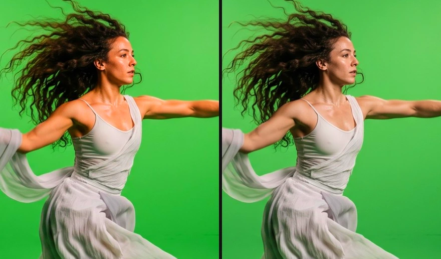
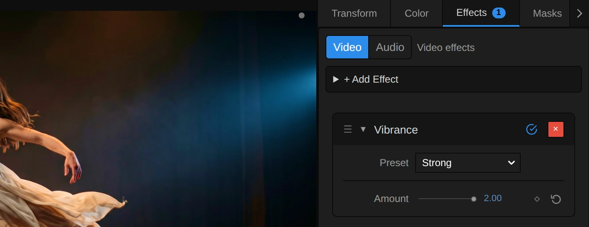
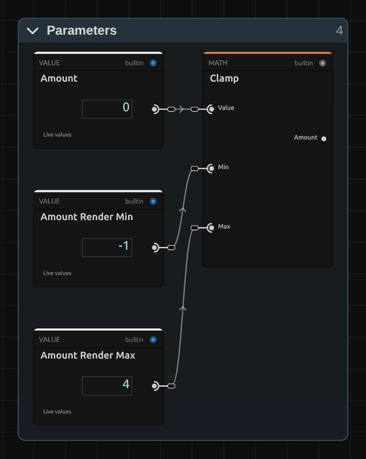
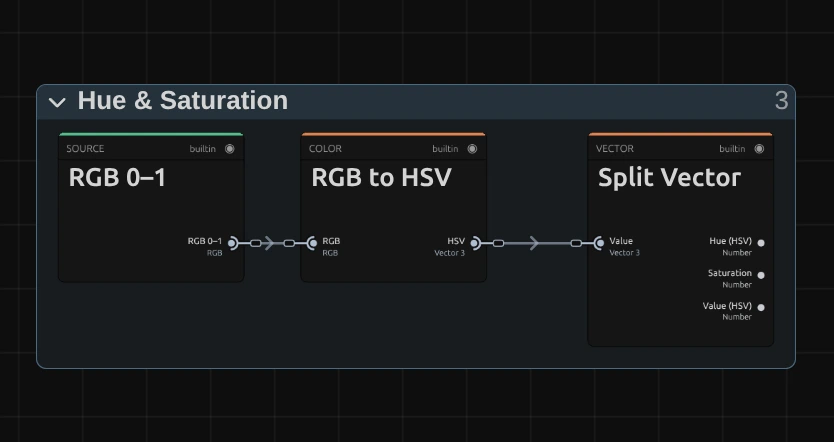
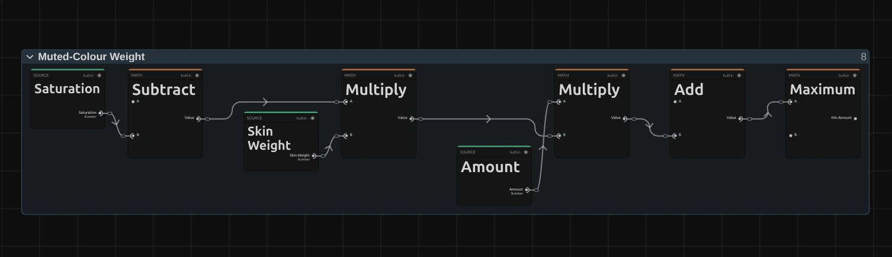

# Vibrance

A gentle saturation that strengthens pale colours a lot and strong colours and skin only a little. Good for scenes with people: the colour comes alive, the faces stay natural.

Group: [Color & Tone](../Effects-Color.md) · [How to add an effect](../Effects.md#add-an-effect)

<figure class="docs-shot docs-compare">

<figcaption>Left: original. Right: Amount 2 (the Strong preset).</figcaption>
</figure>

**Use it for:** livelier colour on people · reviving pale, washed-out shots · a quiet, muted look that keeps skin alive (below 0).

- **Amount** – up for livelier colour, down for a muted look; skin moves least either way.

**Tip:** for a close-up of a face, Vibrance is the safer push. For the same push on the background, [Saturation](./saturation.md) turns skin orange, Vibrance leaves it as it is. Drag the slider across her face:

<figure class="docs-shot docs-compare">

<figcaption>Left: Saturation 2.2. Right: Vibrance 2. The same push on the green.</figcaption>
</figure>

## Presets

<figure class="docs-shot">

<figcaption>The three presets on the harbour town.</figcaption>
</figure>

Pick one in the **Preset** row of the effect card. It sets Amount in one undo step, and the row then shows its name until you change the value. A keyframed Amount keeps its keyframes, and the card says so.

**Vibrant** – a clear push (Amount 1): the sky deepens and pale walls fill up, while faces stay as they were. A good first step for a dull recording.

**Strong** – the top of the slider (Amount 2). Pale colours bloom, while colours that are already strong and skin move only a little.

**Muted** – pale colours fade toward grey (Amount −0.6), strong colours and skin keep most of theirs: a quiet, subdued look that still has life in the faces. For a cool look, add [Temperature](./temperature.md).

## Controls

<figure class="docs-shot">

<svg class="docs-shot-overlay" viewBox="0 0 1017 393" aria-hidden="true" focusable="false">
<defs><marker id="vibrance-inspector-arrow" viewBox="0 0 10 10" refX="8" refY="5" markerWidth="5" markerHeight="5" orient="auto-start-reverse"><path d="M 0 0 L 10 5 L 0 10 Z" fill="#ffd54a" /></marker></defs>
<path class="docs-shot-arrow" d="M565 282 L649 282" marker-end="url(#vibrance-inspector-arrow)" />
<circle class="docs-shot-number" cx="565" cy="282" r="18" /><text x="565" y="282" class="docs-shot-number-text">1</text>
<path class="docs-shot-arrow" d="M555 344 L639 344" marker-end="url(#vibrance-inspector-arrow)" />
<circle class="docs-shot-number" cx="555" cy="344" r="18" /><text x="555" y="344" class="docs-shot-number-text">2</text>
</svg>

<figcaption>Vibrance with the Strong preset. 1 — Preset: pick a starting point. 2 — Amount: muted or livelier colour.</figcaption>
</figure>

**Preset** – one of the three starting points above; it sets Amount.

<figure class="docs-shot docs-clip docs-shot--float-right">
<video src="../assets/effects/clips/vibrance-amount.mp4" poster="../assets/effects/clips/vibrance-amount.webp" width="720" height="540" autoplay muted loop playsinline preload="none" aria-label="The harbour town while Vibrance runs from −1 to 2 and back: at −1 the pale sky and the pastel house fronts turn almost grey while the turquoise sea keeps much of its colour, then the sky deepens to a strong blue and the pink and yellow walls fill with colour, while the sea and the white boats change little; the current value is shown at the bottom left"></video>
<figcaption>Amount from −1 to 2 and back.</figcaption>
</figure>

**Amount** – how much livelier or quieter the colour gets. 0 leaves the picture as it is. Above 0 every colour grows stronger by how pale it is: a washed-out sky or a pale green screen gains a lot, a colour that is already strong gains little, and lit skin tones are spared most of it. Below 0 it works the other way round: pale colours fade toward grey first, and at −1 only the strongest colours keep much of theirs. Like [Saturation](./saturation.md), every colour stops at the strongest version the screen can show, so nothing clips and the brightness stays. Warm surfaces in bright light count as skin too, so on a stage lit in orange the push is weaker; use Saturation there. 1 is a clear push, 2 a strong one. −1 to 2, default 0. In the number field you can type up to 4 for an even stronger push; beyond that, and below −1, the picture uses the limit and the inspector says so.

## Node setup

<figure class="docs-shot docs-shot--graph">

<svg class="docs-shot-overlay" viewBox="0 0 1017 488" aria-hidden="true" focusable="false">
<defs><marker id="vibrance-arrow" viewBox="0 0 10 10" refX="8" refY="5" markerWidth="5" markerHeight="5" orient="auto-start-reverse"><path d="M 0 0 L 10 5 L 0 10 Z" fill="#ffd54a" /></marker></defs>
<path class="docs-shot-arrow" d="M648 465 L648 381" marker-end="url(#vibrance-arrow)" />
<circle class="docs-shot-number" cx="648" cy="465" r="18" /><text x="648" y="465" class="docs-shot-number-text">1</text>
<path class="docs-shot-arrow" d="M508 400 L508 316" marker-end="url(#vibrance-arrow)" />
<circle class="docs-shot-number" cx="508" cy="400" r="18" /><text x="508" y="400" class="docs-shot-number-text">2</text>
<path class="docs-shot-arrow" d="M504 114 L588 114" marker-end="url(#vibrance-arrow)" />
<circle class="docs-shot-number" cx="504" cy="114" r="18" /><text x="504" y="114" class="docs-shot-number-text">3</text>
<path class="docs-shot-arrow" d="M787 414 L787 330" marker-end="url(#vibrance-arrow)" />
<circle class="docs-shot-number" cx="787" cy="414" r="18" /><text x="787" y="414" class="docs-shot-number-text">4</text>
<path class="docs-shot-arrow" d="M926 326 L926 242" marker-end="url(#vibrance-arrow)" />
<circle class="docs-shot-number" cx="926" cy="326" r="18" /><text x="926" y="326" class="docs-shot-number-text">5</text>
</svg>

<figcaption>Vibrance opened in the Nodes tab (Constants, Combine RGB + Alpha and Output left out). 1 — Parameters: Amount, kept within its range. 2 — Hue & Saturation: measures each colour. 3 — Skin Protection: finds lit skin tones. 4 — Muted-Colour Weight: the strength for this pixel. 5 — Saturation (Gamut-Safe): mixes between grey and colour, never past the edge.</figcaption>
</figure>

Vibrance is [Saturation](./saturation.md) with a different strength for every pixel. **Parameters** keeps Amount within its range. **Hue & Saturation** measures each colour, **Skin Protection** finds lit skin tones, and **Muted-Colour Weight** turns both and the Amount into the **Mix Amount** of that pixel: more for pale colours, less for strong ones and for skin. **Saturation (Gamut-Safe)** is the same block as in Saturation and does the mixing. **Clamp** keeps the picture between 0 and 1 first, and **Combine RGB + Alpha** (after the block, not shown) puts the transparency back untouched. Click a folder's header to open it; the sections below show what is inside.

### Parameters

<figure class="docs-shot docs-shot--float-right">

<svg class="docs-shot-overlay" viewBox="0 0 590 740" aria-hidden="true" focusable="false">
<defs><marker id="vibrance-parameters-arrow" viewBox="0 0 10 10" refX="8" refY="5" markerWidth="5" markerHeight="5" orient="auto-start-reverse"><path d="M 0 0 L 10 5 L 0 10 Z" fill="#ffd54a" /></marker></defs>
<path class="docs-shot-arrow" d="M432 521 L432 437" marker-end="url(#vibrance-parameters-arrow)" />
<circle class="docs-shot-number" cx="432" cy="521" r="18" /><text x="432" y="521" class="docs-shot-number-text">1</text>
</svg>

<figcaption>Inside Parameters. 1 — Clamp: keeps Amount between −1 and 4.</figcaption>
</figure>

**Clamp** – keeps Amount between −1 and 4, the values in **Amount Render Min** and **Amount Render Max**. At −1 the palest colours are already almost grey, and above 4 even strong colours have reached the edge of the screen. A keyframe, a node or the AI agent may send more; the graph then uses the limit, and the card and the tool result say so.

### Hue & Saturation

<figure class="docs-shot docs-shot--float-right">

<svg class="docs-shot-overlay" viewBox="0 0 590 313" aria-hidden="true" focusable="false">
<defs><marker id="vibrance-measure-arrow" viewBox="0 0 10 10" refX="8" refY="5" markerWidth="5" markerHeight="5" orient="auto-start-reverse"><path d="M 0 0 L 10 5 L 0 10 Z" fill="#ffd54a" /></marker></defs>
<path class="docs-shot-arrow" d="M279 290 L279 206" marker-end="url(#vibrance-measure-arrow)" />
<circle class="docs-shot-number" cx="279" cy="290" r="18" /><text x="279" y="290" class="docs-shot-number-text">1</text>
<path class="docs-shot-arrow" d="M482 22 L482 88" marker-end="url(#vibrance-measure-arrow)" />
<circle class="docs-shot-number" cx="482" cy="22" r="18" /><text x="482" y="22" class="docs-shot-number-text">2</text>
</svg>

<figcaption>Inside Hue & Saturation. 1 — RGB to HSV: the colour as hue, saturation and value. 2 — Split Vector: the three numbers apart.</figcaption>
</figure>

**RGB to HSV** – describes each colour as its hue (where on the colour wheel, 0 to 1), its saturation (how far from grey, 0 to 1) and its value (the brightness of its strongest channel).

**Split Vector** – hands the three numbers out on their own: **Saturation** goes to the weight, all three go to the skin test.

### Muted-Colour Weight

<figure class="docs-shot docs-shot--graph">

<svg class="docs-shot-overlay" viewBox="0 0 1017 294" aria-hidden="true" focusable="false">
<defs><marker id="vibrance-weight-arrow" viewBox="0 0 10 10" refX="8" refY="5" markerWidth="5" markerHeight="5" orient="auto-start-reverse"><path d="M 0 0 L 10 5 L 0 10 Z" fill="#ffd54a" /></marker></defs>
<path class="docs-shot-arrow" d="M189 272 L189 188" marker-end="url(#vibrance-weight-arrow)" />
<circle class="docs-shot-number" cx="189" cy="272" r="18" /><text x="189" y="272" class="docs-shot-number-text">1</text>
<path class="docs-shot-arrow" d="M432 22 L432 73" marker-end="url(#vibrance-weight-arrow)" />
<circle class="docs-shot-number" cx="432" cy="22" r="18" /><text x="432" y="22" class="docs-shot-number-text">2</text>
<path class="docs-shot-arrow" d="M938 22 L938 73" marker-end="url(#vibrance-weight-arrow)" />
<circle class="docs-shot-number" cx="938" cy="22" r="18" /><text x="938" y="22" class="docs-shot-number-text">3</text>
</svg>

<figcaption>Inside Muted-Colour Weight (the constants 1 and 0 are left out). 1 — Subtract: how pale the colour is. 2 — Multiply: paleness, less on skin; the next Multiply scales it by Amount. 3 — Maximum: the Mix Amount, never below 0.</figcaption>
</figure>

**Subtract** – 1 minus the saturation: how pale the colour is. A grey pixel gets 1, a pure colour 0.

**Multiply** – the paleness times the **Skin Weight** from Skin Protection, so skin tones get only part of it. The Multiply after it scales that weight by **Amount**, and **Add** puts 1 on top, because 1 is the mix that leaves the colour as it is.

**Maximum** – keeps the result at 0 or above, so a mix never turns a colour into its opposite. This is the **Mix Amount** that Saturation (Gamut-Safe) reads.

**Remix:** to treat skin like every other colour, connect a **Value** of 1 to input B of the **Multiply** (2), in place of **Skin Weight**.

### Skin Protection: the hue test

Skin Protection asks two questions: is the hue that of skin, and is the pixel lit like skin? The answer is the **Skin Weight**, 1 for every colour that is not skin and down to 0.3 for clear skin. This section shows the first question, the next one the second.

<figure class="docs-shot docs-shot--graph">

<svg class="docs-shot-overlay" viewBox="0 0 1017 996" aria-hidden="true" focusable="false">
<defs><marker id="vibrance-skin-hue-arrow" viewBox="0 0 10 10" refX="8" refY="5" markerWidth="5" markerHeight="5" orient="auto-start-reverse"><path d="M 0 0 L 10 5 L 0 10 Z" fill="#ffd54a" /></marker></defs>
<path class="docs-shot-arrow" d="M393 22 L393 106" marker-end="url(#vibrance-skin-hue-arrow)" />
<circle class="docs-shot-number" cx="393" cy="22" r="18" /><text x="393" y="22" class="docs-shot-number-text">1</text>
<path class="docs-shot-arrow" d="M854 22 L854 106" marker-end="url(#vibrance-skin-hue-arrow)" />
<circle class="docs-shot-number" cx="854" cy="22" r="18" /><text x="854" y="22" class="docs-shot-number-text">2</text>
<path class="docs-shot-arrow" d="M624 512 L624 596" marker-end="url(#vibrance-skin-hue-arrow)" />
<circle class="docs-shot-number" cx="624" cy="512" r="18" /><text x="624" y="512" class="docs-shot-number-text">3</text>
</svg>

<figcaption>Inside Skin Protection, the hue test. 1 — Subtract: the hue minus the skin hue. 2 — Fraction: wraps it around the colour wheel and back to a distance. 3 — Gaussian Falloff: how close to skin.</figcaption>
</figure>

**Subtract** – the hue minus **Skin Hue**, 0.07 of the colour wheel (about 25°, the orange of skin in light). **Add** puts **Skin Half** (0.5) on top.

**Fraction** – keeps only the part after the decimal point. The colour wheel is a circle, so a red at 0.98 is close to the skin hue too; this wrap finds the short way round. A second Subtract below takes the 0.5 off again, and **Absolute** turns the result into a plain distance from the skin hue, 0 to 0.5.

**Gaussian Falloff** – turns the distance into a match: 1 right on the skin hue, falling off smoothly over **Skin Width** (0.05, about 18°) to nearly 0. This is the **Skin Hue Match**.

### Skin Protection: the light test

<figure class="docs-shot docs-shot--graph">

<svg class="docs-shot-overlay" viewBox="0 0 1017 882" aria-hidden="true" focusable="false">
<defs><marker id="vibrance-skin-weight-arrow" viewBox="0 0 10 10" refX="8" refY="5" markerWidth="5" markerHeight="5" orient="auto-start-reverse"><path d="M 0 0 L 10 5 L 0 10 Z" fill="#ffd54a" /></marker></defs>
<path class="docs-shot-arrow" d="M230 227 L230 311" marker-end="url(#vibrance-skin-weight-arrow)" />
<circle class="docs-shot-number" cx="230" cy="227" r="18" /><text x="230" y="227" class="docs-shot-number-text">1</text>
<path class="docs-shot-arrow" d="M508 535 L508 451" marker-end="url(#vibrance-skin-weight-arrow)" />
<circle class="docs-shot-number" cx="508" cy="535" r="18" /><text x="508" y="535" class="docs-shot-number-text">2</text>
<path class="docs-shot-arrow" d="M926 176 L926 260" marker-end="url(#vibrance-skin-weight-arrow)" />
<circle class="docs-shot-number" cx="926" cy="176" r="18" /><text x="926" y="176" class="docs-shot-number-text">3</text>
</svg>

<figcaption>Inside Skin Protection, the light test. 1 — Smoothstep: is the colour vivid? The Smoothstep below asks: is the pixel lit? 2 — Multiply: lit, not vivid and skin-coloured, in three steps. 3 — Subtract: the Skin Weight.</figcaption>
</figure>

**Smoothstep** – there are two. The upper one rises smoothly from 0 to 1 as the saturation goes from **Skin Pale Saturation** (0.6) to **Skin Vivid Saturation** (0.8); the Subtract after it turns that round: 1 for colours that could be skin, 0 for strong orange light, which then gets the full push. The lower one rises from 0 to 1 as the value goes from **Skin Dark Value** (0.15) to **Skin Lit Value** (0.35): a dark, warm stage floor has the hue of skin but is not lit like it, so it is not protected.

**Multiply** – three in a row. The first joins both tests: lit and not too vivid. The second joins that with the **Skin Hue Match** from the hue test. The third scales it by **Skin Protection**, 0.7: clear skin is spared 70 % of the push.

**Subtract** – 1 minus that: the **Skin Weight**, which the Muted-Colour Weight multiplies with the paleness.

**Remix:** set **Skin Protection** to 1 to leave skin completely untouched, or move **Skin Hue** to 0.6 to spare a blue instead, say the sky of a scene.

### Saturation (Gamut-Safe)

The same block as in [Saturation](./saturation.md#saturation-gamut-safe-the-mix), with the **Mix Amount** in place of the Amount: it mixes from grey to colour and stops every pixel at the strongest version the screen can show. The block is also in **right-click → Reusable Nodes**.

## Technical details

- **Formula.** Mix Amount `k = max(0, 1 + Amount · (1 − S) · w)` with `S` the HSV saturation and `w` the Skin Weight, then `y = L + (x − L) · min(k, limit)` as in [Saturation](./saturation.md#technical-details) (`L`: Rec.709 brightness). At Amount 1 a pale sky of (0.55, 0.7, 0.9) gets `k` = 1.61, stops at its limit 1.46 as (0.49, 0.71, 1.0); a lit skin tone of (0.85, 0.6, 0.48) gets only 1.19 and becomes (0.89, 0.59, 0.45).
- **Skin.** A bell curve around hue 0.07 (about 25°), width 0.05, sparing up to 70 %. The protection fades in over HSV value 0.15–0.35 and out over saturation 0.6–0.8, so dark warm floors and strong orange light get the full Amount.
- **Range.** The slider covers −1 to 2; typed values, keyframes and nodes render −1 to 4. Beyond that the graph uses the limit, and the inspector and the tool result say so.
- **Colour.** Brightness and hue stay; pure black, white and grey stay as they are at every value.
- **Transparency.** Only the colour is changed; the transparency passes through untouched.
- What all colour effects share (8-bit range, saved projects, adjustment layers): [Color & Tone](../Effect-System.md#color--tone-notes). Formulas: [Effect system](../Effect-System.md#editable-color-effect-graphs); blocks: [Node Catalog](../Node-Catalog.md) · [Styles and presets](../Effects.md#styles-and-presets).
