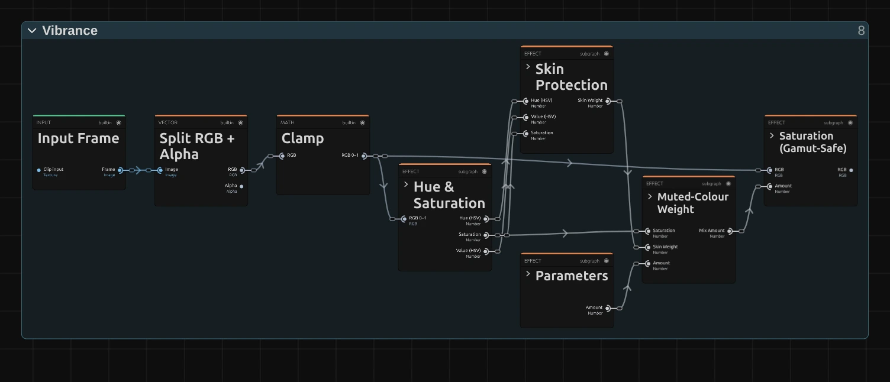

# Vibrance

A gentler saturation that strengthens pale colours a lot and strong colours only a little. It goes
easy on lit skin tones, so it is good for faces.

Group: [Color & Tone](../Effects-Color.md) · [How to add an effect](../Effects.md#add-an-effect)

<figure class="docs-shot">

<figcaption>The same part of the frame. Left: original. Middle: Saturation 1.6. Right: Vibrance 1.</figcaption>
</figure>

**Use it for:** livelier colours on people · reviving pale, washed-out shots · a muted look that
keeps skin alive (below 0).

- **Amount** – up for livelier colours, down for a muted look.

**Tip:** brightly lit warm surfaces count as skin too, so on a warm-lit stage use
[Saturation](./saturation.md) for a stronger push.

## Controls

<!-- generated:controls start -->
| Control | Range | Default |
|---|---|---|
| Amount | −1 to 1 | 0 |
<!-- generated:controls end -->

## Node setup

<figure class="docs-shot docs-shot--graph">

<svg class="docs-shot-overlay" viewBox="0 0 1017 250" aria-hidden="true" focusable="false">
<defs><marker id="vibrance-arrow" viewBox="0 0 10 10" refX="8" refY="5" markerWidth="5" markerHeight="5" orient="auto-start-reverse"><path d="M 0 0 L 10 5 L 0 10 Z" fill="#ffd54a" /></marker></defs>
<path class="docs-shot-arrow" d="M442 228 L442 163" marker-end="url(#vibrance-arrow)" />
<circle class="docs-shot-number" cx="442" cy="228" r="18" /><text x="442" y="228" class="docs-shot-number-text">1</text>
</svg>

<figcaption>Muted-Colour Weight, the middle of Vibrance (the constants 1 and 0 are left out). 1 — Multiply weighs the paleness (1 − Saturation) by Skin Weight.</figcaption>
</figure>

Vibrance reuses the block of [Saturation](./saturation.md#node-setup) and only computes a different
amount for every pixel. **Hue & Saturation** measures each colour, **Muted-Colour Weight** gives
pale colours more of the Amount than strong ones, and **Skin Protection** lowers it on lit,
skin-coloured hues. The result, **Mix Amount**, is the Amount input of **Saturation (Gamut-Safe)**.

**Remix:** to treat skin like every other colour, connect a **Value** of 1 to input B of the
**Multiply** (1), in place of **Skin Weight**.

## Technical details

- **Weight.** The Amount is weighted by `1 − S` (HSV saturation). Skin hues are spared by up to
  70 % (a bell curve at 0.07 turns, about 25°, width 0.05). The protection fades in over HSV value
  0.15–0.35 and out over saturation 0.6–0.8, so dark warm stage floors and strongly saturated
  orange light get the full Amount.
- **Range.** The slider covers −1 to 1; typed values render −1 to 4, and the inspector reports
  anything beyond that.
- Shared colour notes: [Color & Tone](../Effect-System.md#color--tone-notes). Formulas:
  [Effect system](../Effect-System.md#editable-color-effect-graphs); blocks:
  [Node Catalog](../Node-Catalog.md).
