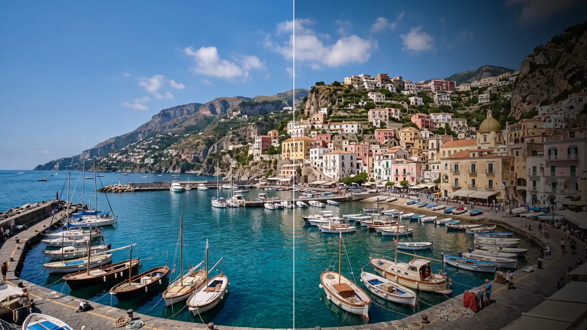

# Vignette

Darkens the edges and corners so the eye goes to the middle of the frame. Subtle, it calms busy
edges; strong, it looks like an old lens or a keyhole.

Group: [Light & Stylize](../Effects-Stylize.md) · [How to add an effect](../Effects.md#add-an-effect)

<figure class="docs-shot">

<figcaption>Top: original. Bottom: Amount 0.85, Size 0.25, Softness 0.8, Roundness 1 (a circle).</figcaption>
</figure>

**Use it for:** guiding the eye to a performer · an old-lens or memory look · softening the frame
edge of a projection.

- **Amount** – how dark the edges get.
- **Size** – where the darkening begins: smaller values start it closer to the centre.
- **Softness** – how gradually it fades in.
- **Roundness** – 1 is a circle, 0 follows the shape of the frame.

**Tip:** Amount 0.3 with a large Softness is barely noticeable, yet it calms busy edges.

## Controls

<!-- generated:controls start -->
| Control | Range | Default |
|---|---|---|
| Amount | 0 to 1 | 0.5 |
| Size | 0 to 1.5 | 0.5 |
| Softness | 0 to 1 | 0.5 |
| Roundness | 0 to 1 | 1 |

The effect card also has controls of its own that this table does not list.
<!-- generated:controls end -->

## Node setup

<figure class="docs-shot docs-shot--graph">

<figcaption>Vignette with the Constants and Coordinates folders and the Output card left out.</figcaption>
</figure>

**Distance & Roundness** measures how far each pixel lies from the centre, with every corner at 1;
Roundness blends between a circle and the shape of the frame. **Falloff** turns that distance into a
brightness gain from Size, Softness and Amount, and **Multiply** darkens the picture by it.
**Anti-Banding Dither** adds a tiny amount of noise where the gain changes, so a smooth dark
background shows no steps.

**Remix:** to see the banding the dither prevents, drag the cable from **Multiply** straight into
**Clamp**, past **Anti-Banding Dither**. On a dark, smooth background the falloff then shows faint
rings.

## Technical details

- **Shape.** The distance is measured in pixels, with every corner at 1 on any aspect ratio. The
  feather is at least 1.5 px.
- **Dither.** At most half an 8-bit step, and only where the picture changes.
- **Saved projects.** A Vignette saved before 2026-10-21 keeps its earlier look (its Roundness 0.5–2
  meant something else); its card offers **Use the new Vignette (resets its shape)**, which resets
  Size, Softness and Roundness and removes their keyframes, in one undo step.
- **Transitions.** The Vignette Bloom transition uses the current Vignette (Roundness 0, with Size
  and Softness ÷ √2: the same falloff as before).
- **Software preview.** Without a graph (as transitions create it) the worker software renderer uses
  the current pixel distance without the dither.
- Shared notes: [Light & Stylize](../Effects-Stylize.md#technical-details). Formulas:
  [Effect system](../Effect-System.md#editable-color-effect-graphs); blocks:
  [Node Catalog](../Node-Catalog.md).
