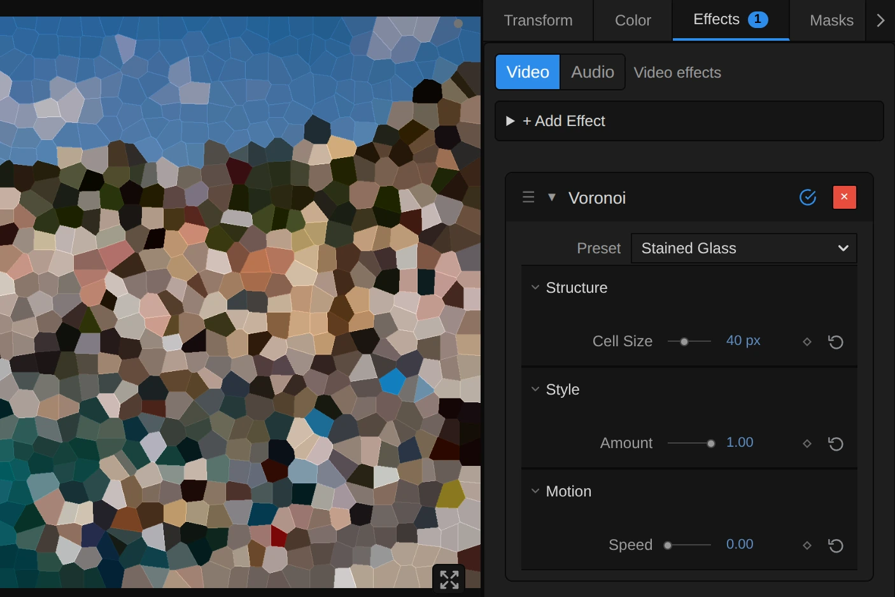
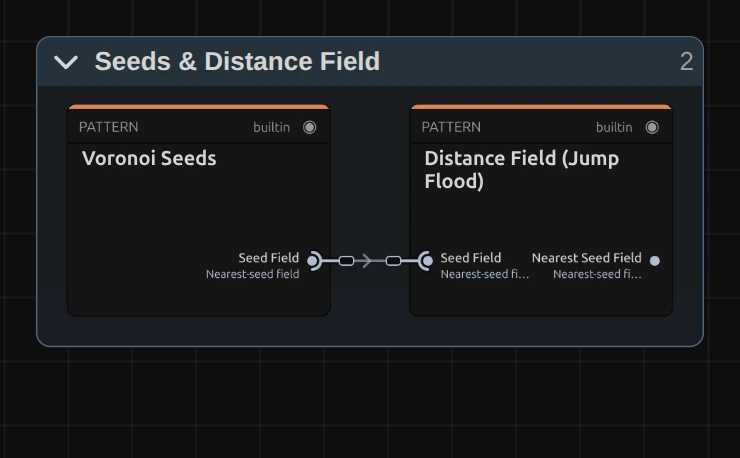
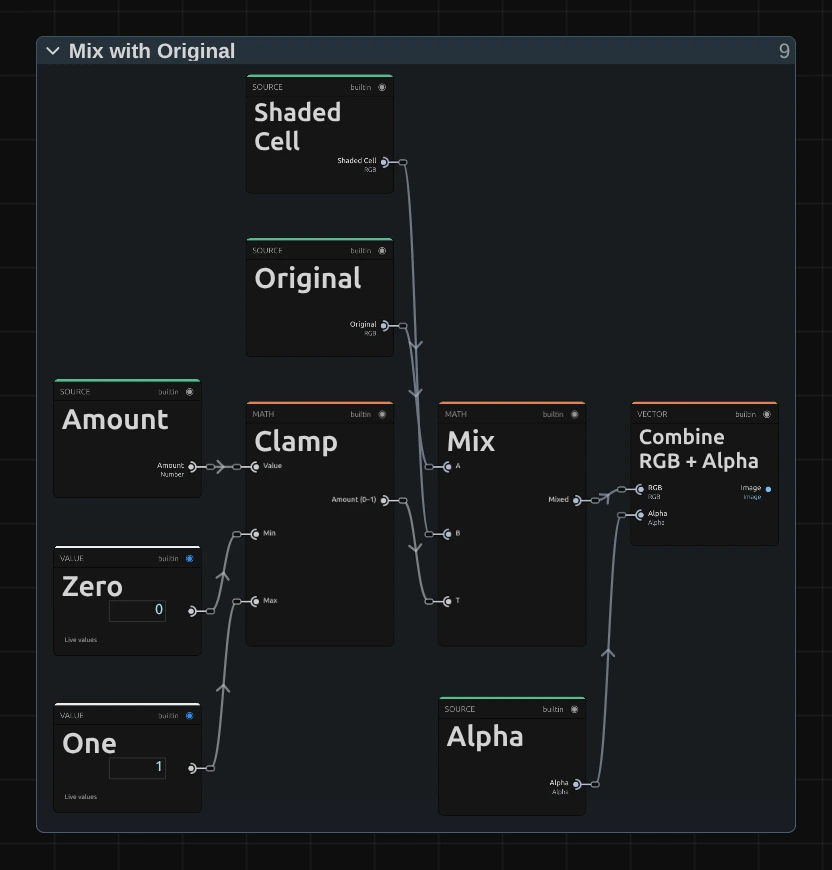

# Voronoi

Breaks the picture into irregular cells like cracked or stained glass, each filled with one colour and edged with a thin light line. The cells drift slowly, so the glass seems to breathe.

Group: [Pixel & Mosaic](../Effects-Pixel.md) · [How to add an effect](../Effects.md#add-an-effect)

<figure class="docs-shot docs-clip docs-compare docs-shot--float-left">
<video src="../assets/effects/clips/voronoi.mp4" poster="../assets/effects/clips/voronoi.webp" width="960" height="460" autoplay muted loop playsinline preload="none" aria-label="The dancer turning on a dark stage, original left and with Voronoi right: the picture breaks into small irregular cells, each filled with one colour and outlined by a thin light line; the cells follow her dress and arms as she moves, and their edges drift slowly"></video>
<figcaption>Left: original. Right: Voronoi at its default settings.</figcaption>
</figure>

**Use it for:** a stained-glass window · a memory or a dream that shatters · a picture seen through cracked or frosted glass.

- **Cell Size** – how big the cells are.
- **Amount** – how much of the cells lies over the picture.
- **Speed** – how fast the cell edges drift.

**Tip:** keyframe **Cell Size** from 96 down to 6 px: a picture of a few large shards settles into fine glass.

## Presets

<figure class="docs-shot docs-clip">
<video src="../assets/effects/clips/voronoi-presets.mp4" poster="../assets/effects/clips/voronoi-presets.webp" width="962" height="938" autoplay muted loop playsinline preload="none" aria-label="The dancer four times in a grid, moving in sync, each with one preset: Stained Glass top left with large flat cells like coloured glass, Fine Crackle top right with a fine net of small cells over the clear picture, Glass Veil bottom left with cells laid half over the original, Drifting Shards bottom right with big shards whose edges keep sliding"></video>
<figcaption>The four presets on the moving dancer, in sync.</figcaption>
</figure>

Pick one in the **Preset** row of the effect card. It sets all controls at once, in one undo step, and the row then shows its name until you change something. A control with keyframes keeps them, and the card says so.

**Stained Glass** – large flat cells that stand still, like a church window: the figure reads only by its colours and outline. Strong for a title or a single held image.

**Fine Crackle** – a fine net of small cells over the whole picture: faces and hands stay readable, as if seen through crackled glass. The quietest look, good for a whole scene.

**Glass Veil** – medium cells laid at 50 % over the picture, so it stays clear under a soft pattern of glass. For a scene that starts to fall apart, or behind text.

**Drifting Shards** – big shards whose edges keep sliding: the picture breaks into a few large pieces that never settle. For a breakdown or a cue that should feel unstable.

## Controls

<figure class="docs-shot">

<svg class="docs-shot-overlay" viewBox="0 0 1017 678" aria-hidden="true" focusable="false">
<defs><marker id="voronoi-inspector-arrow" viewBox="0 0 10 10" refX="8" refY="5" markerWidth="5" markerHeight="5" orient="auto-start-reverse"><path d="M 0 0 L 10 5 L 0 10 Z" fill="#ffd54a" /></marker></defs>
<path class="docs-shot-arrow" d="M565 282 L649 282" marker-end="url(#voronoi-inspector-arrow)" />
<circle class="docs-shot-number" cx="565" cy="282" r="18" /><text x="565" y="282" class="docs-shot-number-text">1</text>
<path class="docs-shot-arrow" d="M583 387 L667 387" marker-end="url(#voronoi-inspector-arrow)" />
<circle class="docs-shot-number" cx="583" cy="387" r="18" /><text x="583" y="387" class="docs-shot-number-text">2</text>
<path class="docs-shot-arrow" d="M592 503 L676 503" marker-end="url(#voronoi-inspector-arrow)" />
<circle class="docs-shot-number" cx="592" cy="503" r="18" /><text x="592" y="503" class="docs-shot-number-text">3</text>
<path class="docs-shot-arrow" d="M601 619 L685 619" marker-end="url(#voronoi-inspector-arrow)" />
<circle class="docs-shot-number" cx="601" cy="619" r="18" /><text x="601" y="619" class="docs-shot-number-text">4</text>
</svg>

<figcaption>Voronoi with the Stained Glass preset. 1 — Preset: pick a starting point. 2 — Cell Size. 3 — Amount. 4 — Speed.</figcaption>
</figure>

Every cell takes the colour of one pixel, its seed, a little darker than the picture, with a thin light line where it meets the cell to its right or below, so the cells read as glass.

### Structure

<figure class="docs-shot docs-clip docs-shot--float-right">
<video src="../assets/effects/clips/voronoi-cell-size.mp4" poster="../assets/effects/clips/voronoi-cell-size.webp" width="720" height="540" autoplay muted loop playsinline preload="none" aria-label="The dancer with Voronoi while Cell Size runs from 6 to 72 px and back: at the low end a fine net of cells keeps her face and hands readable, then the cells grow until her figure is a few large shards; the current value is shown at the bottom left"></video>
<figcaption>Cell Size from 6 to 72 px and back, Amount 1.</figcaption>
</figure>

**Cell Size** – the distance between the seeds, so roughly the width of a cell. 6–12 keeps faces readable under a fine net, 24 shows clear cells, 48 and more turns a figure into a few shards. It counts pixels of a 1080p picture, so a 4K export and a lower Preview Quality show the same cells. Below 4 the cells stay at 4, and the card says so; above 96 the cells keep growing. 4 to 96 px, default 24 px.

### Style

**Amount** – how much of the cells you see. 0 shows the original, 1 only cells, 0.5 lays them half over the picture, so it stays readable under a pattern of glass. Values outside 0 to 1 are held at the nearest end, and the card says so. 0 to 1, default 0.8.

### Motion

<figure class="docs-shot docs-clip docs-shot--float-right">
<video src="../assets/effects/clips/voronoi-speed.mp4" poster="../assets/effects/clips/voronoi-speed.webp" width="720" height="540" autoplay muted loop playsinline preload="none" aria-label="The dancer with Voronoi cells of 48 px at three speeds, about two seconds each: at Speed 0 the cell edges stand still and only the colours change where she moves, at 1 the edges slide slowly, at 4 they wobble quickly; the speed is shown at the bottom left"></video>
<figcaption>Speed 0, 1 and 4 at Cell Size 48 px, about two seconds each.</figcaption>
</figure>

**Speed** – how fast the seeds drift. Each seed sways around its place by up to a seventh of a cell, so the edges slide and the cells change shape without ever leaving their spot. 0 holds the glass still, and only the colours change where the picture moves; at 0.5 one sway takes about twelve seconds, at 4 a little over one and a half. It follows the playhead, so a paused picture stands still and the export matches the preview. 0 to 4, default 0.5.

## Node setup

<figure class="docs-shot docs-shot--graph">

<svg class="docs-shot-overlay" viewBox="0 0 1017 1064" aria-hidden="true" focusable="false">
<defs><marker id="voronoi-arrow" viewBox="0 0 10 10" refX="8" refY="5" markerWidth="5" markerHeight="5" orient="auto-start-reverse"><path d="M 0 0 L 10 5 L 0 10 Z" fill="#ffd54a" /></marker></defs>
<path class="docs-shot-arrow" d="M143 523 L143 607" marker-end="url(#voronoi-arrow)" />
<circle class="docs-shot-number" cx="143" cy="523" r="18" /><text x="143" y="523" class="docs-shot-number-text">1</text>
<path class="docs-shot-arrow" d="M386 612 L386 696" marker-end="url(#voronoi-arrow)" />
<circle class="docs-shot-number" cx="386" cy="612" r="18" /><text x="386" y="612" class="docs-shot-number-text">2</text>
<path class="docs-shot-arrow" d="M446 217 L530 217" marker-end="url(#voronoi-arrow)" />
<circle class="docs-shot-number" cx="446" cy="217" r="18" /><text x="446" y="217" class="docs-shot-number-text">3</text>
<path class="docs-shot-arrow" d="M873 523 L873 607" marker-end="url(#voronoi-arrow)" />
<circle class="docs-shot-number" cx="873" cy="523" r="18" /><text x="873" y="523" class="docs-shot-number-text">4</text>
</svg>

<figcaption>Voronoi opened in the Nodes tab (input frame and output left out). 1 — Seeds & Distance Field: the nearest seed of every pixel. 2 — Cell Colour: the colour of that seed. 3 — Cell Edges: the shade and the light edge line. 4 — Mix with Original: blends by Amount.</figcaption>
</figure>

Voronoi works in four stages, one folder each in the Nodes tab: **Seeds & Distance Field** places one seed per cell and finds the nearest seed for every pixel, **Cell Colour** reads the colour of that seed, **Cell Edges** shades the cell and draws its light edge line, and **Mix with Original** blends the result with the picture by Amount. Click a folder's header to open it; the sections below show what is inside.

### Seeds & Distance Field

<figure class="docs-shot docs-shot--float-right">

<svg class="docs-shot-overlay" viewBox="0 0 590 365" aria-hidden="true" focusable="false">
<defs><marker id="voronoi-seeds-arrow" viewBox="0 0 10 10" refX="8" refY="5" markerWidth="5" markerHeight="5" orient="auto-start-reverse"><path d="M 0 0 L 10 5 L 0 10 Z" fill="#ffd54a" /></marker></defs>
<path class="docs-shot-arrow" d="M159 342 L159 258" marker-end="url(#voronoi-seeds-arrow)" />
<circle class="docs-shot-number" cx="159" cy="342" r="18" /><text x="159" y="342" class="docs-shot-number-text">1</text>
<path class="docs-shot-arrow" d="M432 342 L432 258" marker-end="url(#voronoi-seeds-arrow)" />
<circle class="docs-shot-number" cx="432" cy="342" r="18" /><text x="432" y="342" class="docs-shot-number-text">2</text>
</svg>

<figcaption>Inside Seeds & Distance Field (Cell Size, Speed). 1 — Voronoi Seeds: one seed per cell. 2 — Distance Field (Jump Flood): the nearest seed of every pixel.</figcaption>
</figure>

**Voronoi Seeds** – lays a square grid of Cell Size over the frame and puts one seed at a random place in each square, between 8 % and 92 % of its width. With Speed above 0 every seed sways around that place on the timeline clock. The result is a picture in which only the seed pixels are marked.

**Distance Field (Jump Flood)** – spreads every seed to the pixels around it in a few big, then smaller steps (half the frame, a quarter, … one pixel), until every pixel knows its nearest seed. That map is the Voronoi pattern.

### Cell Colour

<figure class="docs-shot docs-shot--graph">

<svg class="docs-shot-overlay" viewBox="0 0 1017 553" aria-hidden="true" focusable="false">
<defs><marker id="voronoi-colour-arrow" viewBox="0 0 10 10" refX="8" refY="5" markerWidth="5" markerHeight="5" orient="auto-start-reverse"><path d="M 0 0 L 10 5 L 0 10 Z" fill="#ffd54a" /></marker></defs>
<path class="docs-shot-arrow" d="M184 205 L184 289" marker-end="url(#voronoi-colour-arrow)" />
<circle class="docs-shot-number" cx="184" cy="205" r="18" /><text x="184" y="205" class="docs-shot-number-text">1</text>
<path class="docs-shot-arrow" d="M509 22 L509 72" marker-end="url(#voronoi-colour-arrow)" />
<circle class="docs-shot-number" cx="509" cy="22" r="18" /><text x="509" y="22" class="docs-shot-number-text">2</text>
<path class="docs-shot-arrow" d="M833 531 L833 447" marker-end="url(#voronoi-colour-arrow)" />
<circle class="docs-shot-number" cx="833" cy="531" r="18" /><text x="833" y="531" class="docs-shot-number-text">3</text>
<path class="docs-shot-arrow" d="M941 522 L941 438" marker-end="url(#voronoi-colour-arrow)" />
<circle class="docs-shot-number" cx="941" cy="522" r="18" /><text x="941" y="522" class="docs-shot-number-text">4</text>
</svg>

<figcaption>Inside Cell Colour. 1 — Read Nearest Seed: where this pixel's seed lies. 2 — Switch: the seed pixel to read. 3 — Alpha to Scalar: how opaque the seed is. 4 — Mix: the cell colour.</figcaption>
</figure>

**Read Nearest Seed** – reads, for this pixel, where its nearest seed lies. The two Read Nearest Seed nodes in Cell Edges do the same for the pixel to the right and the pixel below.

**Switch** – the seed's position, or the pixel's own where no seed was found (Greater Than checks the record's validity).

**Alpha to Scalar** – the transparency of the seed pixel as a number from 0 to 1.

**Mix** – blends from the pixel's own colour to the seed's colour by that number. An opaque seed colours the whole cell; a transparent one, at the edge of a cut-out figure or a picture smaller than the frame, leaves the pixel its own colour instead of turning the cell black.

### Cell Edges

<figure class="docs-shot docs-shot--graph">

<svg class="docs-shot-overlay" viewBox="0 0 1017 1721" aria-hidden="true" focusable="false">
<defs><marker id="voronoi-edges-arrow" viewBox="0 0 10 10" refX="8" refY="5" markerWidth="5" markerHeight="5" orient="auto-start-reverse"><path d="M 0 0 L 10 5 L 0 10 Z" fill="#ffd54a" /></marker></defs>
<path class="docs-shot-arrow" d="M389 254 L389 284" marker-end="url(#voronoi-edges-arrow)" />
<circle class="docs-shot-number" cx="389" cy="254" r="18" /><text x="389" y="254" class="docs-shot-number-text">1</text>
<path class="docs-shot-arrow" d="M389 725 L389 755" marker-end="url(#voronoi-edges-arrow)" />
<circle class="docs-shot-number" cx="389" cy="725" r="18" /><text x="389" y="725" class="docs-shot-number-text">2</text>
<path class="docs-shot-arrow" d="M867 671 L867 755" marker-end="url(#voronoi-edges-arrow)" />
<circle class="docs-shot-number" cx="867" cy="671" r="18" /><text x="867" y="671" class="docs-shot-number-text">3</text>
<path class="docs-shot-arrow" d="M628 1347 L628 1263" marker-end="url(#voronoi-edges-arrow)" />
<circle class="docs-shot-number" cx="628" cy="1347" r="18" /><text x="628" y="1347" class="docs-shot-number-text">4</text>
</svg>

<figcaption>Inside Cell Edges. The number cards are values from the Constants folder, shown where they plug in. 1 — Read Nearest Seed: the seeds of the neighbours. 2 — Maximum: how far apart the seeds lie. 3 — Switch: on the edge or inside. 4 — Multiply: the shaded cell.</figcaption>
</figure>

**Read Nearest Seed** – the nearest seed of the pixel to the right and of the pixel below.

**Maximum** – how far those seeds lie from this pixel's seed. A different seed means a different cell.

**Switch** – 1 on the edge of a cell, where the neighbour belongs to another seed (Greater Than Half 0.5), else 0.

**Multiply** – the cell colour times its shade: 0.82 inside the cell and 1 on its edge, so every cell is a little darker than the picture, with a light line along its right and lower edge.

**Remix:** open the **Constants** folder and set the value **0.82** to **1**: the cells keep the picture's full brightness, and the edge lines vanish into them, a softer, seamless mosaic.

### Mix with Original

<figure class="docs-shot docs-shot--float-right">

<svg class="docs-shot-overlay" viewBox="0 0 590 617" aria-hidden="true" focusable="false">
<defs><marker id="voronoi-mix-arrow" viewBox="0 0 10 10" refX="8" refY="5" markerWidth="5" markerHeight="5" orient="auto-start-reverse"><path d="M 0 0 L 10 5 L 0 10 Z" fill="#ffd54a" /></marker></defs>
<path class="docs-shot-arrow" d="M227 548 L227 464" marker-end="url(#voronoi-mix-arrow)" />
<circle class="docs-shot-number" cx="227" cy="548" r="18" /><text x="227" y="548" class="docs-shot-number-text">1</text>
<path class="docs-shot-arrow" d="M363 195 L363 279" marker-end="url(#voronoi-mix-arrow)" />
<circle class="docs-shot-number" cx="363" cy="195" r="18" /><text x="363" y="195" class="docs-shot-number-text">2</text>
<path class="docs-shot-arrow" d="M500 477 L500 393" marker-end="url(#voronoi-mix-arrow)" />
<circle class="docs-shot-number" cx="500" cy="477" r="18" /><text x="500" y="477" class="docs-shot-number-text">3</text>
</svg>

<figcaption>Inside Mix with Original. 1 — Clamp: Amount between 0 and 1. 2 — Mix: original to cell. 3 — Combine RGB + Alpha: the original transparency back on.</figcaption>
</figure>

**Clamp** – keeps Amount between 0 and 1, so a keyframe or a typed value past the ends cannot push colours beyond the cell.

**Mix** – blends from the original colour to the shaded cell by Amount: 0 is the picture itself, 1 the cells alone.

**Combine RGB + Alpha** – joins the mixed colour with the original transparency, so a cut-out figure keeps its own smooth outline while its inside turns into glass.

## Technical details

- **Size.** Cell Size counts pixels of a frame whose shorter side is 1080: a 4K export, a portrait frame, a lower Preview Quality and the thumbnails show the same cells. A cell is never smaller than 4 such pixels and 2 rendered pixels; the card says when Cell Size is below 4. The seed grid starts at the top-left corner.
- **Accuracy.** The jump flood finds the nearest seed in about eleven passes for a 1080p frame. It is very close to exact; now and then a pixel at the corner where three cells meet takes the second-nearest seed, which shows as a pixel-sized step in an edge line.
- **Time.** The seeds sway with the timeline time: scrubbing, playback and export give the same frame for the same moment, and a paused picture needs no extra rendering. Speed multiplies that time, so a keyframed Speed makes the seeds jump; to change the look on a cue, keyframe Cell Size or Amount instead.
- **Transparency.** The cells keep the original transparency, so a cut-out figure keeps its outline. A cell whose seed is transparent leaves its pixels their own colour.
- **Saved projects.** Since 2026-10-22 Cell Size counts 1080p pixels (it counted output pixels, so the preview and a 4K export showed other cells than a 1080p frame), a transparent seed no longer paints its cell black, and Amount stays between 0 and 1. A 1080p frame of opaque footage looks as before. The old Threshold control did nothing and is gone; a value saved in a project is ignored. A Voronoi whose node setup you edited keeps its own recipe.
- **More:** [Effect system](../Effect-System.md#pixel--mosaic-notes) · [Node Catalog](../Node-Catalog.md) · [Styles and presets](../Effects.md#styles-and-presets).
