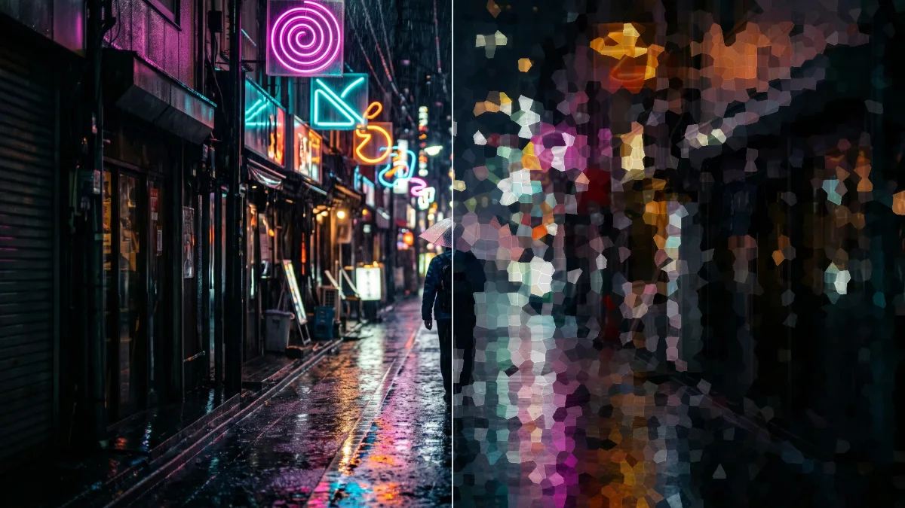

# Voronoi

<!-- effect-docs: basic page sha=584483b2c177, written by scripts/effect-docs.mjs. Delete this line to write the page by hand (template B in Documentation-Site.md). -->

Shatters the image into slowly drifting Voronoi cells, each filled with one sampled color and subtly outlined; Scale sets cell size.

Group: [Pixel & Mosaic](../Effects-Pixel.md) · [How to add an effect](../Effects.md#add-an-effect)

<figure class="docs-shot">

<figcaption>Left: the original. Right: Voronoi at its default settings, one frame of its movement.</figcaption>
</figure>

*A short page made from the editor’s effect catalog: what the effect does and its controls. Tips and its node setup will follow.*

## Controls

<!-- generated:controls start -->
| Control | Range | Default |
|---|---|---|
| **Structure** | | |
| Cell / Segment Size | 4 to 96 | 24 |
| **Style** | | |
| Amount | 0 to 1 | 0.8 |
| Threshold | 0 to 1 | 0.45 |
| **Motion** | | |
| Speed | 0 to 4 | 0.5 |
<!-- generated:controls end -->

## Technical details

It runs as a GPU compute effect. It keeps moving while the playhead stands still. How effects are stored, rendered and exported: [Effect system](../Effect-System.md). Its building blocks: [Node Catalog](../Node-Catalog.md).
