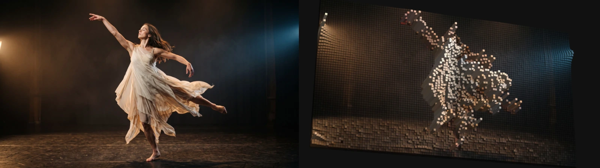

# Voxel Relief

Builds the picture out of small blocks in 3D: bright parts rise, dark parts stay low. You can look at
the relief from any angle.

Group: [3D & Particles](../Effects-3D-Particles.md) · [How to add an effect](../Effects.md#add-an-effect)

<figure class="docs-shot">

<figcaption>Left: original. Right: Voxel Relief seen from the side (Tilt 70°, Yaw −18°, Distance 0.93, Columns 120, Height 0.35, Height Contrast 2). The defaults (Height 1.2, Height Contrast 3) look almost straight on and make bright parts rise much taller; from the side they become long pillars.</figcaption>
</figure>

**Use it for:** a pin-art or city-model look · a slow camera move over a still picture · a graphic,
3D treatment of a portrait.

- **Columns** – how many blocks across the picture.
- **Height** – how far bright parts rise.
- **Tilt** and **Yaw** (degrees) and **Distance** – where the camera looks from.
- **Light Angle** – where the light comes from.

**Tip:** press **Orbit** on the effect card, then drag in the preview to look from another angle and
scroll to move closer. Keyframe Tilt and Yaw for a camera move.

## Controls

<!-- generated:controls start -->
| Control | Range | Default |
|---|---|---|
| **General** | | |
| History Loop | Reset, Continuous | Reset |
| **Relief** | | |
| Columns | 12 to 180 | 107.4 |
| Height | 0 to 1.2 | 1.2 |
| Base | 0 to 0.2 | 0.015 |
| Gap | 0 to 0.36 | 0.06 |
| Limit to Video | on or off | on |
| Height Contrast | 0.2 to 3 | 3 |
| **Camera** | | |
| Tilt | −180 to 180° | 87° |
| Yaw | −180 to 180° | 0° |
| FOV | 0.15 to 1.6 | 0.22 |
| Distance | 0.2 to 6 | 0.8 |
| Center X | 0 to 1 | 0.5 |
| Center Y | 0 to 1 | 0.5 |
| Roll | −180 to 180° | 0° |
| **Light** | | |
| Ambient | 0 to 1 | 0.58 |
| Light | 0 to 2 | 0.48 |
| Light Angle | 0 to 360° | 310° |
| Light Elevation | 5 to 85° | 45° |
| Light Follows Camera | on or off | off |
| **Look** | | |
| Color | 0 to 1 | 0.95 |
| Smoothing | 0 to 0.9 | 0.08 |
| Gaps | 0 to 1 | 0.1 |
| Edges | 0 to 1 | 0.68 |
| Reset Smoothing | on or off | off |
| **Quality** | | |
| Ray Steps | 24 to 144 | 72 |
<!-- generated:controls end -->

## Node setup

<figure class="docs-shot docs-shot--graph">

<figcaption>Voxel Relief with Column geometry open; Height field stays folded.</figcaption>
</figure>

Voxel Relief is a small 3D scene: blocks on a grid, a camera and a light. **Column geometry** builds
the blocks: **Grid Points** places one point per column, **Primitive** is the block, **Height
field** turns brightness into height (Height Contrast, Height and Base are its controls) and
**Instance on Points** puts a block on every point. **Mesh Object** dresses the blocks in the
picture's colours (**Surface Material**), and **Relief Render** films them with the **Orbit Camera**
and the **Relief Light**. **Open Nodes** in the effect card opens this graph directly.

**Remix:** select **Primitive** and switch its **Shape** from Box to Sphere or Cylinder: the relief
turns into beads or round pillars. The effect card shows the same Shape under Primitive.

## Technical details

- **Rendering.** The 2D relief is raymarched (Ray Steps); as a 3D scene object it uses instancing:
  [Voxel Relief as a true 3D scene object](../Effect-System.md#voxel-relief-as-a-true-3d-scene-object).
- **Look.** Block sides keep at least 55 % of the column colour. The default Distance 0.8 fills the
  layer at the default Tilt.
- **Framing.** Height does not move the camera: a low or keyframed relief keeps the framing of the
  default relief, and only a relief taller than the default makes the camera step back. Distance
  alone sets how close it is.
- **Warnings.** Values its shader clamps are named in the effect card and the tool result.
- **Saved projects.** A Voxel Relief saved earlier keeps its darker sides, Distance 1 if it was
  saved before Distance existed, and a camera that moves closer as Height drops if it was saved
  before 27 October 2026.
- Nodes and camera: [Editable Voxel Relief nodes](../Effect-System.md#editable-voxel-relief-nodes),
  [camera and orbit mode](../Effect-System.md#voxel-relief-camera--orbit-mode); blocks:
  [Node Catalog](../Node-Catalog.md).
