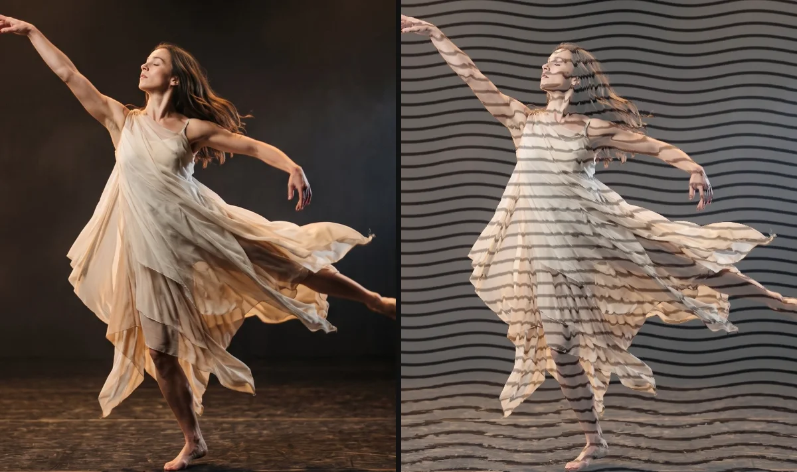

# Wave Lines

Redraws the picture as wavy lines on a plain background, a graphic line-art look. The waves bend with the brightness of the picture and drift over time.

Group: [Lines & Engraving](../Effects-Lines.md) · [How to add an effect](../Effects.md#add-an-effect)

<figure class="docs-shot">

<figcaption>Left: original. Right: default settings (Amount 0.3, Line Density 14).</figcaption>
</figure>

**Use it for:** a graphic, printed look · a background that turns into line art · titles and posters with a moving texture.

- **Amount** – how strongly the drawing covers the picture and how far the lines bend. From about 0.5 the drawing covers most of the picture; at 1 only the bending of the lines shows the picture.
- **Line Density** – how many lines run down the picture (three per step).
- **Lines** and **Background** – the two colours of the drawing.
- **Speed** – how fast the waves drift; 0 holds them still.

**Tip:** for a dark stage, swap the colours: white Lines on a black Background give a line drawing of light.

## Controls

<!-- generated:controls start -->
| Control | Range | Default |
|---|---|---|
| **Pattern** | | |
| Line Density | 3 to 80 | 14 |
| **Style** | | |
| Amount | 0 to 1 | 0.3 |
| **Color** | | |
| Lines | a colour | `#111827` |
| Background | a colour | `#f8fafc` |
| **Motion** | | |
| Speed | 0 to 5 | 1 |
<!-- generated:controls end -->

## Node setup

Wave Lines is one look of the pattern engine: its card has a **Style** menu that switches to other looks with the same controls, such as [Glitch Grid](./glitch-grid.md) and [Drift Lines](./drift-lines.md) ([Styles and presets](../Effects.md#styles-and-presets)). Its own graph is small: the line height follows a **Sine** across the frame whose phase moves with time and with the brightness of the pixel, a **Smoothstep** from 0.05 to 0.2 draws each line, and a last **Mix** lays the drawing over the picture by Amount.

**Remix:** for thicker lines, select the two **Value** cards of the Smoothstep and raise them from 0.05 and 0.2 to 0.15 and 0.3.

## Technical details

- **Units.** Line Density × 3 lines run over the frame height (Line Density 14: 42 lines); values below 3 render as 3, and the inspector says so.
- **Transparency.** The source alpha is kept: transparent parts stay transparent.
- **Time.** The waves follow timeline time, so the preview, scrubbing and the export match.
- **Saved projects.** New Wave Lines start at Amount 0.3; saved ones keep their value (the default was 0.75 before 2026-10).

More: [Effect system: Wave Lines](../Effect-System.md#wave-lines). Nodes: [Node Catalog](../Node-Catalog.md).
