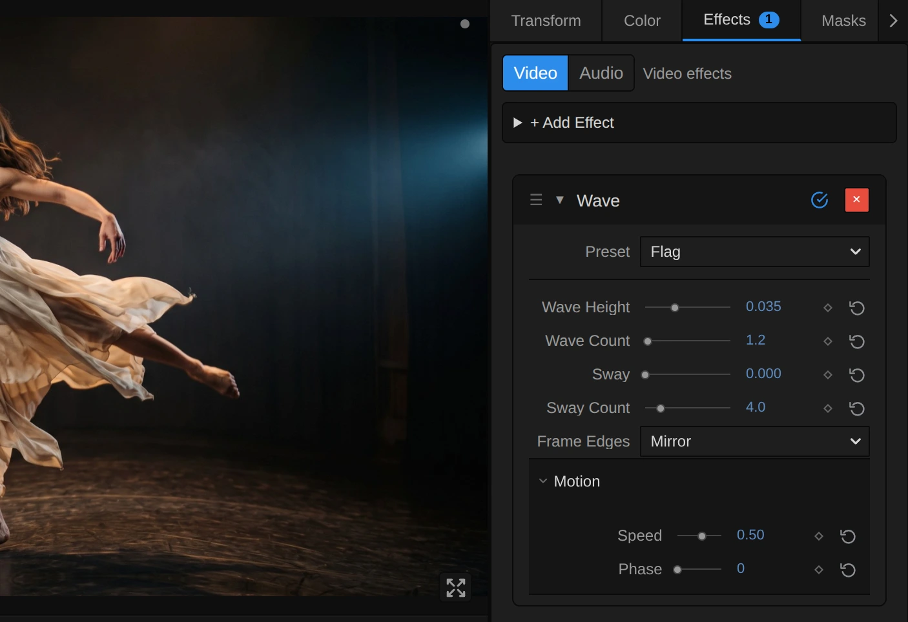
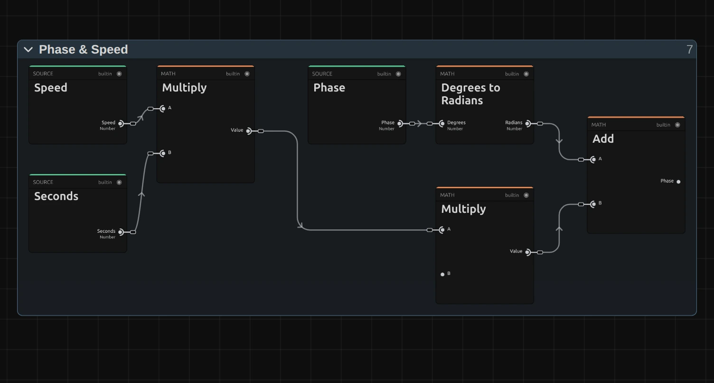
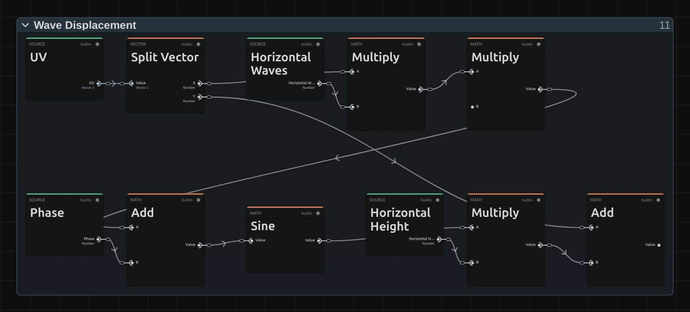

# Wave

Ripples the picture with smooth, travelling waves, from a faint heat shimmer to a funhouse wobble.

Group: [Lens & Distort](../Effects-Distort.md) · [How to add an effect](../Effects.md#add-an-effect)

<figure class="docs-shot docs-clip docs-compare docs-shot--float-left">
<video src="../assets/effects/clips/wave.mp4" poster="../assets/effects/clips/wave.webp" width="960" height="460" autoplay muted loop playsinline preload="none" aria-label="The dancer turning on a dark stage, original left and with Wave right: her arms, her dress and the edge of the stage floor ripple in small waves that travel slowly through the picture"></video>
<figcaption>Left: original. Right: Wave at its default settings.</figcaption>
</figure>

**Use it for:** heat over a hot floor · an underwater or dream look · a banner in the wind · a wobbly transition.

- **Wave Height / Wave Count** – waves that lift the picture up and down.
- **Sway / Sway Count** – waves that push it sideways.
- **Speed** – how fast the waves travel.

**Tip:** keyframe **Wave Height** and **Sway** from 0 up to 0.03 and back over one second: the picture melts for a moment, and a cut hidden at the peak disappears.

## Presets

<figure class="docs-shot docs-clip">
<video src="../assets/effects/clips/wave-presets.mp4" poster="../assets/effects/clips/wave-presets.webp" width="962" height="938" autoplay muted loop playsinline preload="none" aria-label="The dancer four times in a grid, moving in sync, each with one preset: Heat Shimmer top left with fine trembling edges, Dream top right with the whole figure swaying in long slow waves, Flag bottom left bending up and down like a banner, Funhouse Mirror bottom right pushed sideways into one broad curve"></video>
<figcaption>The four presets on the moving dancer, in sync.</figcaption>
</figure>

Pick one in the **Preset** row of the effect card. It sets all controls at once, in one undo step, and the row then shows its name until you change something. A control with keyframes keeps them, and the card says so.

**Heat Shimmer** – fine, fast ripples, mostly sideways: edges tremble like air over a hot stage floor, and the picture stays easy to read. Good under text or for a quiet unease.

**Dream** – long, slow waves in both directions: the whole figure sways and breathes, as if seen through deep water. For memories, sleep and underwater scenes.

**Flag** – about one wave across the frame, up and down only: the picture bends like a banner in the wind. Strong on a projected flag, a poster or a curtain.

**Funhouse Mirror** – one broad sideways bend from top to bottom that drifts slowly: the figure curves like a reflection in a fairground mirror. For comedy, a dream or a distorted self-image.

## Controls

<figure class="docs-shot">

<svg class="docs-shot-overlay" viewBox="0 0 1017 697" aria-hidden="true" focusable="false">
<defs><marker id="wave-inspector-arrow" viewBox="0 0 10 10" refX="8" refY="5" markerWidth="5" markerHeight="5" orient="auto-start-reverse"><path d="M 0 0 L 10 5 L 0 10 Z" fill="#ffd54a" /></marker></defs>
<path class="docs-shot-arrow" d="M565 282 L649 282" marker-end="url(#wave-inspector-arrow)" />
<circle class="docs-shot-number" cx="565" cy="282" r="18" /><text x="565" y="282" class="docs-shot-number-text">1</text>
<path class="docs-shot-arrow" d="M517 344 L601 344" marker-end="url(#wave-inspector-arrow)" />
<circle class="docs-shot-number" cx="517" cy="344" r="18" /><text x="517" y="344" class="docs-shot-number-text">2</text>
<path class="docs-shot-arrow" d="M520 382 L604 382" marker-end="url(#wave-inspector-arrow)" />
<circle class="docs-shot-number" cx="520" cy="382" r="18" /><text x="520" y="382" class="docs-shot-number-text">3</text>
<path class="docs-shot-arrow" d="M511 494 L595 494" marker-end="url(#wave-inspector-arrow)" />
<circle class="docs-shot-number" cx="511" cy="494" r="18" /><text x="511" y="494" class="docs-shot-number-text">4</text>
<path class="docs-shot-arrow" d="M601 600 L685 600" marker-end="url(#wave-inspector-arrow)" />
<circle class="docs-shot-number" cx="601" cy="600" r="18" /><text x="601" y="600" class="docs-shot-number-text">5</text>
</svg>

<figcaption>Wave with the Flag preset. 1 — Preset: pick a starting point. 2 — Wave Height: how far the picture lifts. 3 — Wave Count: how many waves fit across. 4 — Frame Edges: what fills in beyond the frame. 5 — Speed: how fast the waves travel.</figcaption>
</figure>

**Preset** – a starting point for the heights, the counts and Speed; see [Presets](#presets).

### General

<figure class="docs-shot docs-clip docs-shot--float-right">
<video src="../assets/effects/clips/wave-height.mp4" poster="../assets/effects/clips/wave-height.webp" width="720" height="540" autoplay muted loop playsinline preload="none" aria-label="The dancer with Wave while Wave Height runs from 0 to 0.06 and back: the picture starts to bend up and down in broad waves across the frame, the edge of the floor turns into hills, and it settles again; the current value is shown at the bottom left"></video>
<figcaption>Wave Height from 0 to 0.06 and back, Sway 0.</figcaption>
</figure>

**Wave Height** – how far the waves that run across the picture lift it up and down, as a share of the picture height: 0.015 is 1.5 %. 0.005 is a shimmer, 0.015 a clear ripple, 0.05 and more bends a figure out of shape. At 0 these waves are off. 0 to 0.1, default 0.015.

<figure class="docs-shot docs-clip docs-shot--float-right">
<video src="../assets/effects/clips/wave-count.mp4" poster="../assets/effects/clips/wave-count.webp" width="720" height="540" autoplay muted loop playsinline preload="none" aria-label="The dancer with Wave while Wave Count runs from 1 to 16 and back: one slow bend across the frame becomes many tight ripples that make her outline tremble, and widens again; the current value is shown at the bottom left"></video>
<figcaption>Wave Count from 1 to 16 and back, at Wave Height 0.02.</figcaption>
</figure>

**Wave Count** – how many of those waves fit across the picture. 1 or less bends the whole frame like a flag, 4 gives clear waves, 10 and more fine ripples that make outlines tremble. 0.5 to 20, default 4.

<figure class="docs-shot docs-clip docs-shot--float-right">
<video src="../assets/effects/clips/wave-sway.mp4" poster="../assets/effects/clips/wave-sway.webp" width="720" height="540" autoplay muted loop playsinline preload="none" aria-label="The dancer with Wave while Sway runs from 0 to 0.06 and back: her figure is pushed left and right into a snake-like curve from head to feet, and straightens again; the current value is shown at the bottom left"></video>
<figcaption>Sway from 0 to 0.06 and back, Wave Height 0.</figcaption>
</figure>

**Sway** – how far the waves that run down the picture push it left and right, as a share of the picture width. A standing figure turns into a snake-like curve. On a wide frame the same value moves further than Wave Height (1.78 times on 16:9), because the width is longer. At 0 these waves are off. 0 to 0.1, default 0.015.

<figure class="docs-shot docs-clip docs-shot--float-right">
<video src="../assets/effects/clips/wave-sway-count.mp4" poster="../assets/effects/clips/wave-sway-count.webp" width="720" height="540" autoplay muted loop playsinline preload="none" aria-label="The dancer with Wave while Sway Count runs from 1 to 16 and back: one broad sideways bend becomes a tight zigzag through the whole figure, and widens again; the current value is shown at the bottom left"></video>
<figcaption>Sway Count from 1 to 16 and back, at Sway 0.02.</figcaption>
</figure>

**Sway Count** – how many of those waves fit from top to bottom. 1 is one broad bend, as in a fairground mirror; 16 a tight zigzag. 0.5 to 20, default 4.

**Frame Edges** – what fills in where a wave reads from beyond the frame, at the edges of a strong wave. **Mirror** reflects the picture at the edge, so the waves keep flowing; **Clamp** repeats the outermost pixels into streaks; **Transparent** leaves those places empty, so the layer below shows through. Mirror, Clamp, Transparent, default Mirror.

### Motion

<figure class="docs-shot docs-clip docs-shot--float-right">
<video src="../assets/effects/clips/wave-speed.mp4" poster="../assets/effects/clips/wave-speed.webp" width="720" height="540" autoplay muted loop playsinline preload="none" aria-label="The dancer, held still, with Wave at three speeds, 1.6 seconds each: at Speed 0 the waves stand still, at 0.5 they travel slowly through her dress and the floor, at 2 they wobble quickly; the speed is shown at the bottom left"></video>
<figcaption>Speed 0, 0.5 and 2, 1.6 seconds each, on a held frame.</figcaption>
</figure>

**Speed** – how fast the waves travel, in waves per second: at 0.5 every wave moves on by its own length in two seconds. Positive values run them to the left and upwards, negative values the other way, 0 holds them still. It follows the playhead, so a paused picture stands still and the export matches the preview. −4 to 4, default 0.5.

<figure class="docs-shot docs-clip docs-shot--float-right">
<video src="../assets/effects/clips/wave-phase.mp4" poster="../assets/effects/clips/wave-phase.webp" width="720" height="540" autoplay muted loop playsinline preload="none" aria-label="The dancer with Wave at Speed 0 while Phase runs from 0° to 360° and back: the waves slide along by one whole wave and back again; the current angle is shown at the bottom left"></video>
<figcaption>Phase from 0° to 360° and back, at Speed 0.</figcaption>
</figure>

**Phase** – shifts both sets of waves along by part of a wave: 180° swaps crests and troughs, 360° is one whole wave and looks like 0°. With Speed 0, keyframe Phase to move the waves exactly where and when you want, for example only during one musical phrase. 0 to 360°, default 0°; a typed or keyframed value may go further, since the waves repeat every 360°.

## Node setup

<figure class="docs-shot docs-shot--graph">

<svg class="docs-shot-overlay" viewBox="0 0 1017 663" aria-hidden="true" focusable="false">
<defs><marker id="wave-arrow" viewBox="0 0 10 10" refX="8" refY="5" markerWidth="5" markerHeight="5" orient="auto-start-reverse"><path d="M 0 0 L 10 5 L 0 10 Z" fill="#ffd54a" /></marker></defs>
<path class="docs-shot-arrow" d="M314 22 L314 96" marker-end="url(#wave-arrow)" />
<circle class="docs-shot-number" cx="314" cy="22" r="18" /><text x="314" y="22" class="docs-shot-number-text">1</text>
<path class="docs-shot-arrow" d="M509 71 L509 155" marker-end="url(#wave-arrow)" />
<circle class="docs-shot-number" cx="509" cy="71" r="18" /><text x="509" y="71" class="docs-shot-number-text">2</text>
<path class="docs-shot-arrow" d="M509 640 L509 556" marker-end="url(#wave-arrow)" />
<circle class="docs-shot-number" cx="509" cy="640" r="18" /><text x="509" y="640" class="docs-shot-number-text">3</text>
<path class="docs-shot-arrow" d="M703 213 L703 297" marker-end="url(#wave-arrow)" />
<circle class="docs-shot-number" cx="703" cy="213" r="18" /><text x="703" y="213" class="docs-shot-number-text">4</text>
<path class="docs-shot-arrow" d="M897 71 L897 155" marker-end="url(#wave-arrow)" />
<circle class="docs-shot-number" cx="897" cy="71" r="18" /><text x="897" y="71" class="docs-shot-number-text">5</text>
</svg>

<figcaption>Wave opened in the Nodes tab (Constants, Coordinates and the Output card left out). 1 — Phase & Speed: where the waves stand now. 2 — Wave Displacement: where each pixel reads. 3 — Premultiplied Source: the picture, ready to read. 4 — Frame Edges & Sampling: reads the picture there. 5 — Straight Alpha Output: back to a normal picture.</figcaption>
</figure>

Wave does not paint anything: it moves where each pixel reads, like every effect in its group ([the shared idea](../Effects-Distort.md#the-shared-idea)). **Phase & Speed** works out where the waves stand at this moment, **Wave Displacement** shifts each pixel's place by two sine waves, **Frame Edges & Sampling** reads the picture at the shifted place, from the **Premultiplied Source** prepared once per frame, and **Straight Alpha Output** turns the result back into a normal picture. Click a folder's header to open it; the sections below show what is inside.

### Phase & Speed

<figure class="docs-shot docs-shot--graph">

<svg class="docs-shot-overlay" viewBox="0 0 1017 546" aria-hidden="true" focusable="false">
<defs><marker id="wave-phase-speed-arrow" viewBox="0 0 10 10" refX="8" refY="5" markerWidth="5" markerHeight="5" orient="auto-start-reverse"><path d="M 0 0 L 10 5 L 0 10 Z" fill="#ffd54a" /></marker></defs>
<path class="docs-shot-arrow" d="M293 22 L293 87" marker-end="url(#wave-phase-speed-arrow)" />
<circle class="docs-shot-number" cx="293" cy="22" r="18" /><text x="293" y="22" class="docs-shot-number-text">1</text>
<path class="docs-shot-arrow" d="M691 22 L691 87" marker-end="url(#wave-phase-speed-arrow)" />
<circle class="docs-shot-number" cx="691" cy="22" r="18" /><text x="691" y="22" class="docs-shot-number-text">2</text>
<path class="docs-shot-arrow" d="M691 524 L691 440" marker-end="url(#wave-phase-speed-arrow)" />
<circle class="docs-shot-number" cx="691" cy="524" r="18" /><text x="691" y="524" class="docs-shot-number-text">3</text>
<path class="docs-shot-arrow" d="M906 76 L906 160" marker-end="url(#wave-phase-speed-arrow)" />
<circle class="docs-shot-number" cx="906" cy="76" r="18" /><text x="906" y="76" class="docs-shot-number-text">4</text>
</svg>

<figcaption>Inside Phase & Speed. 1 — Multiply: how many waves have passed. 2 — Degrees to Radians: Phase as an angle. 3 — Multiply: waves into an angle. 4 — Add: where the waves stand now.</figcaption>
</figure>

**Multiply** – Speed times **Seconds**, the timeline time of this frame: how many waves have passed by now. Seconds comes from the playhead, so scrubbing, playback and export agree.

**Degrees to Radians** – turns Phase from degrees into the angle the Sine nodes count in.

**Multiply** – the waves that have passed, times Tau (2π, one whole wave as an angle; its card sits in the Constants folder, so the input shows a free dot here).

**Add** – both together: the Wave Phase that goes on to Wave Displacement and moves every wave along.

### Wave Displacement

<figure class="docs-shot docs-shot--graph">

<svg class="docs-shot-overlay" viewBox="0 0 1017 490" aria-hidden="true" focusable="false">
<defs><marker id="wave-displacement-arrow" viewBox="0 0 10 10" refX="8" refY="5" markerWidth="5" markerHeight="5" orient="auto-start-reverse"><path d="M 0 0 L 10 5 L 0 10 Z" fill="#ffd54a" /></marker></defs>
<path class="docs-shot-arrow" d="M787 22 L787 79" marker-end="url(#wave-displacement-arrow)" />
<circle class="docs-shot-number" cx="787" cy="22" r="18" /><text x="787" y="22" class="docs-shot-number-text">1</text>
<path class="docs-shot-arrow" d="M648 113 L648 197" marker-end="url(#wave-displacement-arrow)" />
<circle class="docs-shot-number" cx="648" cy="113" r="18" /><text x="648" y="113" class="docs-shot-number-text">2</text>
<path class="docs-shot-arrow" d="M787 401 L787 337" marker-end="url(#wave-displacement-arrow)" />
<circle class="docs-shot-number" cx="787" cy="401" r="18" /><text x="787" y="401" class="docs-shot-number-text">3</text>
<path class="docs-shot-arrow" d="M926 113 L926 197" marker-end="url(#wave-displacement-arrow)" />
<circle class="docs-shot-number" cx="926" cy="113" r="18" /><text x="926" y="113" class="docs-shot-number-text">4</text>
</svg>

<figcaption>Inside Wave Displacement, the strand that lifts the picture; the sideways strand and Combine Vector are left out. Green cards bring values in from outside the folder; Tau is 2π, one whole wave. 1 — Y: the pixel's height. 2 — Sine: one smooth wave. 3 — Multiply: the wave times Wave Height. 4 — Add: the shifted height.</figcaption>
</figure>

**Y** – the pixel's height in the picture, from 0 at the top to 1 at the bottom. **Split Vector** at the start of the folder splits the pixel's place (UV) into **X** and Y. X times **Wave Count** times Tau, plus the Wave Phase, says where along the waves this pixel lies.

**Sine** – turns that place into a smooth swing between −1 and 1: up, back, down, back, Wave Count times across the picture.

**Multiply** – the swing times **Wave Height**: how far this pixel is lifted or lowered.

**Add** – Y plus that shift: the shifted height. A second strand in the same folder does the same with the shifted height, **Sway Count** and **Sway**, and shifts X sideways; **Combine Vector** joins both into the **Read Position**.

**Remix:** for waves that grow towards the bottom, like a water surface seen from above, add a **Multiply** node between the **Sine** (2) and the Multiply (3), and connect the **Y** card (1) to its second input. The ripples are calm at the top of the picture and strongest at the bottom.

### Premultiplied Source

<figure class="docs-shot docs-shot--graph">

<svg class="docs-shot-overlay" viewBox="0 0 1017 478" aria-hidden="true" focusable="false">
<defs><marker id="wave-premultiplied-source-arrow" viewBox="0 0 10 10" refX="8" refY="5" markerWidth="5" markerHeight="5" orient="auto-start-reverse"><path d="M 0 0 L 10 5 L 0 10 Z" fill="#ffd54a" /></marker></defs>
<path class="docs-shot-arrow" d="M589 455 L589 371" marker-end="url(#wave-premultiplied-source-arrow)" />
<circle class="docs-shot-number" cx="589" cy="455" r="18" /><text x="589" y="455" class="docs-shot-number-text">1</text>
<path class="docs-shot-arrow" d="M914 22 L914 106" marker-end="url(#wave-premultiplied-source-arrow)" />
<circle class="docs-shot-number" cx="914" cy="22" r="18" /><text x="914" y="22" class="docs-shot-number-text">2</text>
</svg>

<figcaption>Inside Premultiplied Source (cached). 1 — Multiply: colour times transparency. 2 — Cache Image: keeps the prepared picture.</figcaption>
</figure>

**Multiply** – multiplies every pixel's colour by its transparency. When the read later blends two neighbouring pixels, a transparent one then adds no colour, so a cut-out figure keeps clean edges instead of a dark rim.

**Cache Image** – keeps the prepared picture, so it is made once per frame, not once per pixel.

### Frame Edges & Sampling

<figure class="docs-shot docs-shot--graph">

<svg class="docs-shot-overlay" viewBox="0 0 1017 1058" aria-hidden="true" focusable="false">
<defs><marker id="wave-frame-edges-arrow" viewBox="0 0 10 10" refX="8" refY="5" markerWidth="5" markerHeight="5" orient="auto-start-reverse"><path d="M 0 0 L 10 5 L 0 10 Z" fill="#ffd54a" /></marker></defs>
<path class="docs-shot-arrow" d="M314 145 L314 229" marker-end="url(#wave-frame-edges-arrow)" />
<circle class="docs-shot-number" cx="314" cy="145" r="18" /><text x="314" y="145" class="docs-shot-number-text">1</text>
<path class="docs-shot-arrow" d="M314 928 L314 844" marker-end="url(#wave-frame-edges-arrow)" />
<circle class="docs-shot-number" cx="314" cy="928" r="18" /><text x="314" y="928" class="docs-shot-number-text">2</text>
<path class="docs-shot-arrow" d="M509 145 L509 229" marker-end="url(#wave-frame-edges-arrow)" />
<circle class="docs-shot-number" cx="509" cy="145" r="18" /><text x="509" y="145" class="docs-shot-number-text">3</text>
<path class="docs-shot-arrow" d="M703 145 L703 229" marker-end="url(#wave-frame-edges-arrow)" />
<circle class="docs-shot-number" cx="703" cy="145" r="18" /><text x="703" y="145" class="docs-shot-number-text">4</text>
<path class="docs-shot-arrow" d="M897 145 L897 229" marker-end="url(#wave-frame-edges-arrow)" />
<circle class="docs-shot-number" cx="897" cy="145" r="18" /><text x="897" y="145" class="docs-shot-number-text">5</text>
</svg>

<figcaption>Inside Frame Edges & Sampling, reduced to its recipe (how Edge Coverage and Is Transparent are worked out is left out). 1 — Mirror Repeat: reflects at the edge. 2 — Clamp: stops at the edge. 3 — Switch: picks one by Frame Edges. 4 — Sample Image: reads the picture. 5 — Multiply: empties the places beyond the edge.</figcaption>
</figure>

**Mirror Repeat** – folds a Read Position beyond the frame back in, as in a mirror: the **Mirror** choice.

**Clamp** – holds the Read Position between Zero and One, so it stops at the outermost pixel: the **Clamp** choice, and the base of **Transparent**.

**Switch** – picks the mirrored or the clamped position. Greater Than compares Frame Edges with 0.5: Mirror is the only choice below it.

**Sample Image** – reads the Premultiplied Source at that position, blending the four nearest pixels.

**Multiply** – scales the read by One, or for **Transparent** by Edge Coverage, which falls from 1 to 0 within one pixel of the frame edge. Places that read from beyond the frame turn empty with a soft edge.

### Straight Alpha Output

<figure class="docs-shot docs-shot--graph">

<svg class="docs-shot-overlay" viewBox="0 0 1017 515" aria-hidden="true" focusable="false">
<defs><marker id="wave-straight-alpha-arrow" viewBox="0 0 10 10" refX="8" refY="5" markerWidth="5" markerHeight="5" orient="auto-start-reverse"><path d="M 0 0 L 10 5 L 0 10 Z" fill="#ffd54a" /></marker></defs>
<path class="docs-shot-arrow" d="M589 22 L589 83" marker-end="url(#wave-straight-alpha-arrow)" />
<circle class="docs-shot-number" cx="589" cy="22" r="18" /><text x="589" y="22" class="docs-shot-number-text">1</text>
<path class="docs-shot-arrow" d="M752 491 L752 407" marker-end="url(#wave-straight-alpha-arrow)" />
<circle class="docs-shot-number" cx="752" cy="491" r="18" /><text x="752" y="491" class="docs-shot-number-text">2</text>
<path class="docs-shot-arrow" d="M914 59 L914 143" marker-end="url(#wave-straight-alpha-arrow)" />
<circle class="docs-shot-number" cx="914" cy="59" r="18" /><text x="914" y="59" class="docs-shot-number-text">3</text>
</svg>

<figcaption>Inside Straight Alpha Output. 1 — Maximum: never divide by zero. 2 — Divide: the colour back to full strength. 3 — Combine RGB + Alpha: the finished picture.</figcaption>
</figure>

**Maximum** – keeps the transparency above a tiny Coverage Floor, so a fully transparent pixel never divides by zero.

**Divide** – divides the colour by the transparency again: the step back from the Premultiplied Source, so half-transparent edges keep their real colour.

**Combine RGB + Alpha** – joins colour and transparency into the finished picture that goes on to the next effect.

## Technical details

- **Formula.** Wave adds sin(2π × Wave Count × x + φ) × Wave Height to y, then sin(2π × Sway Count × y′ + φ) × Sway to x, where y′ is the shifted y and φ = Phase (in radians) + 2π × Speed × time in seconds.
- **Time.** The waves follow the timeline time: scrubbing, playback and export give the same frame for the same moment, and a paused picture needs no extra rendering. Speed multiplies that time, so a keyframed Speed makes the waves jump, the further along the timeline the more. To start the motion on a cue, keyframe Wave Height and Sway, or Phase at Speed 0.
- **Units.** Wave Height is a share of the picture height, Sway a share of the width, so a 4K export, a portrait frame and the thumbnails show the same waves.
- **Both heights 0** skip the effect, so the picture passes through exactly.
- **Limits.** Each pixel is read once, so many small waves (a high count at a small height) shimmer on fine detail.
- **Transparency.** The picture is read premultiplied, so cut-out figures keep clean edges; the preview and the export match.
- **Saved projects.** An untouched graph, an effect saved before effects owned a graph and an effect preset of the earlier recipe load as the current recipe with Clamp and Speed 0, so they look as before.
- **More:** [Effect system: Lens & Distort](../Effect-System.md#lens--distort-notes) · [Editable UV distortions](../Effect-System.md#editable-uv-distortions) · [Node Catalog](../Node-Catalog.md) · [Styles and presets](../Effects.md#styles-and-presets).
