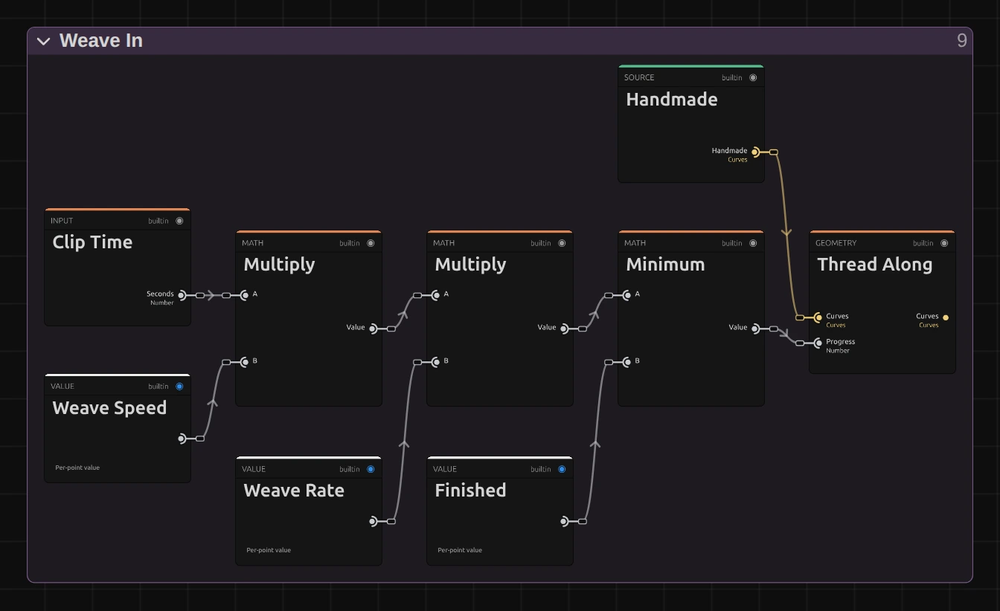
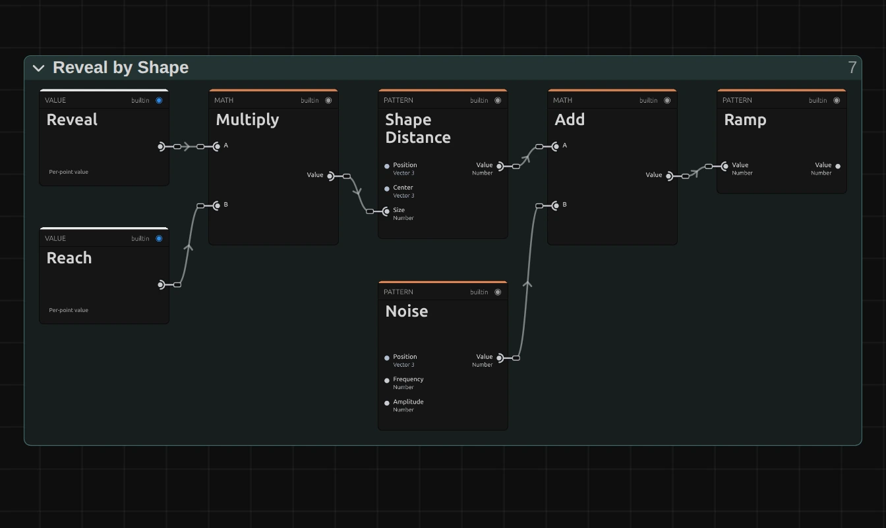
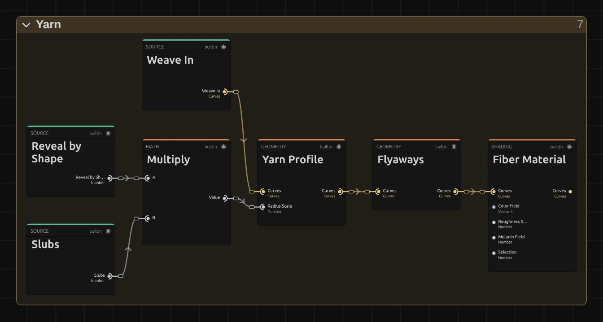
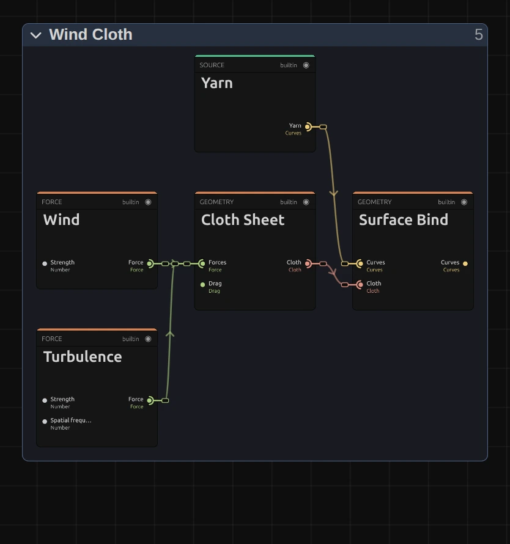

# Weave

Draws threads of yarn in 3D: a net that weaves itself in, or a knitted jellyfish with pulsing ribbons. It draws its own picture above the clip, so put it on a black or transparent clip, or over footage as a veil.

Group: [3D & Particles](../Effects-3D-Particles.md) · [How to add an effect](../Effects.md#add-an-effect)

<figure class="docs-shot docs-clip docs-shot--float-left">
<video src="../assets/effects/clips/weave.mp4" poster="../assets/effects/clips/weave.webp" width="960" height="540" autoplay muted loop playsinline preload="none" aria-label="Weave on black at its default settings: grey wool threads are pulled in one by one, first the upright warps from the left, then the wefts row by row, until a woven sheet hangs turned three quarters to the camera and breathes in a light wind"></video>
<figcaption>Weave at its default settings, on black: the net is finished after four seconds.</figcaption>
</figure>

**Use it for:** a net or a veil that weaves itself in front of a performer · a slow, breathing creature of yarn (the **Qualle** preset) · textile and handmade looks in a projection.

- **Form** – a woven net or a knitted jellyfish.
- **Weave Speed** – how fast the threads are pulled in.
- **Reveal** – how much of the net has grown, from the middle out.
- **Color** – the colour of the yarn.

**Tip:** the net starts weaving with the clip. To start it on a cue, move the clip there; to grow it from the middle instead, keyframe **Reveal** from 0 to 1.

## Presets

<figure class="docs-shot docs-clip">
<video src="../assets/effects/clips/weave-presets.mp4" poster="../assets/effects/clips/weave-presets.webp" width="962" height="646" autoplay muted loop playsinline preload="none" aria-label="Four Weave presets on black in a grid, in sync: Burlap top left, a pale, coarse and crooked weave whose corners have frayed away; Red Sail top right, an even red cloth that bows and sways in strong gusts; Nest bottom left, a round patch of brown, fuzzy wool; Qualle bottom right, a cream knitted jellyfish whose bell pulses and whose long ribbons curl"></video>
<figcaption>The four presets on black, in sync.</figcaption>
</figure>

Pick one in the **Preset** row of the effect card. It sets all controls at once, in one undo step, and the row then shows its name until you change something. A control with keyframes keeps them, and the card says so.

**Burlap** – pale, coarse yarn in a crooked weave: the threads wander and bunch, leaving uneven gaps, and the corners have frayed away, so it reads as a rough, torn piece of sacking. It weaves itself in a little faster than the default and drifts in a light wind.

**Red Sail** – an even, deep red cloth in strong wind: it bows to one side and sways with each gust. It is woven in after two seconds; strong on a dark stage and under warm light.

**Nest** – only a round patch of brown wool grows, very uneven, with a swollen, frayed rim. It looks like a bird's nest or a woven basket seen from above.

**Qualle** – a knitted bell of cream yarn with long ribbons below it. The bell pulses slowly and the ribbons curl at their ends, like a jellyfish drifting in place. It is the ribbon motion of the MasterSelects animation *Qualle* (German for jellyfish).

## Controls

<figure class="docs-shot docs-shot--float-right">

<svg class="docs-shot-overlay" viewBox="0 0 590 876" aria-hidden="true" focusable="false">
<defs><marker id="weave-inspector-arrow" viewBox="0 0 10 10" refX="8" refY="5" markerWidth="5" markerHeight="5" orient="auto-start-reverse"><path d="M 0 0 L 10 5 L 0 10 Z" fill="#ffd54a" /></marker></defs>
<path class="docs-shot-arrow" d="M125 102 L209 102" marker-end="url(#weave-inspector-arrow)" />
<circle class="docs-shot-number" cx="125" cy="102" r="18" /><text x="125" y="102" class="docs-shot-number-text">1</text>
<path class="docs-shot-arrow" d="M135 166 L219 166" marker-end="url(#weave-inspector-arrow)" />
<circle class="docs-shot-number" cx="135" cy="166" r="18" /><text x="135" y="166" class="docs-shot-number-text">2</text>
<path class="docs-shot-arrow" d="M158 463 L242 463" marker-end="url(#weave-inspector-arrow)" />
<circle class="docs-shot-number" cx="158" cy="463" r="18" /><text x="158" y="463" class="docs-shot-number-text">3</text>
<path class="docs-shot-arrow" d="M173 760 L257 760" marker-end="url(#weave-inspector-arrow)" />
<circle class="docs-shot-number" cx="173" cy="760" r="18" /><text x="173" y="760" class="docs-shot-number-text">4</text>
<path class="docs-shot-arrow" d="M88 817 L172 817" marker-end="url(#weave-inspector-arrow)" />
<circle class="docs-shot-number" cx="88" cy="817" r="18" /><text x="88" y="817" class="docs-shot-number-text">5</text>
</svg>

<figcaption>Weave with the Nest preset. 1 — Preset: pick a starting point. 2 — Form: the net or the jellyfish. 3 — Reveal: a round patch at 0.32. 4 — Wind. 5 — Qualle controls: folded, they act on the Qualle only.</figcaption>
</figure>

**Preset** – sets every control at once to one of the looks above.

### Form and color

**Form** – which structure Weave draws. **Woven Cloth** is a sheet of plain-woven wool, about two thirds of the frame wide and turned three quarters to the camera, that weaves itself in over the first seconds of the clip and then hangs in a light wind. **Qualle** is a knitted jellyfish standing upright in the frame, whose bell pulses and whose ribbons curl. Each form has its own controls below; the controls of the other form wait folded in one closed section at the end of the card (**Qualle controls** or **Woven Cloth controls**). Once you change the node setup in the Nodes tab, Form leaves the card. Woven Cloth, Qualle, default Woven Cloth.

**Color** – the colour of the yarn. It is lit like wool, so the threads are darker in the shadows and catch a soft highlight; pale colours read best on black, a deep red or blue glows under stage light. Both forms use it: a colour, default `#8a857c`.

### Weave In

<figure class="docs-shot docs-clip">
<video src="../assets/effects/clips/weave-weave-speed.mp4" poster="../assets/effects/clips/weave-weave-speed.webp" width="960" height="212" autoplay muted loop playsinline preload="none" aria-label="The grey net weaving itself in at three speeds side by side, in sync from the clip start: at Weave Speed 0.5 about half the warps are in after four seconds, at 1 the net is finished after four seconds, at 2.5 after about one and a half"></video>
<figcaption>Weave Speed 0.5, 1 and 2.5, each from the clip start.</figcaption>
</figure>

**Weave Speed** – how fast the threads are pulled into the sheet, warps first, then the wefts row by row. At 1 the net is finished after four seconds, at 2.5 after about one and a half, at 0.5 after eight; at 0 the sheet stays empty. The weave runs with the playhead from the start of the clip, so scrubbing and the export show the same moment. Keyframing it makes the net jump, because the speed multiplies the time since the clip started: to start later, move the clip. 0 to 10, default 1.

### Reveal by Shape

<figure class="docs-shot docs-clip docs-shot--float-right">
<video src="../assets/effects/clips/weave-reveal.mp4" poster="../assets/effects/clips/weave-reveal.webp" width="640" height="360" autoplay muted loop playsinline preload="none" aria-label="The grey net while Reveal runs from 0 to 1 and back: a small round patch with a frayed rim grows from the middle until the whole sheet is there, then shrinks to nothing; the current value is shown at the bottom left"></video>
<figcaption>Reveal from 0 to 1 and back.</figcaption>
</figure>

**Reveal** – how much of the net exists, as a sphere growing from its middle. Below 1 only a round patch is there, with a swollen, frayed rim where it grows; 0.3 gives a small disc, 0.6 rounds off the corners, 1 shows the whole sheet. Keyframe it from 0 to 1 for a net that grows out of nothing. 0 to 1, default 1.

### Handmade

<figure class="docs-shot docs-clip docs-shot--float-right">
<video src="../assets/effects/clips/weave-irregularity.mp4" poster="../assets/effects/clips/weave-irregularity.webp" width="640" height="360" autoplay muted loop playsinline preload="none" aria-label="The grey net while Irregularity runs from 0 to 3 and back: the even grid turns crooked, the threads wander and bunch with uneven gaps and thick, fuzzy places, then it straightens again; the current value is shown at the bottom left"></video>
<figcaption>Irregularity from 0 to 3 and back.</figcaption>
</figure>

**Irregularity** – how hand-made the cloth looks. At 0 the threads run straight and evenly spaced, like machine linen; 1 lets them meander a little, pull with uneven tension and thicken in places. The wander grows with the square of the value: 2 is clearly uneven, and at 3 the threads bend and bunch so the gaps between them differ by more than half, a loose, crooked net. 0 to 3, default 1.

### Wind Cloth

<figure class="docs-shot docs-clip docs-shot--float-right">
<video src="../assets/effects/clips/weave-wind.mp4" poster="../assets/effects/clips/weave-wind.webp" width="640" height="360" autoplay muted loop playsinline preload="none" aria-label="The grey net, turned three quarters, at three wind strengths, two and a half seconds each: at Wind 0 it hangs flat and still, at 0.5 it bows gently and breathes with the gusts, at 2 it bellies out hard and its free edges sway; the value is shown at the bottom left"></video>
<figcaption>Wind 0, 0.5 and 2, two and a half seconds each.</figcaption>
</figure>

**Wind** – how hard the wind blows into the sheet, which is held at its four corners. Because the sheet is turned three quarters to the camera, its bellying shows as a sideways bow of the threads, and the gusts make it breathe. At 0 it hangs flat and still; 0.5 bows it gently; at 2 it bellies out hard and its free edges sway with every gust. The bow grows quickly at first and then slowly, because the corners hold the cloth: above 1 it mostly gusts harder. The sheet's motion is simulated from the start of the clip, and keyframes on Wind act inside that simulation: a gust you key in builds up, the cloth swings out and settles again, as in real air. Dragging Wind with the playhead far into the clip takes a moment per step, because the cloth is simulated again from the start. Values beyond the slider (from tools) are drawn and named in the card. 0 to 2, default 0.35.

### Jellyfish Pulse

<figure class="docs-shot docs-clip">
<video src="../assets/effects/clips/weave-pulse-rate.mp4" poster="../assets/effects/clips/weave-pulse-rate.webp" width="840" height="440" autoplay muted loop playsinline preload="none" aria-label="The Qualle jellyfish at three pulse rates side by side, in sync: at 0 the bell stays still and only the ribbons drift, at 0.4 Hz it contracts slowly, at 1.2 Hz quickly"></video>
<figcaption>Pulse Rate 0, 0.4 and 1.2 Hz, side by side.</figcaption>
</figure>

**Pulse Rate** – how often the bell contracts, in pulses per second. 0.4 is a slow, calm breath, about one pulse every two and a half seconds; 1.2 and more looks hurried. At 0 the jellyfish holds still and only its ribbons drift. Like Weave Speed, it multiplies the time since the clip started, so keyframing it makes the pulse jump. 0 to 2 Hz, default 0.4 Hz.

<figure class="docs-shot docs-clip docs-shot--float-right">
<video src="../assets/effects/clips/weave-pulse-size.mp4" poster="../assets/effects/clips/weave-pulse-size.webp" width="440" height="654" autoplay muted loop playsinline preload="none" aria-label="The Qualle jellyfish while Pulse Size runs from 0 to 0.6 and back: the round bell starts to contract and stretch the body with each pulse, more and more, then calms again; the value is shown at the bottom left"></video>
<figcaption>Pulse Size from 0 to 0.6 and back.</figcaption>
</figure>

**Pulse Size** – how strongly the bell contracts and the body stretches with each pulse. At 0 the bell stays round; 0.3 is a gentle breath, 0.54 the full swimming stroke of the Qualle. 0 to 0.6, default 0.54.

### Return Curls

<figure class="docs-shot docs-clip docs-shot--float-right">
<video src="../assets/effects/clips/weave-curl-strength.mp4" poster="../assets/effects/clips/weave-curl-strength.webp" width="480" height="554" autoplay muted loop playsinline preload="none" aria-label="The Qualle jellyfish while Curl Strength runs from 0 to 0.25 and back: the smooth hanging ribbons begin to swirl and loop outwards on both sides, then settle into calm loops again; the value is shown at the bottom left"></video>
<figcaption>Curl Strength from 0 to 0.25 and back.</figcaption>
</figure>

**Curl Strength** – how far the ribbons curl and swirl as they hang. At 0 they fall in smooth, calm loops; the default 0.063 gives a slow, organic drift; 0.15 throws them into wide loops on both sides, and 0.25, the end of the slider, is the widest swirl that still stays in the frame. The knitted bell stays untouched. 0 to 0.25, default 0.063.

## Node setup

<figure class="docs-shot docs-shot--graph">

<svg class="docs-shot-overlay" viewBox="0 0 1017 540" aria-hidden="true" focusable="false">
<defs><marker id="weave-arrow" viewBox="0 0 10 10" refX="8" refY="5" markerWidth="5" markerHeight="5" orient="auto-start-reverse"><path d="M 0 0 L 10 5 L 0 10 Z" fill="#ffd54a" /></marker></defs>
<path class="docs-shot-arrow" d="M427 22 L427 83" marker-end="url(#weave-arrow)" />
<circle class="docs-shot-number" cx="427" cy="22" r="18" /><text x="427" y="22" class="docs-shot-number-text">1</text>
<path class="docs-shot-arrow" d="M264 22 L264 94" marker-end="url(#weave-arrow)" />
<circle class="docs-shot-number" cx="264" cy="22" r="18" /><text x="264" y="22" class="docs-shot-number-text">2</text>
<path class="docs-shot-arrow" d="M589 420 L589 336" marker-end="url(#weave-arrow)" />
<circle class="docs-shot-number" cx="589" cy="420" r="18" /><text x="589" y="420" class="docs-shot-number-text">3</text>
<path class="docs-shot-arrow" d="M752 22 L752 94" marker-end="url(#weave-arrow)" />
<circle class="docs-shot-number" cx="752" cy="22" r="18" /><text x="752" y="22" class="docs-shot-number-text">4</text>
<path class="docs-shot-arrow" d="M427 518 L427 434" marker-end="url(#weave-arrow)" />
<circle class="docs-shot-number" cx="427" cy="518" r="18" /><text x="427" y="518" class="docs-shot-number-text">5</text>
</svg>

<figcaption>Weave (Woven Cloth) opened in the Nodes tab, the Output card left out. 1 — Weave In: pulls the threads in. 2 — Handmade: makes them uneven. 3 — Yarn: twists fibres around them. 4 — Wind Cloth: hangs them on a sheet in the wind, turned towards the camera. 5 — Reveal by Shape: how much of the net exists.</figcaption>
</figure>

Weave works in five stages, one folder each in the Nodes tab. **Weave Pattern** lays out the threads of a plain weave as curves; **Handmade** makes them uneven, **Weave In** pulls them in over the first seconds, **Yarn** twists fibres around them, and **Wind Cloth** hangs them on a sheet in the wind, turned three quarters to the camera. **Reveal by Shape** sets how thick the yarn is, so it decides how much of the net exists. **Strand Render** draws the result as lit fibres. Click a folder's header to open it; the sections below show what is inside. The **Qualle** form is a larger graph of its own, described at the end.

### Weave In

<figure class="docs-shot docs-shot--graph">

<svg class="docs-shot-overlay" viewBox="0 0 1017 622" aria-hidden="true" focusable="false">
<defs><marker id="weave-weave-in-arrow" viewBox="0 0 10 10" refX="8" refY="5" markerWidth="5" markerHeight="5" orient="auto-start-reverse"><path d="M 0 0 L 10 5 L 0 10 Z" fill="#ffd54a" /></marker></defs>
<path class="docs-shot-arrow" d="M314 504 L314 420" marker-end="url(#weave-weave-in-arrow)" />
<circle class="docs-shot-number" cx="314" cy="504" r="18" /><text x="314" y="504" class="docs-shot-number-text">1</text>
<path class="docs-shot-arrow" d="M703 504 L703 420" marker-end="url(#weave-weave-in-arrow)" />
<circle class="docs-shot-number" cx="703" cy="504" r="18" /><text x="703" y="504" class="docs-shot-number-text">2</text>
<path class="docs-shot-arrow" d="M897 145 L897 229" marker-end="url(#weave-weave-in-arrow)" />
<circle class="docs-shot-number" cx="897" cy="145" r="18" /><text x="897" y="145" class="docs-shot-number-text">3</text>
</svg>

<figcaption>Inside Weave In (Weave Speed). 1 — Multiply: seconds since the clip started, times Weave Speed. 2 — Minimum: the progress, at most 1. 3 — Thread Along: pulls each thread in.</figcaption>
</figure>

**Multiply** – the seconds since the clip started, times Weave Speed. The next Multiply scales it by **Weave Rate** 0.25, so at Weave Speed 1 the weave needs four seconds.

**Minimum** – keeps that progress at 1 (**Finished**) at most: once the net is done, it stays done, and the graph gives the same picture every frame after.

**Thread Along** – pulls every thread in along its path behind a tip that lifts off the sheet and settles with a soft swing: the upright warps first, then the wefts row by row. At progress 0 nothing is there, at 1 every thread lies in place.

**Remix:** set **Weave Rate** to 0.1: at Weave Speed 1 the net now takes ten seconds and you can watch every thread arrive.

### Reveal by Shape

<figure class="docs-shot docs-shot--graph">

<svg class="docs-shot-overlay" viewBox="0 0 1017 607" aria-hidden="true" focusable="false">
<defs><marker id="weave-reveal-by-shape-arrow" viewBox="0 0 10 10" refX="8" refY="5" markerWidth="5" markerHeight="5" orient="auto-start-reverse"><path d="M 0 0 L 10 5 L 0 10 Z" fill="#ffd54a" /></marker></defs>
<path class="docs-shot-arrow" d="M314 372 L314 288" marker-end="url(#weave-reveal-by-shape-arrow)" />
<circle class="docs-shot-number" cx="314" cy="372" r="18" /><text x="314" y="372" class="docs-shot-number-text">1</text>
<path class="docs-shot-arrow" d="M509 22 L509 96" marker-end="url(#weave-reveal-by-shape-arrow)" />
<circle class="docs-shot-number" cx="509" cy="22" r="18" /><text x="509" y="22" class="docs-shot-number-text">2</text>
<path class="docs-shot-arrow" d="M509 585 L509 501" marker-end="url(#weave-reveal-by-shape-arrow)" />
<circle class="docs-shot-number" cx="509" cy="585" r="18" /><text x="509" y="585" class="docs-shot-number-text">3</text>
<path class="docs-shot-arrow" d="M897 22 L897 96" marker-end="url(#weave-reveal-by-shape-arrow)" />
<circle class="docs-shot-number" cx="897" cy="22" r="18" /><text x="897" y="22" class="docs-shot-number-text">4</text>
</svg>

<figcaption>Inside Reveal by Shape (Reveal). 1 — Multiply: the sphere radius. 2 — Shape Distance: how far each point lies from the sphere. 3 — Noise: a ragged edge. 4 — Ramp: thickness from that distance.</figcaption>
</figure>

**Multiply** – Reveal times **Reach** 1.15, the radius of the sphere at Reveal 1: just past the corners of the sheet, so the whole range of Reveal grows the net.

**Shape Distance** – how far each point of the threads lies from the surface of a sphere in the middle of the sheet: negative inside, positive outside.

**Noise** – added to that distance, so the edge of the growing patch is ragged instead of a perfect circle.

**Ramp** – turns the distance into a thickness for the yarn: 1 well inside, 1.6 right at the edge (the swollen, frayed rim), 0 outside, where the yarn disappears.

### Handmade

<figure class="docs-shot docs-shot--graph">

<svg class="docs-shot-overlay" viewBox="0 0 1017 663" aria-hidden="true" focusable="false">
<defs><marker id="weave-handmade-arrow" viewBox="0 0 10 10" refX="8" refY="5" markerWidth="5" markerHeight="5" orient="auto-start-reverse"><path d="M 0 0 L 10 5 L 0 10 Z" fill="#ffd54a" /></marker></defs>
<path class="docs-shot-arrow" d="M264 108 L264 192" marker-end="url(#weave-handmade-arrow)" />
<circle class="docs-shot-number" cx="264" cy="108" r="18" /><text x="264" y="108" class="docs-shot-number-text">1</text>
<path class="docs-shot-arrow" d="M589 108 L589 192" marker-end="url(#weave-handmade-arrow)" />
<circle class="docs-shot-number" cx="589" cy="108" r="18" /><text x="589" y="108" class="docs-shot-number-text">2</text>
<path class="docs-shot-arrow" d="M752 431 L752 347" marker-end="url(#weave-handmade-arrow)" />
<circle class="docs-shot-number" cx="752" cy="431" r="18" /><text x="752" y="431" class="docs-shot-number-text">3</text>
<path class="docs-shot-arrow" d="M914 108 L914 192" marker-end="url(#weave-handmade-arrow)" />
<circle class="docs-shot-number" cx="914" cy="108" r="18" /><text x="914" y="108" class="docs-shot-number-text">4</text>
</svg>

<figcaption>Inside Handmade (Irregularity), the meander path. 1 — Multiply: Irregularity squared, then times Wobble Scale. 2 — Noise: a smooth wander along each thread. 3 — Combine Vector: joins the three offsets. 4 — Set Position: moves the threads.</figcaption>
</figure>

**Multiply** – Irregularity times itself, then the second Multiply times **Wobble Scale** 0.008: how far, in scene units, a thread may wander from its straight path. Squaring keeps 1 at the familiar look and makes 3 nine times as uneven.

**Noise** – a smooth, slow noise read at each place along the thread, different for every thread, so neighbouring threads wander apart and the spacing turns uneven.

**Combine Vector** – joins that sideways wander with the same wander up and down and with the **Crimp**: a per-thread tension, also scaled by Irregularity squared, that makes some threads arch more over and under than others.

**Set Position** – moves every point of the woven curves by that offset. A third path, not shown, swells the yarn in places (**Slubs**) and goes to Yarn.

### Yarn

<figure class="docs-shot docs-shot--graph">

<svg class="docs-shot-overlay" viewBox="0 0 1017 543" aria-hidden="true" focusable="false">
<defs><marker id="weave-yarn-arrow" viewBox="0 0 10 10" refX="8" refY="5" markerWidth="5" markerHeight="5" orient="auto-start-reverse"><path d="M 0 0 L 10 5 L 0 10 Z" fill="#ffd54a" /></marker></defs>
<path class="docs-shot-arrow" d="M314 504 L314 420" marker-end="url(#weave-yarn-arrow)" />
<circle class="docs-shot-number" cx="314" cy="504" r="18" /><text x="314" y="504" class="docs-shot-number-text">1</text>
<path class="docs-shot-arrow" d="M509 145 L509 229" marker-end="url(#weave-yarn-arrow)" />
<circle class="docs-shot-number" cx="509" cy="145" r="18" /><text x="509" y="145" class="docs-shot-number-text">2</text>
<path class="docs-shot-arrow" d="M703 445 L703 361" marker-end="url(#weave-yarn-arrow)" />
<circle class="docs-shot-number" cx="703" cy="445" r="18" /><text x="703" y="445" class="docs-shot-number-text">3</text>
<path class="docs-shot-arrow" d="M897 145 L897 229" marker-end="url(#weave-yarn-arrow)" />
<circle class="docs-shot-number" cx="897" cy="145" r="18" /><text x="897" y="145" class="docs-shot-number-text">4</text>
</svg>

<figcaption>Inside Yarn (Color). 1 — Multiply: the yarn thickness. 2 — Yarn Profile: plies and fibres twisted around each thread. 3 — Flyaways: stray hairs. 4 — Fiber Material: the colour and sheen of wool.</figcaption>
</figure>

**Multiply** – the thickness from Reveal by Shape times the Slubs from Handmade: where the net is hidden the yarn has no thickness, at the edge it swells.

**Yarn Profile** – turns every thread into three plies of five twisted fibres, 0.028 scene units thick, so it reads as spun yarn rather than a line.

**Flyaways** – stray hairs and small loops that stand off the yarn, the fuzz that makes it look like wool.

**Fiber Material** – lights the fibres like wool, in the card's Color.

**Remix:** in **Yarn Profile**, set Plies to 1 and Fibers to 1: the net turns into smooth, plastic-looking cord.

### Wind Cloth

<figure class="docs-shot docs-shot--float-right">

<svg class="docs-shot-overlay" viewBox="0 0 590 630" aria-hidden="true" focusable="false">
<defs><marker id="weave-wind-cloth-arrow" viewBox="0 0 10 10" refX="8" refY="5" markerWidth="5" markerHeight="5" orient="auto-start-reverse"><path d="M 0 0 L 10 5 L 0 10 Z" fill="#ffd54a" /></marker></defs>
<path class="docs-shot-arrow" d="M112 425 L112 341" marker-end="url(#weave-wind-cloth-arrow)" />
<circle class="docs-shot-number" cx="112" cy="425" r="18" /><text x="112" y="425" class="docs-shot-number-text">1</text>
<path class="docs-shot-arrow" d="M112 608 L112 524" marker-end="url(#weave-wind-cloth-arrow)" />
<circle class="docs-shot-number" cx="112" cy="608" r="18" /><text x="112" y="608" class="docs-shot-number-text">2</text>
<path class="docs-shot-arrow" d="M295 132 L295 216" marker-end="url(#weave-wind-cloth-arrow)" />
<circle class="docs-shot-number" cx="295" cy="132" r="18" /><text x="295" y="132" class="docs-shot-number-text">3</text>
<path class="docs-shot-arrow" d="M478 132 L478 216" marker-end="url(#weave-wind-cloth-arrow)" />
<circle class="docs-shot-number" cx="478" cy="132" r="18" /><text x="478" y="132" class="docs-shot-number-text">4</text>
</svg>

<figcaption>Inside Wind Cloth (Wind). 1 — Wind. 2 — Turbulence. 3 — Cloth Sheet: the simulated sail. 4 — Surface Bind: lays the net on it.</figcaption>
</figure>

**Wind** – a steady wind with gusts, blowing into the sheet; its strength is the card's Wind.

**Turbulence** – a swirling force that makes the sheet ripple unevenly.

**Cloth Sheet** – a simulated sail of 40 × 24 cells, held at its four corners. It is simulated from the start of the clip, so every frame shows the shape the wind has given it by then. Its **Turn** of 32° turns the finished sheet about its upright axis: head-on, the bellying would run straight at the camera and hardly show; turned, it bows the threads sideways. Turn does not change the motion itself.

**Surface Bind** – places the woven curves on the moving sheet, so the net bellies out and sways with it.

**Remix:** select **Cloth Sheet** and set **Turn** to 70: the sheet stands almost edge-on and the wind makes it ripple like a flag; 0 shows it head-on, as Weaves saved before Turn existed do.

### Qualle form

The **Qualle** form is a graph of about 160 nodes in nine folders: **Closed Knit Body** knits the bell and the closed courses of yarn, **Tail Shape** draws the loose loops in behind it, **Loose Returns**, **Return Length** and **Return Curls** let the ribbons wander and curl on both sides, **Jellyfish Pulse** contracts the bell and sends the wave down the body, **Soft Head & Yarn Motion** keeps it breathing, **Cream Yarn** gives it its fibres, and **Upright Pose** stands it up in the frame. Its folders share many values, so even with every folder closed its overview in the Nodes tab is a dense web of cables; the three folders that hold the card controls and the pose follow, each on its own. It is the ribbon motion of the animation *Qualle*, and only the ribbon values were taken over (the piece's metamorphosis, scan overlay and particle wake were left out).

### Jellyfish Pulse

<figure class="docs-shot docs-shot--graph">

<svg class="docs-shot-overlay" viewBox="0 0 1017 452" aria-hidden="true" focusable="false">
<defs><marker id="weave-jellyfish-pulse-arrow" viewBox="0 0 10 10" refX="8" refY="5" markerWidth="5" markerHeight="5" orient="auto-start-reverse"><path d="M 0 0 L 10 5 L 0 10 Z" fill="#ffd54a" /></marker></defs>
<path class="docs-shot-arrow" d="M292 22 L292 85" marker-end="url(#weave-jellyfish-pulse-arrow)" />
<circle class="docs-shot-number" cx="292" cy="22" r="18" /><text x="292" y="22" class="docs-shot-number-text">1</text>
<path class="docs-shot-arrow" d="M617 252 L617 168" marker-end="url(#weave-jellyfish-pulse-arrow)" />
<circle class="docs-shot-number" cx="617" cy="252" r="18" /><text x="617" y="252" class="docs-shot-number-text">2</text>
<path class="docs-shot-arrow" d="M941 281 L941 197" marker-end="url(#weave-jellyfish-pulse-arrow)" />
<circle class="docs-shot-number" cx="941" cy="281" r="18" /><text x="941" y="281" class="docs-shot-number-text">3</text>
<path class="docs-shot-arrow" d="M184 406 L184 322" marker-end="url(#weave-jellyfish-pulse-arrow)" />
<circle class="docs-shot-number" cx="184" cy="406" r="18" /><text x="184" y="406" class="docs-shot-number-text">4</text>
</svg>

<figcaption>Inside Jellyfish Pulse (Pulse Rate, Pulse Size), the beat. 1 — Fraction: the place within one pulse. 2 — Cosine: a smooth wave. 3 — Power: a short, sharp contraction. 4 — Multiply: Pulse Size times Beat on the Bell.</figcaption>
</figure>

**Fraction** – the pulses counted so far (Clip Time times **Pulse Rate**) without their whole part: where the bell is within the current pulse, from 0 to 1. Further down the body the phase starts a little later (**Delay down the Body**), so the contraction runs down the ribbons as a wave.

**Cosine** – turns that phase into a smooth rise and fall.

**Power** – sharpens the wave into a short contraction followed by a long, slow release, the rhythm of a swimming jellyfish. Its exponent and the card that uses the beat lie outside this picture.

**Multiply** – **Pulse Size** times how close a point is to the bell (**Beat on the Bell**): how strongly each point follows the beat. Further on, outside this picture, the beat from Power is multiplied by it, which pulls the bell in and stretches the body.

### Return Curls

<figure class="docs-shot docs-shot--graph">

<svg class="docs-shot-overlay" viewBox="0 0 1017 787" aria-hidden="true" focusable="false">
<defs><marker id="weave-return-curls-arrow" viewBox="0 0 10 10" refX="8" refY="5" markerWidth="5" markerHeight="5" orient="auto-start-reverse"><path d="M 0 0 L 10 5 L 0 10 Z" fill="#ffd54a" /></marker></defs>
<path class="docs-shot-arrow" d="M314 497 L314 413" marker-end="url(#weave-return-curls-arrow)" />
<circle class="docs-shot-number" cx="314" cy="497" r="18" /><text x="314" y="497" class="docs-shot-number-text">1</text>
<path class="docs-shot-arrow" d="M509 438 L509 354" marker-end="url(#weave-return-curls-arrow)" />
<circle class="docs-shot-number" cx="509" cy="438" r="18" /><text x="509" y="438" class="docs-shot-number-text">2</text>
<path class="docs-shot-arrow" d="M509 267 L509 183" marker-end="url(#weave-return-curls-arrow)" />
<circle class="docs-shot-number" cx="509" cy="267" r="18" /><text x="509" y="267" class="docs-shot-number-text">3</text>
<path class="docs-shot-arrow" d="M703 138 L703 222" marker-end="url(#weave-return-curls-arrow)" />
<circle class="docs-shot-number" cx="703" cy="138" r="18" /><text x="703" y="138" class="docs-shot-number-text">4</text>
</svg>

<figcaption>Inside Return Curls (Curl Strength), the curl amount. 1 — Divide: the place along the body, 0 at the bell. 2 — Ramp: no curls on the bell, full curls below it. 3 — Curl Strength: the card's control. 4 — Multiply: how far the ribbons swirl.</figcaption>
</figure>

**Divide** – the place of each point along the body, divided by the body length: 0 at the bell, 1 at the end of the ribbons.

**Ramp** – keeps the bell free of curls and fades them in below it, so the knitted bell stays still while the ribbons swirl.

**Curl Strength** – the card's control (0.063 in the piece).

**Multiply** – Curl Strength times the Ramp: how far an evolving curl noise may push each point. Two more Multiply cards split it between the outgoing and the incoming side of the ribbons, so they curl on both sides.

### Upright Pose

<figure class="docs-shot docs-shot--graph">

<svg class="docs-shot-overlay" viewBox="0 0 1017 618" aria-hidden="true" focusable="false">
<defs><marker id="weave-upright-pose-arrow" viewBox="0 0 10 10" refX="8" refY="5" markerWidth="5" markerHeight="5" orient="auto-start-reverse"><path d="M 0 0 L 10 5 L 0 10 Z" fill="#ffd54a" /></marker></defs>
<path class="docs-shot-arrow" d="M228 248 L228 164" marker-end="url(#weave-upright-pose-arrow)" />
<circle class="docs-shot-number" cx="228" cy="248" r="18" /><text x="228" y="248" class="docs-shot-number-text">1</text>
<path class="docs-shot-arrow" d="M374 379 L374 463" marker-end="url(#weave-upright-pose-arrow)" />
<circle class="docs-shot-number" cx="374" cy="379" r="18" /><text x="374" y="379" class="docs-shot-number-text">2</text>
<path class="docs-shot-arrow" d="M665 442 L665 358" marker-end="url(#weave-upright-pose-arrow)" />
<circle class="docs-shot-number" cx="665" cy="442" r="18" /><text x="665" y="442" class="docs-shot-number-text">3</text>
<path class="docs-shot-arrow" d="M934 153 L934 237" marker-end="url(#weave-upright-pose-arrow)" />
<circle class="docs-shot-number" cx="934" cy="153" r="18" /><text x="934" y="153" class="docs-shot-number-text">4</text>
</svg>

<figcaption>Inside Upright Pose. 1 — Split Vector: each point's X, Y and Z. 2 — Multiply: the body's length becomes its height. 3 — Combine Vector: the upright point. 4 — Set Position: stands the jellyfish up.</figcaption>
</figure>

**Split Vector** – takes each point of the jellyfish body apart into X, Y and Z. The piece lies along its length; the Qualle form stands it up itself, because a preset cannot carry a clip transform.

**Multiply** – the body's length becomes its height, scaled by **Scale** 0.42 so the jellyfish is about three quarters of the frame tall; the other two Multiply cards scale its width by the same Scale and turn its height into depth with **Flipped Scale** −0.42.

**Combine Vector** – puts the point back together, raised by **Lift** 0.22 (the **Add** card before it), so the bell sits near the top of the frame and the ribbons hang below it.

**Set Position** – moves every point of the body there, before the yarn is twisted around it.

## Technical details

- **Size.** The sheet is 1.6 × 0.96 scene units, about two thirds of the frame wide with the default camera; the Qualle stands about three quarters of the frame tall. Scale and move them with the clip's Transform.
- **Time.** Weave runs in the time of its clip: the weave-in, the wind and the pulse start at the clip's start, and trimming or splitting the clip continues the motion instead of restarting it. Preview, scrubbing and export show the same frame for the same moment.
- **Transparency.** The threads are drawn as an extra 3D layer above the clip with the clip's transform and blend mode; around them the clip shows through. On a transparent clip only the threads remain.
- **Saved projects.** A Weave keeps the graph it was saved with. While that graph is one of the two forms as they are now, Form keeps working, and moving cards, renaming or folding folders in the Nodes tab is kept until you switch Form. Once you change the node setup in the Nodes tab, or switch a folder off with the switch in its card section, the graph is the Weave's own: Form leaves the card and only the controls that graph uses stay. Weaves saved before Form existed keep their look this way, with their Reveal, Weave Speed and Irregularity. Such a Weave, or one built from another built-in graph such as Jellyfish, has no Form, so the presets can change little or nothing on it; the card says so. Its own exposed values keep the graph's names and ranges.
- **3D scene.** After adding the effect the preview can show "Preparing 3D scene" for a few seconds.
- **More:** [Weave](../Weave.md) (all nodes, knots, ropes and the other built-in Weave graphs) · [Node Catalog](../Node-Catalog.md#curve-graphs-weave) · [Styles and presets](../Effects.md#styles-and-presets).
