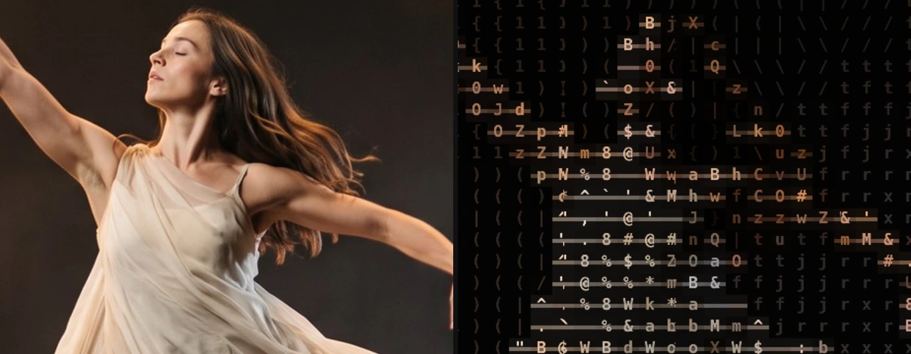

# Word Mosaic

<!-- effect-docs: basic page sha=2a2566a63edb, written by scripts/effect-docs.mjs. Delete this line to write the page by hand (template B in Documentation-Site.md). -->

Builds the image from rows of characters joined by thin connector strokes in brighter areas so they read like words; Cell Size sets letter size.

Group: [Text & Glyph](../Effects-Glyph.md) · [How to add an effect](../Effects.md#add-an-effect)

<figure class="docs-shot">

<figcaption>Left: the original. Right: Word Mosaic at its default settings. An enlarged detail, so the characters can be read.</figcaption>
</figure>

*A short page made from the editor’s effect catalog: what the effect does and its controls. Tips and its node setup will follow.*

## Controls

<!-- generated:controls start -->
| Control | Range | Default |
|---|---|---|
| **Grid** | | |
| Cell Size | 4 to 72 px | 22 px |
| **Style** | | |
| Amount | 0 to 1 | 1 |
| Background | 0 to 1 | 0.2 |
| Black Level | 0 to 0.9 | 0 |
| Invert Ramp | on or off | off |
| **Glyphs** | | |
| Ramp (Used while Custom Ramp is empty) | Standard, Detailed, Blocks, Bars, Binary and 2 more | Detailed |
| Custom Ramp | text | empty |
| Font | Monospace, Serif, Sans Serif | Monospace |
| Weight | 200 to 900 | 600 |
| **Color** | | |
| Color Source | Source, Duotone | Source |
| Dark (Used with Color Source Duotone) | a colour | `#081018` |
| Light (Used with Color Source Duotone) | a colour | `#e8fff5` |
<!-- generated:controls end -->

**Styles:** the **Style** menu in the effect card switches to another look of the same engine and keeps the values and keyframes: [ASCII](./ascii.md), [Brand Generator](./brand-generator.md), [Grid Glyph](./grid-glyph.md), [Inscribe](./inscribe.md), [Number Field](./number-field.md), [Pixel Code](./pixel-code.md), [Stitch Poster](./stitch-poster.md), [Contour Type](./contour-type.md).

## Technical details

Word Mosaic is one look of the glyph engine; its looks share one node setup. How effects are stored, rendered and exported: [Effect system](../Effect-System.md). Its building blocks: [Node Catalog](../Node-Catalog.md).
