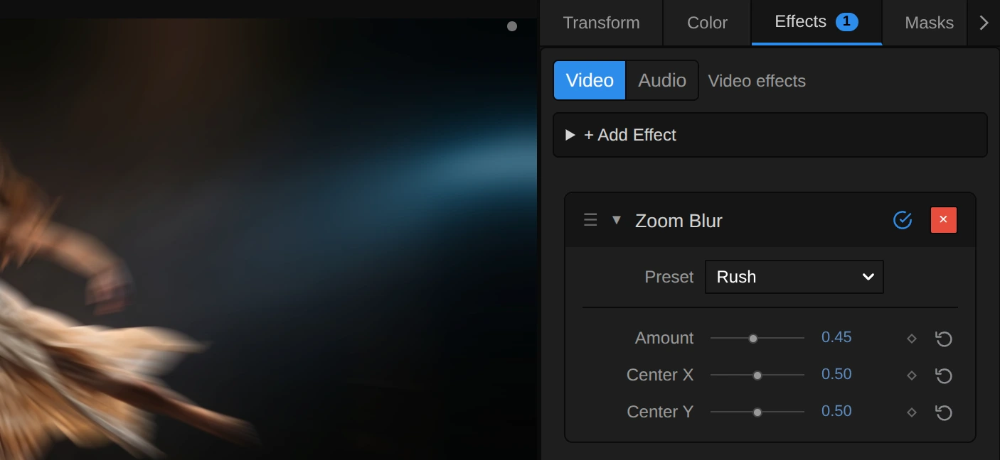

# Zoom Blur

Streaks the picture outward from a centre point, as if the camera rushed in while the shutter was open. A burst of speed.

Group: [Blur & Sharpen](../Effects-Blur.md) · [How to add an effect](../Effects.md#add-an-effect)

<figure class="docs-shot docs-compare docs-shot--float-left">

<figcaption>Left: original. Right: Amount 0.3.</figcaption>
</figure>

**Use it for:** an impact or a sudden reveal · a rush into the picture between two scenes · a tunnel of light around a performer.

- **Amount** – how long the streaks are.
- **Center X / Center Y** – where the burst starts.

**Tip:** keyframe Amount from 0 up to 0.3 and back over a few frames for a punch on a beat. For a softer zoom that fades towards the edges, use the Zoom type of [Radial Blur](./radial-blur.md).

## Presets

<figure class="docs-shot docs-shot--detail">

<figcaption>The four presets on the night street.</figcaption>
</figure>

Pick one in the **Preset** row of the effect card. It sets Amount and puts the centre back in the middle of the frame, in one undo step; the row shows its name until you change something. A control with keyframes keeps them, and the card says so.

**Push In** – Amount 0.08: the edges of the frame just begin to move while faces and text stay readable. A quiet push towards the middle, under a cut or a sound.

**Impact** – Amount 0.2: a clear jolt into the picture. For a hit on a beat; keyframe it for a few frames only.

**Rush** – Amount 0.45: long rays of light shoot out of the middle and only the centre stays recognisable. For the moment of a rush or a transition into the next scene.

**Light Speed** – Amount 0.9: everything but the very middle dissolves into rays. For a jump into another world; works best on dark pictures with bright points.

## Controls

<figure class="docs-shot">

<svg class="docs-shot-overlay" viewBox="0 0 1017 468" aria-hidden="true" focusable="false">
<defs><marker id="zoom-blur-inspector-arrow" viewBox="0 0 10 10" refX="8" refY="5" markerWidth="5" markerHeight="5" orient="auto-start-reverse"><path d="M 0 0 L 10 5 L 0 10 Z" fill="#ffd54a" /></marker></defs>
<path class="docs-shot-arrow" d="M565 282 L649 282" marker-end="url(#zoom-blur-inspector-arrow)" />
<circle class="docs-shot-number" cx="565" cy="282" r="18" /><text x="565" y="282" class="docs-shot-number-text">1</text>
<path class="docs-shot-arrow" d="M555 344 L639 344" marker-end="url(#zoom-blur-inspector-arrow)" />
<circle class="docs-shot-number" cx="555" cy="344" r="18" /><text x="555" y="344" class="docs-shot-number-text">2</text>
<path class="docs-shot-arrow" d="M547 382 L631 382" marker-end="url(#zoom-blur-inspector-arrow)" />
<circle class="docs-shot-number" cx="547" cy="382" r="18" /><text x="547" y="382" class="docs-shot-number-text">3</text>
<path class="docs-shot-arrow" d="M547 419 L631 419" marker-end="url(#zoom-blur-inspector-arrow)" />
<circle class="docs-shot-number" cx="547" cy="419" r="18" /><text x="547" y="419" class="docs-shot-number-text">4</text>
</svg>

<figcaption>Zoom Blur with the Rush preset. 1 — Preset: pick a starting point. 2 — Amount: how long the streaks are. 3 — Center X: where the burst starts across. 4 — Center Y: and up or down.</figcaption>
</figure>

**Preset** – a starting point for Amount; see [Presets](#presets).

**Amount** – how long the streaks are. Every pixel is averaged with the picture on the way out from it, away from the centre, over half of Amount times its distance from the centre: the middle stays sharp, the streaks grow towards the edges and every point along them counts the same. At the default 0.3 the corners of a 1080p frame streak about 165 px, at 0.1 about 55 px and at 1 about 550 px, where only the middle survives. Animated it changes smoothly, and 0 leaves the picture untouched. 0 to 1, default 0.3.

**Center X** – where the burst starts across the frame: 0 is the left edge, 0.5 the middle, 1 the right edge. The point under it stays sharp, and the streaks are longest at the corner farthest from it, so an off-centre point gives a lopsided rush. Keyframe it to follow a performer. 0 to 1, default 0.5.

**Center Y** – where the burst starts from top to bottom: 0 is the top edge, 0.5 the middle, 1 the bottom. Raise it to the height of a face to keep the face sharp. 0 to 1, default 0.5.

## Node setup

<figure class="docs-shot docs-shot--graph">

<svg class="docs-shot-overlay" viewBox="0 0 1017 454" aria-hidden="true" focusable="false">
<defs><marker id="zoom-blur-arrow" viewBox="0 0 10 10" refX="8" refY="5" markerWidth="5" markerHeight="5" orient="auto-start-reverse"><path d="M 0 0 L 10 5 L 0 10 Z" fill="#ffd54a" /></marker></defs>
<path class="docs-shot-arrow" d="M112 194 L196 194" marker-end="url(#zoom-blur-arrow)" />
<circle class="docs-shot-number" cx="112" cy="194" r="18" /><text x="112" y="194" class="docs-shot-number-text">1</text>
<path class="docs-shot-arrow" d="M274 118 L358 118" marker-end="url(#zoom-blur-arrow)" />
<circle class="docs-shot-number" cx="274" cy="118" r="18" /><text x="274" y="118" class="docs-shot-number-text">2</text>
<path class="docs-shot-arrow" d="M274 359 L358 359" marker-end="url(#zoom-blur-arrow)" />
<circle class="docs-shot-number" cx="274" cy="359" r="18" /><text x="274" y="359" class="docs-shot-number-text">3</text>
<path class="docs-shot-arrow" d="M437 307 L521 307" marker-end="url(#zoom-blur-arrow)" />
<circle class="docs-shot-number" cx="437" cy="307" r="18" /><text x="437" y="307" class="docs-shot-number-text">4</text>
<path class="docs-shot-arrow" d="M599 194 L683 194" marker-end="url(#zoom-blur-arrow)" />
<circle class="docs-shot-number" cx="599" cy="194" r="18" /><text x="599" y="194" class="docs-shot-number-text">5</text>
<path class="docs-shot-arrow" d="M762 161 L846 161" marker-end="url(#zoom-blur-arrow)" />
<circle class="docs-shot-number" cx="762" cy="161" r="18" /><text x="762" y="161" class="docs-shot-number-text">6</text>
</svg>

<figcaption>Zoom Blur opened in the Nodes tab (Constants, Coordinates and the Output card left out). 1 — Blur Range: how far the streak reaches. 2 — Tap Counts & Box Length: how to cut the streak into pieces. 3 — Premultiplied Source: the picture, ready to average. 4 — Stage A: averages one short piece. 5 — Stage B: adds up the pieces along the streak. 6 — Straight Alpha Output: back to a normal picture.</figcaption>
</figure>

Zoom Blur works in the six stages of [Motion Blur](./motion-blur.md#node-setup), one folder each in the Nodes tab; only the path of the streak differs: a ray out from the centre instead of a straight line. **Blur Range** turns Amount into the range of the streak, **Tap Counts & Box Length** cuts the longest streak into short pieces, and **Premultiplied Source** prepares the picture so transparent edges stay clean. **Stage A** averages one short piece of the ray around every pixel and caches it, **Stage B** reads that cache once per piece along the whole streak, and **Straight Alpha Output** turns the result back into a normal picture. Click a folder's header to open it.

### Blur Range

<figure class="docs-shot docs-shot--graph">

<svg class="docs-shot-overlay" viewBox="0 0 1017 882" aria-hidden="true" focusable="false">
<defs><marker id="zoom-blur-blur-range-arrow" viewBox="0 0 10 10" refX="8" refY="5" markerWidth="5" markerHeight="5" orient="auto-start-reverse"><path d="M 0 0 L 10 5 L 0 10 Z" fill="#ffd54a" /></marker></defs>
<path class="docs-shot-arrow" d="M112 586 L196 586" marker-end="url(#zoom-blur-blur-range-arrow)" />
<circle class="docs-shot-number" cx="112" cy="586" r="18" /><text x="112" y="586" class="docs-shot-number-text">1</text>
<path class="docs-shot-arrow" d="M112 424 L196 424" marker-end="url(#zoom-blur-blur-range-arrow)" />
<circle class="docs-shot-number" cx="112" cy="424" r="18" /><text x="112" y="424" class="docs-shot-number-text">2</text>
<path class="docs-shot-arrow" d="M437 451 L521 451" marker-end="url(#zoom-blur-blur-range-arrow)" />
<circle class="docs-shot-number" cx="437" cy="451" r="18" /><text x="437" y="451" class="docs-shot-number-text">3</text>
<path class="docs-shot-arrow" d="M599 430 L683 430" marker-end="url(#zoom-blur-blur-range-arrow)" />
<circle class="docs-shot-number" cx="599" cy="430" r="18" /><text x="599" y="430" class="docs-shot-number-text">4</text>
<path class="docs-shot-arrow" d="M762 430 L846 430" marker-end="url(#zoom-blur-blur-range-arrow)" />
<circle class="docs-shot-number" cx="762" cy="430" r="18" /><text x="762" y="430" class="docs-shot-number-text">5</text>
</svg>

<figcaption>Inside Blur Range, reduced to its recipe (how the farthest corner is found is left out). 1 — Length: the farthest corner. 2 — Multiply: how much farther out the streak reaches. 3 — Maximum: never past the centre. 4 — Natural Logarithm: the range of the streak. 5 — Absolute: the longest range.</figcaption>
</figure>

**Length** – the distance from the centre to the farthest corner of the frame, in pixels (Farthest (px)). The streak is longest there, so the later stages plan their reads for it.

**Multiply** – Amount times Zoom Scale Per Amount (0.5): how much farther out than the pixel the streak reaches, as a share of the pixel's distance from the centre. **Add** puts One in front of it: the End Scale, 1.15 at the default.

**Maximum** – keeps the End Scale at Min Scale 0.05 or above. That only matters for a negative Amount, which a keyframe overshoot or a tool can produce and which streaks inward: below −1.9 the streak would pass the centre, so it stops there, and the card and the tool result say so.

**Natural Logarithm** – the logarithm of the End Scale is the Range Length, so equal steps along the streak are equal steps in size, as in a real zoom. Zoom Blur's range is the same for every pixel; the streak in pixels grows with the distance from the centre because each step scales that distance.

**Absolute** – the Range Length without its sign: the Longest Range, which the tap counts are planned for, also when a negative Amount streaks inward.

**Remix:** for twice as long streaks, set the **Value** Zoom Scale Per Amount to 1. Amount 1 then streaks each pixel all the way out to twice its distance from the centre, beyond what the card's slider reaches.

### Tap Counts & Box Length

<figure class="docs-shot docs-shot--graph">

<svg class="docs-shot-overlay" viewBox="0 0 1017 749" aria-hidden="true" focusable="false">
<defs><marker id="zoom-blur-tap-counts-arrow" viewBox="0 0 10 10" refX="8" refY="5" markerWidth="5" markerHeight="5" orient="auto-start-reverse"><path d="M 0 0 L 10 5 L 0 10 Z" fill="#ffd54a" /></marker></defs>
<path class="docs-shot-arrow" d="M67 105 L151 105" marker-end="url(#zoom-blur-tap-counts-arrow)" />
<circle class="docs-shot-number" cx="67" cy="105" r="18" /><text x="67" y="105" class="docs-shot-number-text">1</text>
<path class="docs-shot-arrow" d="M311 162 L395 162" marker-end="url(#zoom-blur-tap-counts-arrow)" />
<circle class="docs-shot-number" cx="311" cy="162" r="18" /><text x="311" y="162" class="docs-shot-number-text">2</text>
<path class="docs-shot-arrow" d="M555 199 L639 199" marker-end="url(#zoom-blur-tap-counts-arrow)" />
<circle class="docs-shot-number" cx="555" cy="199" r="18" /><text x="555" y="199" class="docs-shot-number-text">3</text>
<path class="docs-shot-arrow" d="M798 178 L882 178" marker-end="url(#zoom-blur-tap-counts-arrow)" />
<circle class="docs-shot-number" cx="798" cy="178" r="18" /><text x="798" y="178" class="docs-shot-number-text">4</text>
</svg>

<figcaption>Inside Tap Counts & Box Length. 1 — Multiply: the longest streak in pixels. 2 — Square Root: the balance of both stages. 3 — Clamp: how many pieces. 4 — Maximum: how long one piece is.</figcaption>
</figure>

**Multiply** – the Longest Range times the distance to the farthest corner: about the longest streak anywhere in the frame, in pixels. At the default (Amount 0.3, centred) it is about 150 px in a 1080p frame, at Amount 1 about 450 px.

**Square Root** – the square root of twice that length. Cutting the streak into that many pieces gives both stages about the same work: 150 px become 18 pieces of about 9 px, so a pixel in the corner reads about 27 times instead of 150.

**Clamp** – rounds that up and keeps it between 1 and 64: the Coarse Taps, the most pieces Stage B reads.

**Maximum** – the Longest Range divided by the number of pieces: the Box Length, shared by every pixel. It is measured along the range, not in pixels, so a piece is longer far from the centre and shorter close to it, just like the streak. It never reaches 0, so a zero streak cannot divide by zero.

### Premultiplied Source

<figure class="docs-shot docs-shot--graph">

<svg class="docs-shot-overlay" viewBox="0 0 1017 377" aria-hidden="true" focusable="false">
<defs><marker id="zoom-blur-premultiplied-source-arrow" viewBox="0 0 10 10" refX="8" refY="5" markerWidth="5" markerHeight="5" orient="auto-start-reverse"><path d="M 0 0 L 10 5 L 0 10 Z" fill="#ffd54a" /></marker></defs>
<path class="docs-shot-arrow" d="M437 262 L521 262" marker-end="url(#zoom-blur-premultiplied-source-arrow)" />
<circle class="docs-shot-number" cx="437" cy="262" r="18" /><text x="437" y="262" class="docs-shot-number-text">1</text>
<path class="docs-shot-arrow" d="M762 134 L846 134" marker-end="url(#zoom-blur-premultiplied-source-arrow)" />
<circle class="docs-shot-number" cx="762" cy="134" r="18" /><text x="762" y="134" class="docs-shot-number-text">2</text>
</svg>

<figcaption>Inside Premultiplied Source (cached). 1 — Multiply: colour times transparency. 2 — Cache Image: keeps the prepared picture.</figcaption>
</figure>

**Multiply** – multiplies each pixel's colour by its alpha. A see-through pixel then adds almost nothing to the average, so the colour of its invisible part cannot smear into the streak as a dark rim around a cut-out figure or a title.

**Cache Image** – keeps the prepared picture in a 16-bit float texture for Stage A to read, so no precision is lost in dark areas.

### Stage A: Short Box

<figure class="docs-shot docs-shot--graph">

<svg class="docs-shot-overlay" viewBox="0 0 1017 788" aria-hidden="true" focusable="false">
<defs><marker id="zoom-blur-stage-a-arrow" viewBox="0 0 10 10" refX="8" refY="5" markerWidth="5" markerHeight="5" orient="auto-start-reverse"><path d="M 0 0 L 10 5 L 0 10 Z" fill="#ffd54a" /></marker></defs>
<path class="docs-shot-arrow" d="M67 298 L151 298" marker-end="url(#zoom-blur-stage-a-arrow)" />
<circle class="docs-shot-number" cx="67" cy="298" r="18" /><text x="67" y="298" class="docs-shot-number-text">1</text>
<path class="docs-shot-arrow" d="M433 675 L517 675" marker-end="url(#zoom-blur-stage-a-arrow)" />
<circle class="docs-shot-number" cx="433" cy="675" r="18" /><text x="433" y="675" class="docs-shot-number-text">2</text>
<path class="docs-shot-arrow" d="M67 192 L151 192" marker-end="url(#zoom-blur-stage-a-arrow)" />
<circle class="docs-shot-number" cx="67" cy="192" r="18" /><text x="67" y="192" class="docs-shot-number-text">3</text>
<path class="docs-shot-arrow" d="M555 347 L639 347" marker-end="url(#zoom-blur-stage-a-arrow)" />
<circle class="docs-shot-number" cx="555" cy="347" r="18" /><text x="555" y="347" class="docs-shot-number-text">4</text>
<path class="docs-shot-arrow" d="M798 330 L882 330" marker-end="url(#zoom-blur-stage-a-arrow)" />
<circle class="docs-shot-number" cx="798" cy="330" r="18" /><text x="798" y="330" class="docs-shot-number-text">5</text>
</svg>

<figcaption>Inside Stage A, reduced to its recipe (how the read offset and position are worked out is left out). 1 — Length: the distance from the centre. 2 — Clamp: reads per piece. 3 — Exponential: along the ray. 4 — Sequence Reduce: adds up the reads. 5 — Cache Image: keeps the short pieces.</figcaption>
</figure>

**Length** – the pixel's distance from the centre in pixels. Times the Box Length it gives how long this pixel's piece is: the farther out, the longer.

**Clamp** – that length rounded up, between 1 and 256: one read per pixel of the piece, so no pixel along it is skipped.

**Exponential** – turns each read's step along the range into a scale; **Multiply** scales the pixel's offset from the centre by it and **Add** puts it back at the centre. The reads therefore run along the ray through the centre. A read that falls outside the frame repeats the edge pixel; a mirrored edge, as in Motion Blur, would fold the path onto another ray.

**Sequence Reduce** – reads the Premultiplied Source at every position along the piece (**Sample Image**) and adds up the reads; Normalize by Weight turns the sum into an average.

**Cache Image** – keeps, for every pixel, the average of the short piece around it: the Short Boxes that Stage B reads.

### Stage B: Coarse Taps

<figure class="docs-shot docs-shot--graph">

![Inside the Stage B folder, reduced to its recipe: Streak length divided by Box Length gives the number of pieces; minus the Coarse Tap and clamped it gives the covered share, at least Covered Floor by Maximum the Box Weight; One times the Box Weight by Multiply gives the Tap Weight; the Read offset goes through Exponential and scales the Offset around the Centre; Sample Image reads the Short Boxes at the Read position, Sequence Reduce adds up the weighted reads over Taps Here and Normalize by Weight divides by the summed weight](../assets/effects/graphs/zoom-blur-stage-b.webp)

<svg class="docs-shot-overlay" viewBox="0 0 1017 688" aria-hidden="true" focusable="false">
<defs><marker id="zoom-blur-stage-b-arrow" viewBox="0 0 10 10" refX="8" refY="5" markerWidth="5" markerHeight="5" orient="auto-start-reverse"><path d="M 0 0 L 10 5 L 0 10 Z" fill="#ffd54a" /></marker></defs>
<path class="docs-shot-arrow" d="M67 312 L151 312" marker-end="url(#zoom-blur-stage-b-arrow)" />
<circle class="docs-shot-number" cx="67" cy="312" r="18" /><text x="67" y="312" class="docs-shot-number-text">1</text>
<path class="docs-shot-arrow" d="M311 333 L395 333" marker-end="url(#zoom-blur-stage-b-arrow)" />
<circle class="docs-shot-number" cx="311" cy="333" r="18" /><text x="311" y="333" class="docs-shot-number-text">2</text>
<path class="docs-shot-arrow" d="M555 271 L639 271" marker-end="url(#zoom-blur-stage-b-arrow)" />
<circle class="docs-shot-number" cx="555" cy="271" r="18" /><text x="555" y="271" class="docs-shot-number-text">3</text>
<path class="docs-shot-arrow" d="M67 436 L151 436" marker-end="url(#zoom-blur-stage-b-arrow)" />
<circle class="docs-shot-number" cx="67" cy="436" r="18" /><text x="67" y="436" class="docs-shot-number-text">4</text>
<path class="docs-shot-arrow" d="M676 310 L760 310" marker-end="url(#zoom-blur-stage-b-arrow)" />
<circle class="docs-shot-number" cx="676" cy="310" r="18" /><text x="676" y="310" class="docs-shot-number-text">5</text>
</svg>

<figcaption>Inside Stage B, reduced to its recipe (how the read offset and position are worked out is left out). 1 — Divide: how many pieces fit. 2 — Clamp: how much of a piece lies on the streak. 3 — Multiply: the weight of a read. 4 — Exponential: the next piece along the ray. 5 — Sequence Reduce: adds up the pieces.</figcaption>
</figure>

**Divide** – the Streak length divided by the Box Length: how many pieces fit on this pixel's streak. In Zoom Blur every pixel has the same range, so that is always the Coarse Taps; the blur still grows smoothly with Amount, because the pieces grow with it.

**Clamp** – how much of piece number Coarse Tap lies on the streak, between 0 and 1. Here every piece counts fully; the Clamp matters in Radial Blur's Zoom, whose streak differs from pixel to pixel, and after a remix of the range.

**Multiply** – One times the Box Weight: the Tap Weight of a read. Every piece along the streak counts the same, which gives Zoom Blur its hard, even rays; Radial Blur's Zoom puts a fade into this input instead.

**Exponential** – like in Stage A, turns the read's place along the range into a scale around the centre, so each tap lands one piece farther out on the ray.

**Sequence Reduce** – reads one cached short piece per tap (**Sample Image** on the Short Boxes), adds them up with their Tap Weights, and Normalize by Weight divides by the summed weight, so the streak keeps the picture's brightness.

### Straight Alpha Output

<figure class="docs-shot docs-shot--graph">

<svg class="docs-shot-overlay" viewBox="0 0 1017 409" aria-hidden="true" focusable="false">
<defs><marker id="zoom-blur-straight-alpha-arrow" viewBox="0 0 10 10" refX="8" refY="5" markerWidth="5" markerHeight="5" orient="auto-start-reverse"><path d="M 0 0 L 10 5 L 0 10 Z" fill="#ffd54a" /></marker></defs>
<path class="docs-shot-arrow" d="M437 132 L521 132" marker-end="url(#zoom-blur-straight-alpha-arrow)" />
<circle class="docs-shot-number" cx="437" cy="132" r="18" /><text x="437" y="132" class="docs-shot-number-text">1</text>
<path class="docs-shot-arrow" d="M599 294 L683 294" marker-end="url(#zoom-blur-straight-alpha-arrow)" />
<circle class="docs-shot-number" cx="599" cy="294" r="18" /><text x="599" y="294" class="docs-shot-number-text">2</text>
<path class="docs-shot-arrow" d="M762 177 L846 177" marker-end="url(#zoom-blur-straight-alpha-arrow)" />
<circle class="docs-shot-number" cx="762" cy="177" r="18" /><text x="762" y="177" class="docs-shot-number-text">3</text>
</svg>

<figcaption>Inside Straight Alpha Output. 1 — Maximum: never divide by zero. 2 — Divide: the colour back to full strength. 3 — Combine RGB + Alpha: the finished picture.</figcaption>
</figure>

**Maximum** – the averaged alpha, but never below the Coverage Floor, a tiny 0.000001 (the card rounds it to 0). Fully transparent pixels then stay black and transparent instead of turning into errors.

**Divide** – divides the averaged colour by the averaged alpha: the reverse of the Multiply in Premultiplied Source, so half-transparent streaks get their real colour back.

**Combine RGB + Alpha** – joins colour and alpha into the finished picture that leaves the effect.

## Technical details

- **Units.** Center X and Y are shares of the frame (0 to 1, from the top left). Each pixel reads from its own place out to 1 + Amount / 2 times its distance from the centre, with even weights, so the streak is Amount / 2 of that distance: 0 in the centre, about 550 px in the corners of a 1080p frame at Amount 1. At the same Amount the streak is about 3.5 times as long as that of [Radial Blur](./radial-blur.md)'s Zoom in the corners, and even more so near the centre.
- **Two stages.** About 2 × √(2 × longest streak in pixels) reads per pixel: Stage B reads up to 64 pieces, Stage A up to 256 pixels per piece. A streak beyond that (only on very large frames) reads its pieces further apart, and the card and the tool result say so.
- **Edges.** At the frame edge the picture is clamped, not mirrored. Because the reads look outward, a cut-out layer's edge pulls inward and gets soft instead of spreading; transparent edges keep their real colour without a dark rim, and the preview and the export match.
- **Below 0 and zero.** A negative Amount (from a keyframe overshoot or a tool) streaks inward, as in earlier versions, which looks like a zoom out; below −1.9 the streak stops at the centre and the card and the tool result say so. An unedited Zoom Blur at Amount 0 is skipped, so the picture passes through exactly.
- **Software preview.** Where the editor falls back to its software preview, Zoom Blur reads up to 64 taps along the same path in one stage; very long streaks can look stepped there, and the `SoftwareBlur` log says so.
- **Saved projects.** They keep their look. The old Samples value is kept in the project but no longer changes anything. A Zoom Blur whose node setup you edited keeps its own recipe.
- **More:** [Blur & Sharpen notes](../Effect-System.md#blur--sharpen-notes) · [Editable blur kernels](../Effect-System.md#editable-blur-kernels) · [Node Catalog](../Node-Catalog.md) · [Styles and presets](../Effects.md#styles-and-presets).
