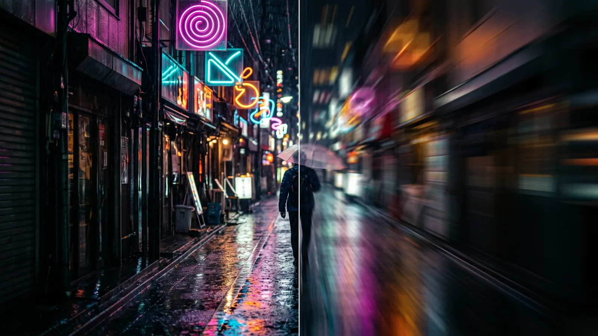
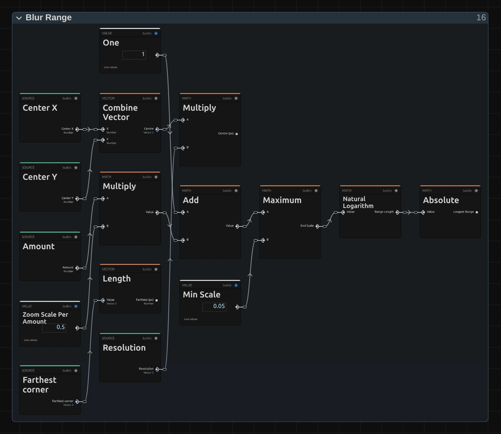
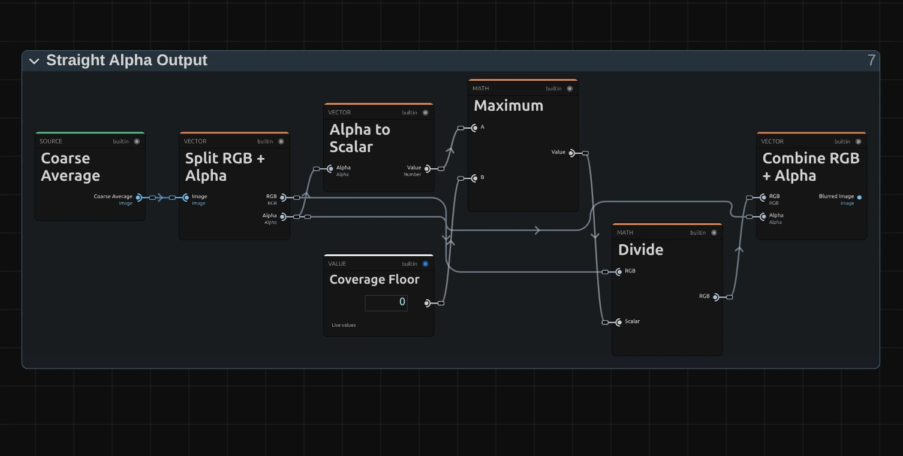

# Zoom Blur

Streaks the picture outward from a centre point, as if the camera rushed in while the shutter was open. A burst of speed.

Group: [Blur & Sharpen](../Effects-Blur.md) · [How to add an effect](../Effects.md#add-an-effect)

<figure class="docs-shot docs-compare docs-shot--float-left">

<figcaption>Left: original. Right: Amount 0.3.</figcaption>
</figure>

**Use it for:** an impact or a sudden reveal · a rush into the picture between two scenes · a tunnel of light around a performer.

- **Amount** – how long the streaks are.
- **Center X / Center Y** – where the burst starts.

**Tip:** keyframe Amount from 0 up to 0.3 and back over a few frames for a punch on a beat. For a softer zoom that fades towards the edges, use the Zoom type of [Radial Blur](./radial-blur.md).

## Presets

<figure class="docs-shot docs-shot--detail">

<figcaption>The four presets on the night street.</figcaption>
</figure>

Pick one in the **Preset** row of the effect card. It sets Amount and puts the centre back in the middle of the frame, in one undo step; the row shows its name until you change something. A control with keyframes keeps them, and the card says so.

**Push In** – Amount 0.08: the edges of the frame just begin to move while faces and text stay readable. A quiet push towards the middle, under a cut or a sound.

**Impact** – Amount 0.2: a clear jolt into the picture. For a hit on a beat; keyframe it for a few frames only.

**Rush** – Amount 0.45: long rays of light shoot out of the middle and only the centre stays recognisable. For the moment of a rush or a transition into the next scene.

**Light Speed** – Amount 0.9: everything but the very middle dissolves into rays. For a jump into another world; works best on dark pictures with bright points.

## Controls

<figure class="docs-shot">

<svg class="docs-shot-overlay" viewBox="0 0 1017 468" aria-hidden="true" focusable="false">
<defs><marker id="zoom-blur-inspector-arrow" viewBox="0 0 10 10" refX="8" refY="5" markerWidth="5" markerHeight="5" orient="auto-start-reverse"><path d="M 0 0 L 10 5 L 0 10 Z" fill="#ffd54a" /></marker></defs>
<path class="docs-shot-arrow" d="M565 282 L649 282" marker-end="url(#zoom-blur-inspector-arrow)" />
<circle class="docs-shot-number" cx="565" cy="282" r="18" /><text x="565" y="282" class="docs-shot-number-text">1</text>
<path class="docs-shot-arrow" d="M555 344 L639 344" marker-end="url(#zoom-blur-inspector-arrow)" />
<circle class="docs-shot-number" cx="555" cy="344" r="18" /><text x="555" y="344" class="docs-shot-number-text">2</text>
<path class="docs-shot-arrow" d="M547 382 L631 382" marker-end="url(#zoom-blur-inspector-arrow)" />
<circle class="docs-shot-number" cx="547" cy="382" r="18" /><text x="547" y="382" class="docs-shot-number-text">3</text>
<path class="docs-shot-arrow" d="M547 419 L631 419" marker-end="url(#zoom-blur-inspector-arrow)" />
<circle class="docs-shot-number" cx="547" cy="419" r="18" /><text x="547" y="419" class="docs-shot-number-text">4</text>
</svg>

<figcaption>Zoom Blur with the Rush preset. 1 — Preset: pick a starting point. 2 — Amount: how long the streaks are. 3 — Center X: where the burst starts across. 4 — Center Y: where the burst starts up or down.</figcaption>
</figure>

**Preset** – a starting point for Amount; see [Presets](#presets).

**Amount** – how long the streaks are. Every pixel is averaged with the picture on the way out from it, away from the centre, over half of Amount times its distance from the centre: the middle stays sharp, the streaks grow towards the edges and every point along them counts the same. At the default 0.3 the corners of a 1080p frame streak about 165 px, at 0.1 about 55 px and at 1 about 550 px, where only the middle survives. Animated it changes smoothly, and 0 leaves the picture untouched. 0 to 1, default 0.3.

**Center X** – where the burst starts across the frame: 0 is the left edge, 0.5 the middle, 1 the right edge. The point under it stays sharp, and the streaks are longest at the corner farthest from it, so an off-centre point gives a lopsided rush. Keyframe it to follow a performer. 0 to 1, default 0.5.

**Center Y** – where the burst starts from top to bottom: 0 is the top edge, 0.5 the middle, 1 the bottom. Move it up to the height of a face (a smaller value) to keep the face sharp. 0 to 1, default 0.5.

## Node setup

<figure class="docs-shot docs-shot--graph">

<svg class="docs-shot-overlay" viewBox="0 0 1017 554" aria-hidden="true" focusable="false">
<defs><marker id="zoom-blur-arrow" viewBox="0 0 10 10" refX="8" refY="5" markerWidth="5" markerHeight="5" orient="auto-start-reverse"><path d="M 0 0 L 10 5 L 0 10 Z" fill="#ffd54a" /></marker></defs>
<path class="docs-shot-arrow" d="M264 53 L264 137" marker-end="url(#zoom-blur-arrow)" />
<circle class="docs-shot-number" cx="264" cy="53" r="18" /><text x="264" y="53" class="docs-shot-number-text">1</text>
<path class="docs-shot-arrow" d="M427 22 L427 83" marker-end="url(#zoom-blur-arrow)" />
<circle class="docs-shot-number" cx="427" cy="22" r="18" /><text x="427" y="22" class="docs-shot-number-text">2</text>
<path class="docs-shot-arrow" d="M427 531 L427 447" marker-end="url(#zoom-blur-arrow)" />
<circle class="docs-shot-number" cx="427" cy="531" r="18" /><text x="427" y="531" class="docs-shot-number-text">3</text>
<path class="docs-shot-arrow" d="M589 178 L589 262" marker-end="url(#zoom-blur-arrow)" />
<circle class="docs-shot-number" cx="589" cy="178" r="18" /><text x="589" y="178" class="docs-shot-number-text">4</text>
<path class="docs-shot-arrow" d="M752 53 L752 137" marker-end="url(#zoom-blur-arrow)" />
<circle class="docs-shot-number" cx="752" cy="53" r="18" /><text x="752" y="53" class="docs-shot-number-text">5</text>
<path class="docs-shot-arrow" d="M914 334 L914 250" marker-end="url(#zoom-blur-arrow)" />
<circle class="docs-shot-number" cx="914" cy="334" r="18" /><text x="914" y="334" class="docs-shot-number-text">6</text>
</svg>

<figcaption>Zoom Blur opened in the Nodes tab (Constants, Coordinates and the Output card left out). 1 — Blur Range: how far the streak reaches. 2 — Tap Counts & Box Length: how to cut the streak into pieces. 3 — Premultiplied Source: the picture, ready to average. 4 — Stage A: averages one short piece. 5 — Stage B: adds up the pieces along the streak. 6 — Straight Alpha Output: back to a normal picture.</figcaption>
</figure>

Zoom Blur works in the six stages of [Motion Blur](./motion-blur.md#node-setup), one folder each in the Nodes tab; only the path of the streak differs: a ray out from the centre instead of a straight line. **Blur Range** turns Amount into the range of the streak, **Tap Counts & Box Length** cuts the longest streak into short pieces, and **Premultiplied Source** prepares the picture so transparent edges stay clean. **Stage A** averages one short piece of the ray around every pixel and caches it, **Stage B** reads that cache once per piece along the whole streak, and **Straight Alpha Output** turns the result back into a normal picture. Click a folder's header to open it.

### Blur Range

<figure class="docs-shot docs-shot--graph">

<svg class="docs-shot-overlay" viewBox="0 0 1017 517" aria-hidden="true" focusable="false">
<defs><marker id="zoom-blur-blur-range-arrow" viewBox="0 0 10 10" refX="8" refY="5" markerWidth="5" markerHeight="5" orient="auto-start-reverse"><path d="M 0 0 L 10 5 L 0 10 Z" fill="#ffd54a" /></marker></defs>
<path class="docs-shot-arrow" d="M264 432 L264 348" marker-end="url(#zoom-blur-blur-range-arrow)" />
<circle class="docs-shot-number" cx="264" cy="432" r="18" /><text x="264" y="432" class="docs-shot-number-text">1</text>
<path class="docs-shot-arrow" d="M589 102 L589 186" marker-end="url(#zoom-blur-blur-range-arrow)" />
<circle class="docs-shot-number" cx="589" cy="102" r="18" /><text x="589" y="102" class="docs-shot-number-text">2</text>
<path class="docs-shot-arrow" d="M752 102 L752 186" marker-end="url(#zoom-blur-blur-range-arrow)" />
<circle class="docs-shot-number" cx="752" cy="102" r="18" /><text x="752" y="102" class="docs-shot-number-text">3</text>
<path class="docs-shot-arrow" d="M914 102 L914 186" marker-end="url(#zoom-blur-blur-range-arrow)" />
<circle class="docs-shot-number" cx="914" cy="102" r="18" /><text x="914" y="102" class="docs-shot-number-text">4</text>
</svg>

<figcaption>Inside Blur Range, reduced to the range of the streak (the distance to the farthest corner is left out). 1 — Multiply: how much farther out the streak reaches. 2 — Maximum: never past the centre. 3 — Natural Logarithm: the range of the streak. 4 — Absolute: the longest range.</figcaption>
</figure>

**Multiply** – Amount times Zoom Scale Per Amount (0.5): how much farther out than the pixel the streak reaches, as a share of the pixel's distance from the centre. **Add** puts One in front of it: the End Scale, 1.15 at the default.

**Maximum** – keeps the End Scale at Min Scale 0.05 or above. That only matters for a negative Amount, which a keyframe overshoot or a tool can produce and which streaks inward: below −1.9 the streak would pass the centre, so it stops there, and the card and the tool result say so.

**Natural Logarithm** – the logarithm of the End Scale is the Range Length, so equal steps along the streak are equal steps in size, as in a real zoom. Zoom Blur's range is the same for every pixel; the streak in pixels grows with the distance from the centre because each step scales that distance.

**Absolute** – the Range Length without its sign: the Longest Range, which the tap counts are planned for, also when a negative Amount streaks inward. Beside this chain the folder measures the distance from the centre to the farthest corner of the frame in pixels (Farthest (px)): the streak is longest there, so the later stages plan their reads for it.

**Remix:** for twice as long streaks, set the **Value** Zoom Scale Per Amount to 1. Amount 1 then streaks each pixel all the way out to twice its distance from the centre, beyond what the card's slider reaches.

### Tap Counts & Box Length

<figure class="docs-shot docs-shot--graph">

<svg class="docs-shot-overlay" viewBox="0 0 1017 794" aria-hidden="true" focusable="false">
<defs><marker id="zoom-blur-tap-counts-arrow" viewBox="0 0 10 10" refX="8" refY="5" markerWidth="5" markerHeight="5" orient="auto-start-reverse"><path d="M 0 0 L 10 5 L 0 10 Z" fill="#ffd54a" /></marker></defs>
<path class="docs-shot-arrow" d="M230 237 L230 187" marker-end="url(#zoom-blur-tap-counts-arrow)" />
<circle class="docs-shot-number" cx="230" cy="237" r="18" /><text x="230" y="237" class="docs-shot-number-text">1</text>
<path class="docs-shot-arrow" d="M508 41 L508 125" marker-end="url(#zoom-blur-tap-counts-arrow)" />
<circle class="docs-shot-number" cx="508" cy="41" r="18" /><text x="508" y="41" class="docs-shot-number-text">2</text>
<path class="docs-shot-arrow" d="M648 398 L648 314" marker-end="url(#zoom-blur-tap-counts-arrow)" />
<circle class="docs-shot-number" cx="648" cy="398" r="18" /><text x="648" y="398" class="docs-shot-number-text">3</text>
<path class="docs-shot-arrow" d="M783 195 L867 195" marker-end="url(#zoom-blur-tap-counts-arrow)" />
<circle class="docs-shot-number" cx="783" cy="195" r="18" /><text x="783" y="195" class="docs-shot-number-text">4</text>
</svg>

<figcaption>Inside Tap Counts & Box Length. 1 — Multiply: the longest streak in pixels. 2 — Square Root: the balance of both stages. 3 — Clamp: how many pieces. 4 — Maximum: how long one piece is.</figcaption>
</figure>

**Multiply** – the Longest Range times the distance to the farthest corner: about the longest streak anywhere in the frame, in pixels. At the default (Amount 0.3, centred) it is about 150 px in a 1080p frame, at Amount 1 about 450 px.

**Square Root** – the square root of twice that length. Cutting the streak into that many pieces gives both stages about the same work: 150 px become about 17 pieces of about 9 px, so a pixel in the corner reads about 26 times instead of 150.

**Clamp** – keeps that between 1 and 64 without rounding it: the Coarse Taps, how many pieces Stage B reads at most. It is rarely a whole number; the last piece then counts only with the share of it that fits (Stage B), so the pieces grow smoothly with Amount instead of jumping by one.

**Maximum** – the Longest Range divided by the number of pieces: the Box Length, shared by every pixel. It is measured along the range, not in pixels, so a piece is longer far from the centre and shorter close to it, just like the streak. It never reaches 0, so a zero streak cannot divide by zero.

### Premultiplied Source

<figure class="docs-shot docs-shot--graph">

<svg class="docs-shot-overlay" viewBox="0 0 1017 478" aria-hidden="true" focusable="false">
<defs><marker id="zoom-blur-premultiplied-source-arrow" viewBox="0 0 10 10" refX="8" refY="5" markerWidth="5" markerHeight="5" orient="auto-start-reverse"><path d="M 0 0 L 10 5 L 0 10 Z" fill="#ffd54a" /></marker></defs>
<path class="docs-shot-arrow" d="M589 455 L589 371" marker-end="url(#zoom-blur-premultiplied-source-arrow)" />
<circle class="docs-shot-number" cx="589" cy="455" r="18" /><text x="589" y="455" class="docs-shot-number-text">1</text>
<path class="docs-shot-arrow" d="M914 22 L914 106" marker-end="url(#zoom-blur-premultiplied-source-arrow)" />
<circle class="docs-shot-number" cx="914" cy="22" r="18" /><text x="914" y="22" class="docs-shot-number-text">2</text>
</svg>

<figcaption>Inside Premultiplied Source (cached). 1 — Multiply: colour times transparency. 2 — Cache Image: keeps the prepared picture.</figcaption>
</figure>

**Multiply** – multiplies each pixel's colour by its alpha. A see-through pixel then adds almost nothing to the average, so the colour of its invisible part cannot smear into the streak as a dark rim around a cut-out figure or a title.

**Cache Image** – keeps the prepared picture in a 16-bit float texture for Stage A to read, so no precision is lost in dark areas.

### Stage A: Short Box

<figure class="docs-shot docs-shot--graph">

![Inside the Stage A folder, reduced to its recipe: Half Box (px) divided by Cell (px) gives the half piece in cells; minus the Ring and clamped between 0 and 1 it is the share of that ring's cell the piece covers, at least a tiny floor by Maximum the Fine Weight; Rings needed, clamped and doubled by Multiply, gives the Fine Taps; Sample Image reads the Premultiplied Source at the Read position, Sequence Reduce adds up the weighted reads, Normalize by Weight turns the sum into an average and Cache Image keeps the Short Boxes](../assets/effects/graphs/zoom-blur-stage-a.webp)

<svg class="docs-shot-overlay" viewBox="0 0 1017 680" aria-hidden="true" focusable="false">
<defs><marker id="zoom-blur-stage-a-arrow" viewBox="0 0 10 10" refX="8" refY="5" markerWidth="5" markerHeight="5" orient="auto-start-reverse"><path d="M 0 0 L 10 5 L 0 10 Z" fill="#ffd54a" /></marker></defs>
<path class="docs-shot-arrow" d="M204 22 L204 89" marker-end="url(#zoom-blur-stage-a-arrow)" />
<circle class="docs-shot-number" cx="204" cy="22" r="18" /><text x="204" y="22" class="docs-shot-number-text">1</text>
<path class="docs-shot-arrow" d="M448 22 L448 89" marker-end="url(#zoom-blur-stage-a-arrow)" />
<circle class="docs-shot-number" cx="448" cy="22" r="18" /><text x="448" y="22" class="docs-shot-number-text">2</text>
<path class="docs-shot-arrow" d="M706 335 L622 335" marker-end="url(#zoom-blur-stage-a-arrow)" />
<circle class="docs-shot-number" cx="706" cy="335" r="18" /><text x="706" y="335" class="docs-shot-number-text">3</text>
<path class="docs-shot-arrow" d="M691 22 L691 89" marker-end="url(#zoom-blur-stage-a-arrow)" />
<circle class="docs-shot-number" cx="691" cy="22" r="18" /><text x="691" y="22" class="docs-shot-number-text">4</text>
<path class="docs-shot-arrow" d="M935 260 L935 176" marker-end="url(#zoom-blur-stage-a-arrow)" />
<circle class="docs-shot-number" cx="935" cy="260" r="18" /><text x="935" y="260" class="docs-shot-number-text">5</text>
</svg>

<figcaption>Inside Stage A, reduced to its recipe (how the piece and the read position are worked out is left out, and so are the fixed values). 1 — Divide: the half piece in cells. 2 — Clamp: how much of a cell counts. 3 — Multiply: how many reads. 4 — Sequence Reduce: adds up the reads. 5 — Cache Image: keeps the short pieces.</figcaption>
</figure>

**Divide** – half of this pixel's piece in cells of one pixel. The piece is the Box Length times the pixel's distance from the centre (Length in the folder), so it is longer far from the centre and shorter close to it. Only a piece longer than 256 px gets cells wider than a pixel (Cell).

**Clamp** – the reads sit one pixel apart, in pairs from the pixel outward, each in the middle of its one-pixel cell. A cell the piece covers only partly counts with that share, and its read moves to the middle of the covered part; Maximum keeps every weight just above 0. So the piece grows smoothly with Amount: a new pair enters with weight 0 and grows in, and even a piece shorter than a pixel blurs a little instead of leaving the picture unchanged.

**Multiply** – the number of reads: twice the rings needed to reach the end of the piece, kept between 1 and 128 pairs by the other Clamp. Close to the centre it is 2, in the far corners as many as the piece has pixels.

**Sequence Reduce** – reads the Premultiplied Source at every position along the piece (**Sample Image**) and adds up the reads, each times its weight; Normalize by Weight divides by the summed weight, so the sum becomes an average. The reads run along the ray through the centre: each read's step along the range becomes a scale (Exponential) of the pixel's offset from the centre. A read that falls outside the frame repeats the edge pixel; a mirrored edge, as in Motion Blur, would fold the path onto another ray.

**Cache Image** – keeps, for every pixel, the average of the short piece around it: the Short Boxes that Stage B reads.

### Stage B: Coarse Taps

<figure class="docs-shot docs-shot--graph">

<svg class="docs-shot-overlay" viewBox="0 0 1017 531" aria-hidden="true" focusable="false">
<defs><marker id="zoom-blur-stage-b-arrow" viewBox="0 0 10 10" refX="8" refY="5" markerWidth="5" markerHeight="5" orient="auto-start-reverse"><path d="M 0 0 L 10 5 L 0 10 Z" fill="#ffd54a" /></marker></defs>
<path class="docs-shot-arrow" d="M204 67 L204 151" marker-end="url(#zoom-blur-stage-b-arrow)" />
<circle class="docs-shot-number" cx="204" cy="67" r="18" /><text x="204" y="67" class="docs-shot-number-text">1</text>
<path class="docs-shot-arrow" d="M448 67 L448 151" marker-end="url(#zoom-blur-stage-b-arrow)" />
<circle class="docs-shot-number" cx="448" cy="67" r="18" /><text x="448" y="67" class="docs-shot-number-text">2</text>
<path class="docs-shot-arrow" d="M691 22 L691 106" marker-end="url(#zoom-blur-stage-b-arrow)" />
<circle class="docs-shot-number" cx="691" cy="22" r="18" /><text x="691" y="22" class="docs-shot-number-text">3</text>
<path class="docs-shot-arrow" d="M813 67 L813 151" marker-end="url(#zoom-blur-stage-b-arrow)" />
<circle class="docs-shot-number" cx="813" cy="67" r="18" /><text x="813" y="67" class="docs-shot-number-text">4</text>
</svg>

<figcaption>Inside Stage B, reduced to its recipe (how the read offset and position are worked out is left out). 1 — Divide: how many pieces fit. 2 — Clamp: how much of a piece lies on the streak. 3 — Multiply: the weight of a read. 4 — Sequence Reduce: adds up the pieces.</figcaption>
</figure>

**Divide** – the Streak length divided by the Box Length: how many pieces fit on this pixel's streak. In Zoom Blur every pixel has the same range, so that is the Coarse Taps, rarely a whole number: the last piece counts only with the share of it that fits (Clamp), so the blur grows smoothly with Amount.

**Clamp** – how much of piece number Coarse Tap lies on the streak, between 0 and 1: 1 for every piece but the last, which counts only the share of it that fits, so the blur grows smoothly with Amount.

**Multiply** – One times the Box Weight: the Tap Weight of a read. Every piece along the streak counts the same, which gives Zoom Blur its hard, even rays; Radial Blur's Zoom puts a fade into this input instead.

**Sequence Reduce** – reads one cached short piece per tap (**Sample Image** on the Short Boxes). The Read position is left out of the picture: as in Stage A, an Exponential turns the tap's place along the range into a scale around the centre, so each tap lands one piece farther out on the ray. Sequence Reduce adds them up with their Tap Weights, and Normalize by Weight divides by the summed weight, so the streak keeps the picture's brightness.

### Straight Alpha Output

<figure class="docs-shot docs-shot--graph">

<svg class="docs-shot-overlay" viewBox="0 0 1017 515" aria-hidden="true" focusable="false">
<defs><marker id="zoom-blur-straight-alpha-arrow" viewBox="0 0 10 10" refX="8" refY="5" markerWidth="5" markerHeight="5" orient="auto-start-reverse"><path d="M 0 0 L 10 5 L 0 10 Z" fill="#ffd54a" /></marker></defs>
<path class="docs-shot-arrow" d="M589 22 L589 83" marker-end="url(#zoom-blur-straight-alpha-arrow)" />
<circle class="docs-shot-number" cx="589" cy="22" r="18" /><text x="589" y="22" class="docs-shot-number-text">1</text>
<path class="docs-shot-arrow" d="M752 491 L752 407" marker-end="url(#zoom-blur-straight-alpha-arrow)" />
<circle class="docs-shot-number" cx="752" cy="491" r="18" /><text x="752" y="491" class="docs-shot-number-text">2</text>
<path class="docs-shot-arrow" d="M914 59 L914 143" marker-end="url(#zoom-blur-straight-alpha-arrow)" />
<circle class="docs-shot-number" cx="914" cy="59" r="18" /><text x="914" y="59" class="docs-shot-number-text">3</text>
</svg>

<figcaption>Inside Straight Alpha Output. 1 — Maximum: never divide by zero. 2 — Divide: the colour back to full strength. 3 — Combine RGB + Alpha: the finished picture.</figcaption>
</figure>

**Maximum** – the averaged alpha, but never below the Coverage Floor, a tiny 0.000001. Fully transparent pixels then stay black and transparent instead of turning into errors.

**Divide** – divides the averaged colour by the averaged alpha: the reverse of the Multiply in Premultiplied Source, so half-transparent streaks get their real colour back.

**Combine RGB + Alpha** – joins colour and alpha into the finished picture that leaves the effect.

## Technical details

- **Units.** Center X and Y are shares of the frame (0 to 1, from the top left). Each pixel reads from its own place out to 1 + Amount / 2 times its distance from the centre, with even weights, so the streak is Amount / 2 of that distance: 0 in the centre, about 550 px in the corners of a 1080p frame at Amount 1. At the same Amount the streak is about 3.5 times as long as that of [Radial Blur](./radial-blur.md)'s Zoom in the corners, and even more so near the centre.
- **Two stages.** About 2 × √(2 × longest streak in pixels) reads per pixel: Stage B reads up to 64 pieces, Stage A up to 256 pixels per piece. Neither count is rounded to a whole read: the last piece and the outermost reads count with the share of them that fits, so the blur changes smoothly when the amount is animated. A streak beyond that (only on very large frames) reads its pieces further apart, and the card and the tool result say so.
- **Edges.** At the frame edge the picture is clamped, not mirrored. Because the reads look outward, a cut-out layer's edge pulls inward and gets soft instead of spreading; transparent edges keep their real colour without a dark rim, and the preview and the export match.
- **Below 0 and zero.** A negative Amount (from a keyframe overshoot or a tool) streaks inward, as in earlier versions, which looks like a zoom out; below −1.9 the streak stops at the centre and the card and the tool result say so. An unedited Zoom Blur at Amount 0 is skipped, so the picture passes through exactly.
- **Software preview.** Where the editor falls back to its software preview, Zoom Blur reads the same path in one stage of up to 64 one-pixel steps, blended between pixels, so an animated amount changes smoothly there too. Streaks longer than 64 px spread their reads and can look stepped; the `SoftwareBlur` log says so.
- **Saved projects.** They keep their look, with one fix: every Zoom Blur without an edited node setup renders with the current recipe, also in projects saved with version 3.2.7 (that recipe jumped a little where an animated amount added a read, and left a streak under about a pixel unchanged). Still pictures differ by less than half a level on average, up to about 10–30 levels on thin high-contrast lines. The old Samples value is kept in the project but no longer changes anything. A Zoom Blur whose node setup you edited keeps its own recipe.
- **More:** [Blur & Sharpen notes](../Effect-System.md#blur--sharpen-notes) · [Editable blur kernels](../Effect-System.md#editable-blur-kernels) · [Node Catalog](../Node-Catalog.md) · [Styles and presets](../Effects.md#styles-and-presets).
